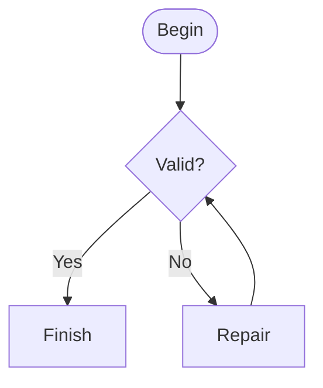
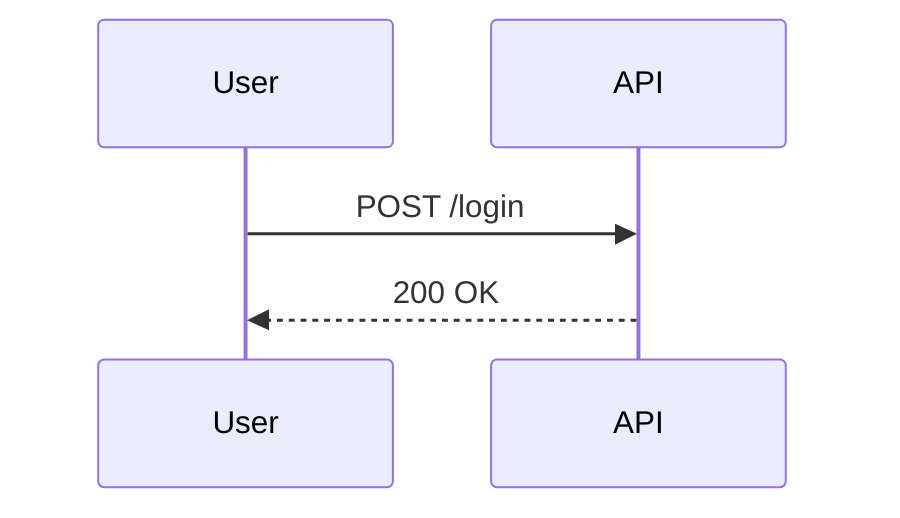
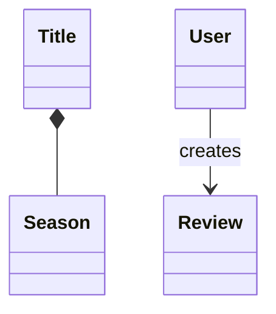
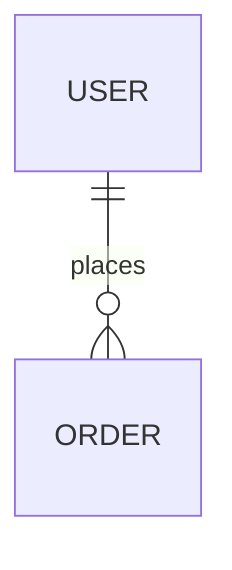
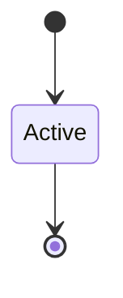
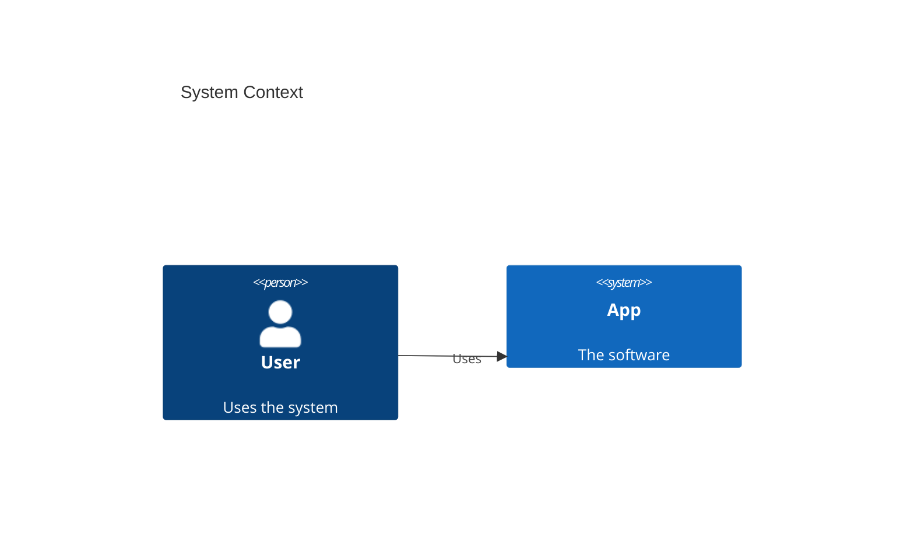

# Mermaid Diagrams

Author, validate, and render software diagrams in Mermaid's text-based
syntax. Diagrams are version-controllable, diffable, and render natively
in GitHub, GitLab, VS Code, Notion, Obsidian, and Confluence.

This skill bundles an offline structural validator
(`scripts/validate-mermaid.ts`, runs under [Bun](https://bun.sh)) plus
per-type syntax references.

## Process

- [ ] 1. Pick the diagram type using the selection guide below.
- [ ] 2. Draft the diagram from the quick reference, consulting the
       linked reference file for the chosen type.
- [ ] 3. Name every node after the real entity, service, or step it
       represents — invented names make documentation drift.
- [ ] 4. Validate with the bundled offline validator (below) or a
       fallback if Bun is unavailable; fix everything it reports.
- [ ] 5. Export or embed: fenced ```mermaid blocks in Markdown render
       natively; use `mmdc` for standalone PNG/SVG.

## Diagram type selection guide

| Task | Diagram type | First line |
|---|---|---|
| Process, algorithm, decision tree, workflow | Flowchart | `flowchart TD` |
| Message flows over time, API request/response | Sequence | `sequenceDiagram` |
| Domain model, OOP structure | Class | `classDiagram` |
| Database schema, table relationships | ERD | `erDiagram` |
| State machines, object lifecycle | State | `stateDiagram-v2` |
| System scope and external actors | C4 context | `C4Context` |
| Deployable apps, databases, services | C4 container | `C4Container` |
| Internal module structure | C4 component | `C4Component` |
| Numbered request flows | C4 dynamic | `C4Dynamic` |
| Infrastructure nodes | C4 deployment | `C4Deployment` |
| User experience steps | Journey | `journey` |
| Event chronology | Timeline | `timeline` |
| Project schedule | Gantt | `gantt` |
| Proportions of a whole | Pie | `pie` |
| Two-axis prioritization | Quadrant | `quadrantChart` |
| Requirements and traceability | Requirement | `requirementDiagram` |
| Work items by lane | Kanban | `kanban` |
| Branching strategy | Git graph | `gitGraph` |
| Hierarchical topics | Mindmap | `mindmap` |
| Service topology, infrastructure | Architecture | `architecture-beta` |
| Flow magnitude between nodes | Sankey | `sankey-beta` |
| Numeric charts | XY chart | `xychart-beta` |
| Blocks and edges, experimental | Block | `block-beta` |
| Multi-metric entity comparison | Radar | `radar-beta` |

For C4: context plus container diagrams are sufficient for most teams;
create component/dynamic/deployment diagrams only when they add value.

## Quick reference

Core syntax shape shared by every type:

```text
diagramType
  definition content
```

- The first significant line declares the diagram type keyword.
- `%%` starts a comment line.
- Unknown words break diagrams; unknown parameters fail silently.
- For rendering-only config, a YAML frontmatter block may precede the
  diagram inside the fence — see [theming and export](references/theming-and-export.md).

Minimal examples per core type:













## Validation law

Validate every diagram before considering the task done. The bundled
validator checks structure deterministically — no network, no renderer:

```sh
bun <skill-dir>/scripts/validate-mermaid.ts <file.md|.mmd>...
```

- Markdown files: every fenced ```mermaid block is extracted and checked.
- `.mmd` files: the whole file is one diagram.
- No paths: default discovery — all git-tracked `.mmd` files and
  mermaid-fenced markdown under the invoking project's `docs/` tree.
- Exit codes: `0` green (or nothing discovered), `1` invalid input,
  `2` usage error.

Regression tests for renderer-verified defects live in
`scripts/tests/validate-mermaid.defects.test.ts` — run them with
`bun test scripts/tests/` after any validator change.

Checks performed:

1. Fences must close; an unterminated fence is reported at its opening line.
2. A diagram must be non-empty after stripping blank and `%%` lines.
3. The first significant line must declare a known keyword (leading
   `%%` comments are skipped). The known set: `flowchart`, `graph`,
   `sequenceDiagram`, `classDiagram`, `stateDiagram`, `stateDiagram-v2`,
   `erDiagram`, `journey`, `gantt`, `pie`, `mindmap`, `timeline`,
   `quadrantChart`, `gitGraph`, `C4Context`, `C4Container`, `C4Component`,
   `C4Dynamic`, `C4Deployment`, `requirementDiagram`, `sankey-beta`, `xychart-beta`,
   `architecture-beta`, `block-beta`, `kanban`, `radar`,
   `radar-beta` (case-insensitive).
4. For flowchart/graph only: two defect classes — a line starting with
   an arrow operator (`-->`, `==>`, `-.->`, `---`) and no source node
   is a malformed edge, and the state-diagram-only terminal `[*]` used
   as a node/edge token (label text inside quotes or pipe labels is
   ignored).
5. For timeline only: the period position of a `period : event`
   statement must stay colon-free — a colon before the spaced ` : `
   separator, or attached to the first token with no separator, breaks
   the renderer's lexer (event text may carry colons; `title` /
   `section` lines are exempt).

The validator is deliberately conservative — passing it does not prove
the diagram renders; it proves the structure is sound. When Bun is
unavailable, fall back to:

- [Mermaid Live Editor](https://mermaid.live) — paste the source and check the render.
- Mermaid CLI: `mmdc -i input.mmd -o output.png`
  (`npm install -g @mermaid-js/mermaid-cli`, or
  `docker run --rm -v "$(pwd)":/data minlag/mermaid-cli -i /data/input.mmd -o /data/output.png`).

## Key rules

- Keep every element name identical to the real entity, service call, or
  step it represents; diagrams whose names drift from the code are worse
  than no diagram.
- Stay under 20 elements per diagram; split complex systems into
  multiple focused views (one diagram per concept).
- C4 style: use native `C4Context`/`C4Container`/... syntax for
  architecture documentation. When the target renderer lacks C4
  support, model C4 concepts with `graph TB` plus `classDef` color
  coding and label the diagram's C4 level in a `%%` header comment —
  both styles are valid; do not mix them in one file.
- Every C4 element gets a name, type, technology (where applicable),
  and a description under ~50 characters; always include `title`.
- Use unidirectional arrows; label arrows with action verbs plus
  technology ("Sends email using SMTP", "Reads from", not just "uses").
- Configuration lives in YAML frontmatter inside the diagram (themes,
  layout, look) — see [theming and export](references/theming-and-export.md).

## Common pitfalls

- Misspellings break the whole diagram silently. Validate before done.
- `{}` inside comments renders as an error; avoid braces in comment text.
- Unknown parameters fail silently — a typo'd directive is ignored,
  not reported.
- Overcomplexity is the default failure mode: if the diagram needs a
  legend the size of the diagram, split it.
- In sequence diagrams, `-->>` is a dotted reply, `->>` a solid call,
  `-) ` an async fire-and-forget, `-x` a lost message. Mixing them
  rewrites the semantics of the flow.

## Reference files

- [Flowcharts](references/flowcharts.md) — node shapes, links, subgraphs, decision logic, styling
- [Sequence diagrams](references/sequence-diagrams.md) — participants, activations, alt/opt/par/loop blocks, notes
- [Class diagrams](references/class-diagrams.md) — relationships, multiplicity, visibility, DDD stereotypes
- [ER diagrams](references/erd-diagrams.md) — cardinality, keys, constraints, schema patterns
- [C4 diagrams](references/c4-diagrams.md) — the full C4 family, element catalog, styling functions, limitations
- [C4 common mistakes](references/c4-common-mistakes.md) — anti-patterns and the pre-publish checklist
- [State and behavior diagrams](references/state-and-behavior-diagrams.md) — state machines, git graphs, journeys, timelines, gantt, pie, quadrant, requirement, kanban
- [Architecture and beta diagrams](references/architecture-and-beta-diagrams.md) — architecture-beta topology, icons, block/sankey/xychart/radar
- [Theming and export](references/theming-and-export.md) — config frontmatter, themes, ELK layout, classDef, mmdc export, accessibility

## Ground rules

- ALWAYS validate a diagram with the offline validator (or a fallback)
  before calling the task done.
- ALWAYS start the first significant line with a known diagram keyword.
- ALWAYS name nodes after the real entities they represent.
- NEVER exceed ~20 elements in one diagram; split the view instead.
- NEVER mix C4-native and flowchart-styled C4 in the same file.
- NEVER trust silent success — unknown Mermaid parameters are ignored,
  so eyeball the rendered output for at least one diagram per session.
- PREFER one focused diagram per concept over one crowded diagram per system.
