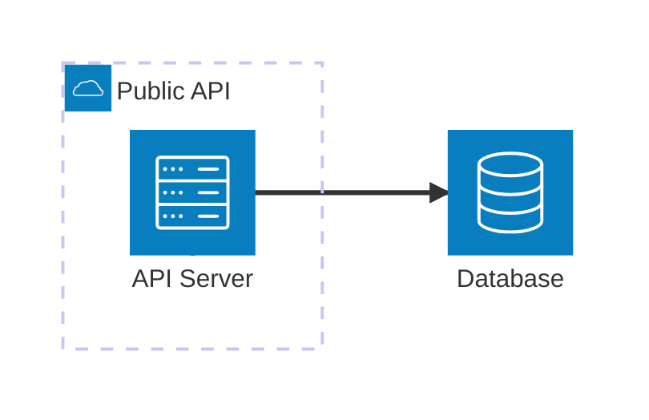
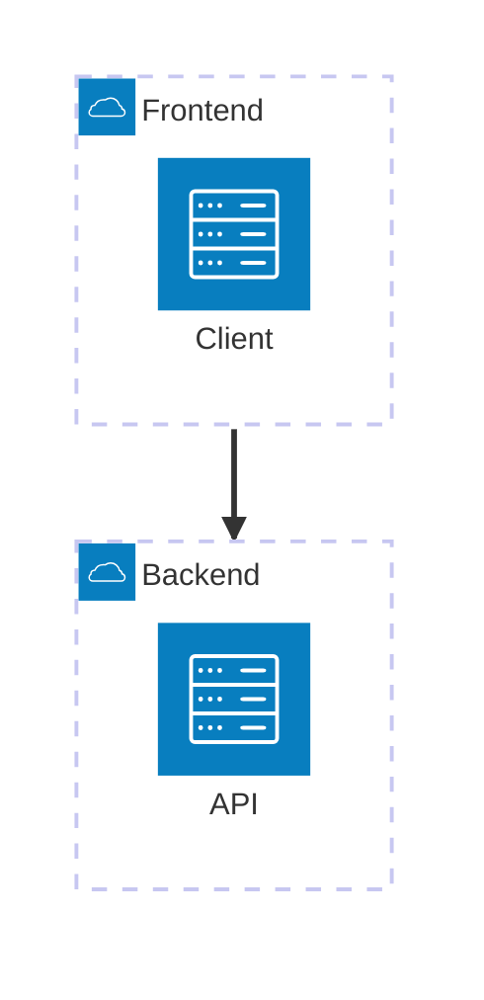
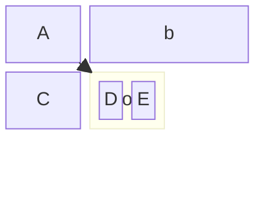
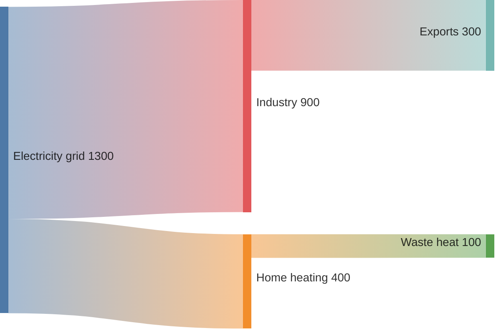
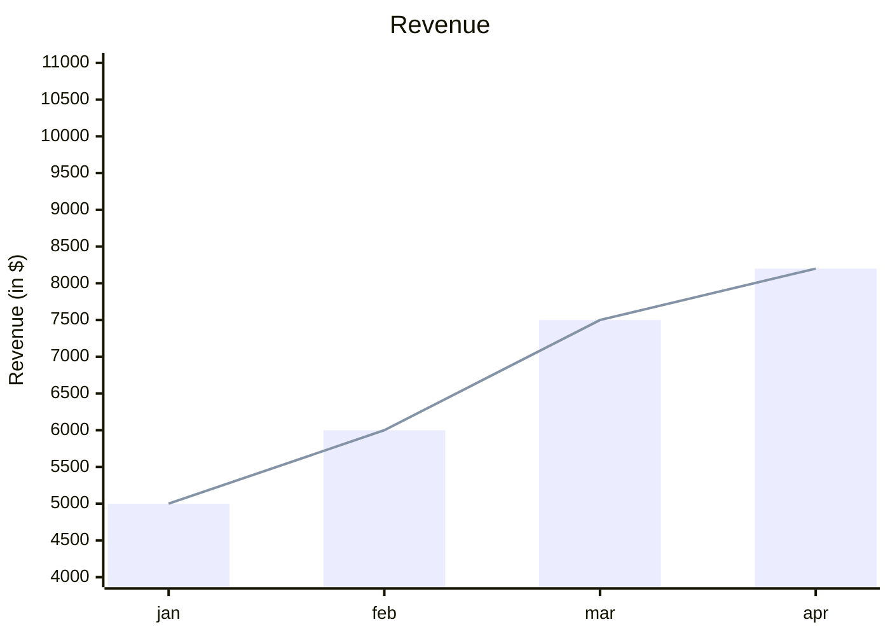
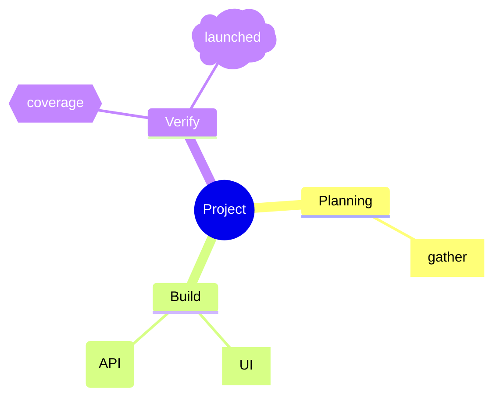

# Architecture and beta diagrams

Syntax reference for `architecture-beta`, `block-beta`, `sankey-beta`,
`xychart-beta`, `radar-beta`, and `mindmap`. Validate every diagram with
`scripts/validate-mermaid.ts` before committing.

## architecture-beta

Visualizes cloud services, CI/CD deployments, and infrastructure relationships.

### Building blocks

```text
group {groupId}({icon})[{title}] (in {parentId})?
service {serviceId}({icon})[{title}] (in {parentId})?
junction {junctionId} (in {parentId})?
```

- Groups nest services; services are the nodes; junctions split flows 4-way.



### Edges

```text
{serviceId}{{group}}?:{T|B|L|R} {<}?--{>}? {T|B|L|R}:{serviceId}{{group}}?
```

- Positions: `T` (top), `B` (bottom), `L` (left), `R` (right).
- Arrows: `<` incoming, `>` outgoing; combine as `<-->` for bidirectional.
- The `{group}` modifier connects to the group boundary instead of the service.

| Pattern              | Description               |
| -------------------- | ------------------------- |
| `A:R -- L:B`         | horizontal edge           |
| `A:T -- B:B`         | vertical edge (90 degree) |
| `A:R --> L:B`        | edge with arrow           |
| `A:R <--> L:B`       | bidirectional edge        |
| `A{group}:R --> L:B` | edge from group boundary  |



### Icons

**Default icons:** `cloud`, `database`, `disk`, `internet`, `server`.

**Custom icons:** any iconify icon, referenced as `pack:icon-name`
(e.g. `service web(logos:docker)[Docker]`, `mdi:database`). `mmdc` resolves
icon packs installed as npm packages:

```bash
npm install @iconify-json/logos @mermaid-js/mermaid-cli
mmdc --iconPacks @iconify-json/logos -i ./diagram.mmd -o ./output.svg
```

| Icon pack                    | Contents                                        | Install                            |
| ---------------------------- | ----------------------------------------------- | ---------------------------------- |
| `@iconify-json/logos`        | technology brands (Docker, AWS, GitHub, etc.)   | `npm i @iconify-json/logos`        |
| `@iconify-json/bi`           | Bootstrap icons                                 | `npm i @iconify-json/bi`           |
| `@iconify-json/mdi`          | Material Design icons                           | `npm i @iconify-json/mdi`          |
| `@iconify-json/simple-icons` | Simple icons                                    | `npm i @iconify-json/simple-icons` |

### Gotchas

- Declare every service, group, and junction before any edge references it.
- Non-default icons resolve in `mmdc` only when the matching `@iconify-json`
  pack is passed via `--iconPacks`; live editors resolve them differently.
- Edges carry no text labels — put protocols (HTTPS, TCP) in service titles.
- Prefer consistent edge directions (e.g. `:R --> L:` for left-to-right flows)
  to avoid crossings.

### Best practices

1. Group services by environment (public/private) or layer (frontend/backend).
2. Use consistent icons for service types.
3. Use junctions for fan-out; keep diagrams focused, splitting complex
   architectures into multiple views.

## block-beta

Grid diagram where the author controls block placement; there is no auto-layout.

### Syntax

```text
block-beta
    columns {N}                    grid width; blocks fill row-major
    {blockId}                      default block (id is the label)
    {blockId}["{label}"]           labeled block
    {blockId}:{N}                  block spanning N columns
    space                          one empty cell
    space:{N}                      N empty cells
    block:{id}["{label}"]         composite block (children indented)
        columns {N}                grid width inside the composite
        {childId}                 child blocks
    end                            closes the composite
    {blockId} --> {otherId}        edge; with text: {blockId}-- "{text}" -->{otherId}
```

Block shapes mirror flowchart node shapes — square `[text]`, rounded
`(text)`, stadium `([text])`, subroutine `[[text]]`, cylinder `[(text)]`,
circle `((text))`, double circle `(((text)))`, asymmetric `>text]`,
rhombus `{text}`, hexagon `{{text}}`, parallelogram `[/"text"/]`,
trapezoid `[\"text"\]`. Block arrows are directional shapes:
`{id}<["{label}"]>(right|left|up|down|x|y|x, down)`. Styling uses
`style {blockId} fill:...` plus `classDef`/`class`, as in flowcharts.



### Gotchas

- A block occupies exactly one grid cell unless given a width (`b:2`); use
  `space`/`space:{N}` to reserve empty cells and control placement.
- Composite blocks (`block:id`) require a matching `end` line and their own
  `columns` statement.
- `block` is an alias for the same diagram; this validator requires the
  literal keyword `block-beta`.

## sankey-beta

Quantitative flow diagram (sources, targets, and magnitudes). Data lives
inside the diagram as CSV rows: `source,target,value`.



### Gotchas

- `value` must be numeric; append units to node names instead
  (e.g. `Home heating (TWh)`). Quote any field containing commas:
  `"Bio-conversion, primary",Liquid,0.597`.
- Node names match exactly (case included); `Heat` and `heat` are two nodes.
- Cycles are permitted. Tune alignment and value labels through config
  frontmatter — `sankey.nodeAlignment` (`justify`, `left`, `right`, `center`),
  `sankey.showValues`, `sankey.linkColor`, `sankey.nodeColor` — never inline.

## xychart-beta

Bar and/or line chart.

### Syntax

```text
xychart-beta
    title {text}
    x-axis [{category1}, {category2}, ...]
    y-axis "{label}" {min} --> {max}
    bar [{values}]
    line [{values}]
```



### Gotchas

- Quote category labels containing commas: `x-axis ["Coastal, north", "Inland"]`.
- Omit the `y-axis` range to auto-scale; keep `min --> max` for fixed-scale
  comparisons.
- Colors come from the `xyChart` config key (`xyChart.plotColorPalette`),
  set via frontmatter or `init` directive — never inline attributes:

```text
---
config:
  xyChart:
    plotColorPalette: "#C3CB6D, #6DECB1"
    showTitle: true
---
```

## radar-beta

Multivariate comparison chart across spokes.

### Syntax

```text
radar-beta
    title {text}
    axis {axisId}["{label}"], ...    one entry per spoke
    curve {curveId}["{label}"]: {v1}, {v2}, ...
    max {value}                       fixed scale ceiling
    config: {"radar": {...}}          inline tuning, e.g. axisScaleFactor
```


### Gotchas

- Each curve needs exactly one value per axis, in axis declaration order.
- Set `max` explicitly when comparing charts; without it the scale derives
  from the plotted values.
- Tune label crowding with `config: {"radar": {"axisScaleFactor": 0.5}}` —
  inline `config:` is allowed in this diagram (unlike frontmatter).

## mindmap

Hierarchical outline diagram; indentation defines the tree — no edge lines.

### Node shapes

square `{id}[{text}]` · rounded `{id}({text})` · circle `{id}(({text}))` ·
hexagon `{id}{{text}}` · bang `{id})){text}((` · cloud `{id}){text}(` ·
default bare `{text}` · untitled node `)`. Bang opens with `))` and closes
with `((`; cloud opens with `)` and closes with `(`.



### Icons and classes

- `::icon(fa fa-book)` or `::icon(mdi mdi-skull-outline)` on its own line,
  applying to the preceding node. Icon fonts must be supplied by the hosting
  page or renderer — the syntax is experimental and may change.
- `:::class1 class2` on its own line attaches CSS classes to the preceding
  node; the class definitions are supplied by the site, not the diagram.
- Markdown strings (`` "`**bold** and *italics*`" ``) support formatting and
  automatic wrapping; regular strings need `<br/>` for line breaks.
- Branch coloring is the default; set `mindmap.colorBy: depth` in config
  frontmatter to color all nodes at the same level alike.

### Gotchas

- Indentation is relative: a node's parent is the nearest previous line with
  smaller indentation. Uneven indentation silently re-parents nodes.
- Use spaces for indentation; mixed tabs render inconsistently across renderers.
- Keep depth modest — branch coloring repeats after eleven levels and deep
  trees render cramped.

## References

- [Architecture](https://mermaid.js.org/syntax/architecture.html)
- [Block](https://mermaid.js.org/syntax/block.html)
- [Sankey](https://mermaid.js.org/syntax/sankey.html)
- [XY chart](https://mermaid.js.org/syntax/xyChart.html)
- [Radar](https://mermaid.js.org/syntax/radar.html)
- [Mindmap](https://mermaid.js.org/syntax/mindmap.html)
- [Iconify icons](https://iconify.design)
