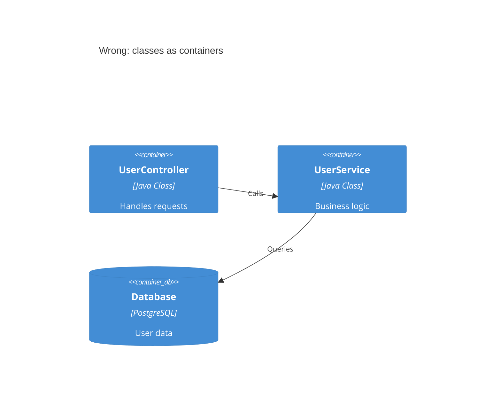
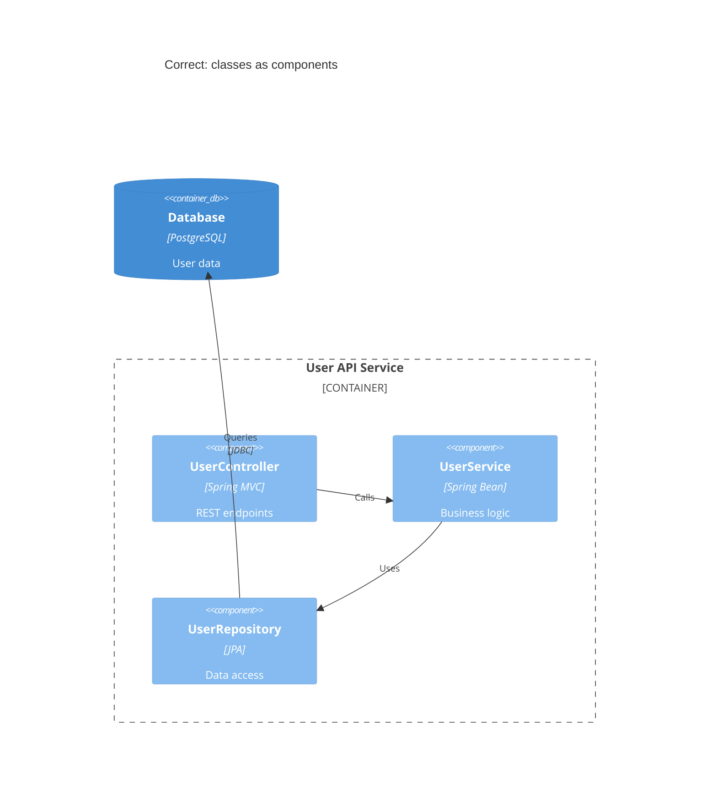
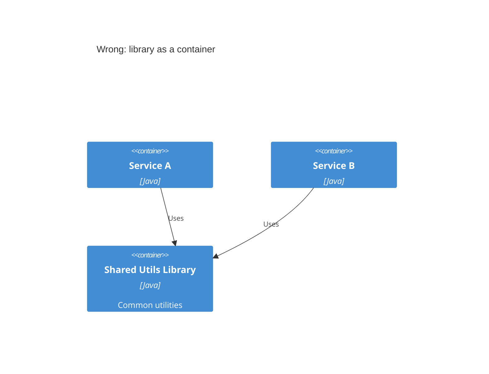
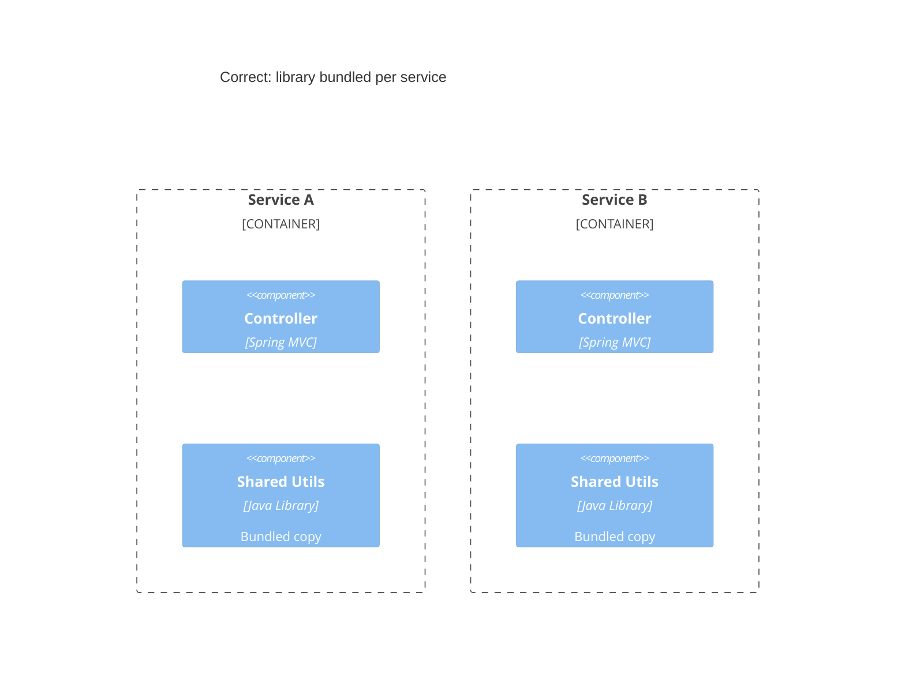
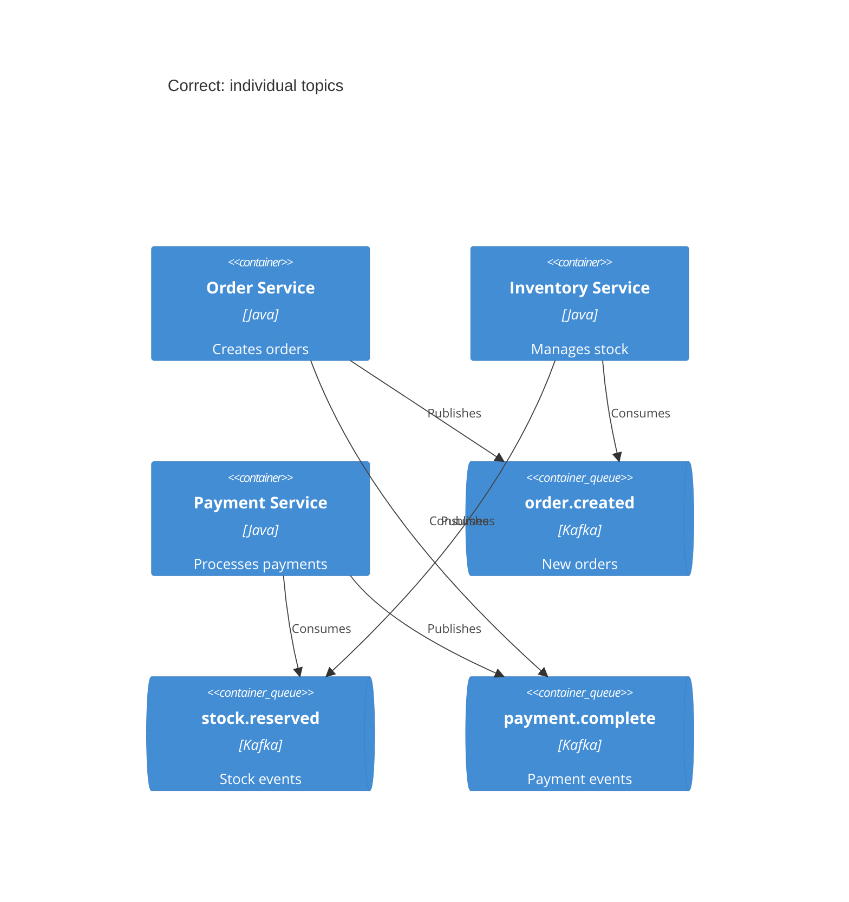
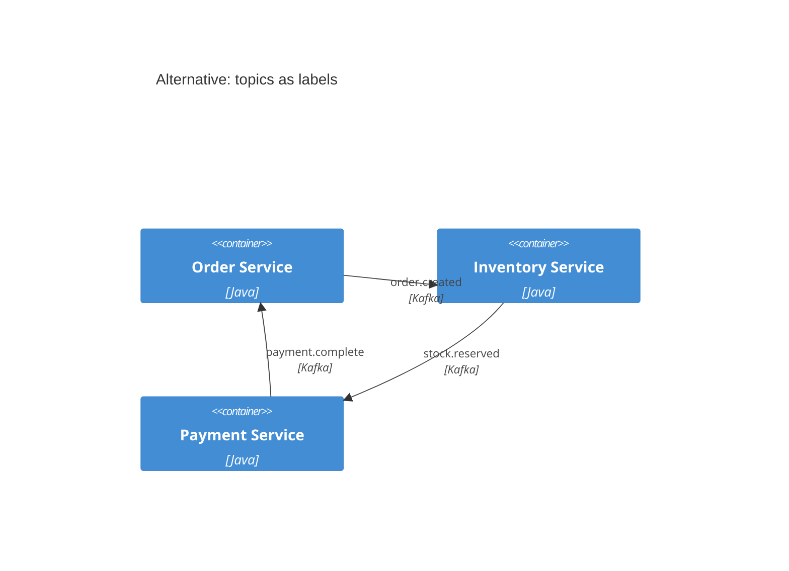
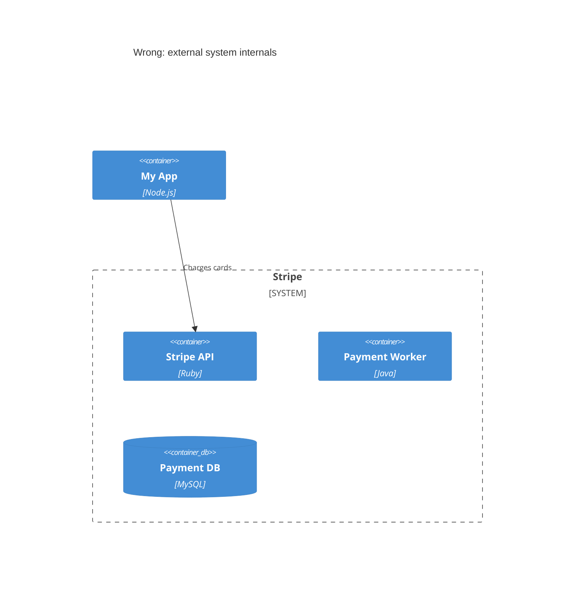
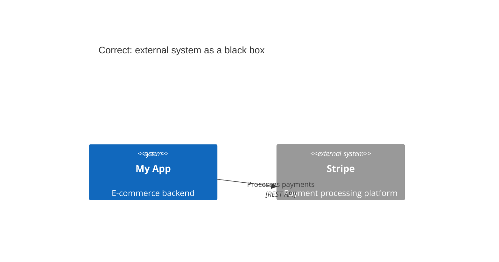
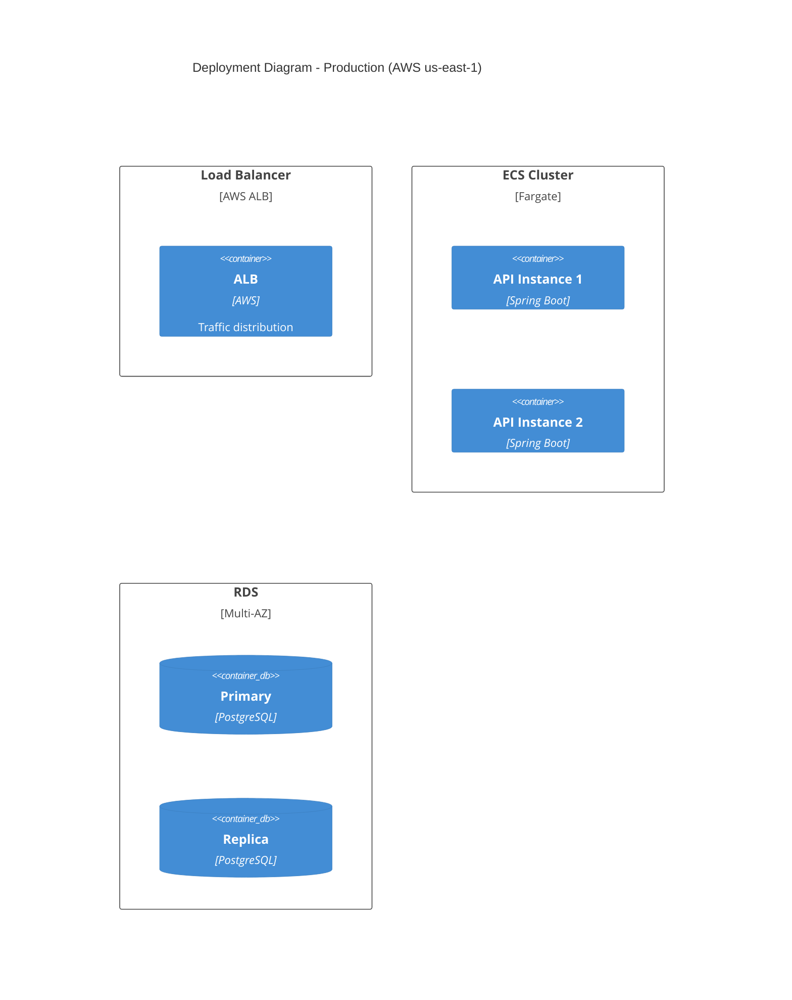

# C4 common mistakes

Anti-patterns seen repeatedly in C4 diagrams, with the correct approach for
each. Verify every diagram against the checklist at the end before
publishing.

## Containers vs components

Containers are deployable units (applications, services, databases).
Components are non-deployable elements inside a container (modules,
classes, packages). A Java class such as `UserController` is a component,
never a container.

Wrong — classes drawn as containers:



Correct — classes as components inside a container:



## Invented abstraction levels

C4 defines exactly four levels. Do not invent "subcomponents",
"microservice groups", or custom levels such as "packages" or "modules" —
there is no Level 2.5 or 3.5. If a container needs more detail than its
components, that is Level 4 (Code), which belongs in UML class diagrams.
Stick to Person, Software System, Container, Component.

Avoid the vague `Subsystem` keyword — it is ambiguous (a system? a
container? a component?). Be specific instead:

```text
System(orderSystem, "Order System", "Handles order lifecycle")
Container(orderService, "Order Service", "Java", "Order processing API")
Component(orderProcessor, "Order Processor", "Spring Bean", "Order business logic")
```

## Shared libraries as containers

A shared library is copied into each application at build time; it does not
run as an independent service. Modeling it as a container implies a
separately deployable unit. Show the library as a component inside each
container that bundles it, or omit it entirely as an implementation detail.

Wrong — the library looks like a third service:



Correct — the library is bundled inside each service:



## Message broker as a single box

Drawing Kafka/RabbitMQ as one container produces a misleading hub-and-spoke
diagram that hides the actual data flows. Model each topic or queue as its
own `ContainerQueue` element, or put topic names on the relationship labels.

Correct — individual topics:



Alternative — topics on relationship labels:



## External system internals

You do not control external systems. Drawing their internal containers
couples the diagram to details that go stale and imply visibility you do
not have. Show every external system as a black box via `System_Ext`.

Wrong — drawing the inside of a third-party system:



Correct — the external system as a black box:



## Arrow mistakes

- `BiRel` is ambiguous — who initiates the call, and what flows in each
  direction? Replace it with two unidirectional `Rel` statements (one per
  direction, each labeled), or a single `Rel` written from the initiator's
  perspective.
- Unlabeled arrows force readers to guess: `Rel(orderSvc, paymentSvc)` says
  nothing. Label with an action verb plus technology.
- Generic labels ("uses", "communicates with", "accesses") do not explain
  what data flows or why. Write "Fetches products, submits orders" and
  "Reads/writes order data", not "Uses" and "Accesses".

```text
Rel(frontend, api, "Fetches products, submits orders", "JSON/HTTPS")
Rel(api, db, "Reads/writes order data", "JDBC")
Rel(orderSvc, paymentSvc, "Requests payment authorization", "gRPC")
```

## Element metadata mistakes

- Removing type labels (`Container`, `Component`, `System`) in an attempt to
  declutter creates ambiguity — `Box(api, "API")` does not say what the
  element is. Keep the typed calls.
- Elements without descriptions force viewers to guess their purpose.
  Prefer `Container(orderSvc, "Order Service", "Spring Boot", "Manages order
  lifecycle and fulfillment")` over `Container(svc, "Service", "Java")`.
- Use meaningful aliases (`orderService`, not `s1`) and keep descriptions
  concise (under ~50 characters).

## Infrastructure detail in container diagrams

Container diagrams show logical architecture. Instances, load balancers,
and read replicas are infrastructure — they belong in a `C4Deployment`
view, not in the container diagram.

Correct — infrastructure in a deployment view:



Deployment titles must name the environment — "Deployment Diagram" alone is
meaningless; write "Deployment Diagram - Production (AWS us-east-1)".

## Scope and size mistakes

- Audience-level mismatch: showing code-level diagrams to executives, or
  context-only diagrams to developers who need implementation detail.

  | Audience | Appropriate levels |
  |---|---|
  | Executives | Context only |
  | Product managers | Context + Container |
  | Architects | Context + Container + key Components |
  | Developers | All levels as needed |
  | DevOps | Container + Deployment |

- Creating all four levels by default: Context (L1) and Container (L2) are
  always worth drawing; Component (L3) only for complex containers; Code
  (L4) rarely — let IDEs generate it.
- Too many elements: diagrams with 20+ elements are unreadable; stay under
  15 where possible. If a diagram with a dozen boxes is hard to understand,
  do not draw a diagram with a dozen boxes. Split by bounded context, per
  service, or show one service plus its direct dependencies.

## Consistency mistakes

- Inconsistent notation across a diagram set — the same element appearing as
  "Payment System" (blue), "Payment Service" (green), and "Payment Module"
  (red) across levels. Use identical names, colors, and shapes throughout
  and keep a team style guide.
- No legend: never assume viewers understand the notation. Explain colors,
  shapes, and line styles every time, even for "obvious" elements. Mermaid's
  `Legend` keyword is unsupported, so write the legend as markdown next to
  the diagram.

## Decision process in diagrams

Architecture diagrams show the outcome of decisions, not the decision
process. Never annotate diagrams with "Option A vs Option B" comparisons —
record trade-offs in Architecture Decision Records and link them; diagrams
show the chosen architecture, ADRs explain why.

## Pre-publish checklist

- [ ] Every element has a name, type, technology (where applicable), and description
- [ ] All arrows are unidirectional with action-verb labels
- [ ] Technology/protocol appears on relationships
- [ ] The diagram has a clear, specific title (deployment diagrams name the environment)
- [ ] Under 20 elements (ideally under 15)
- [ ] The level matches the target audience
- [ ] Containers are deployable; components are not
- [ ] External systems appear as black boxes
- [ ] Message topics are shown individually, not as a single broker
- [ ] No infrastructure details in container diagrams
- [ ] The diagram is consistent with the others in the set
