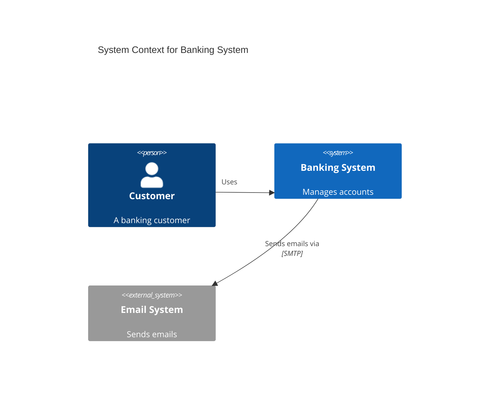
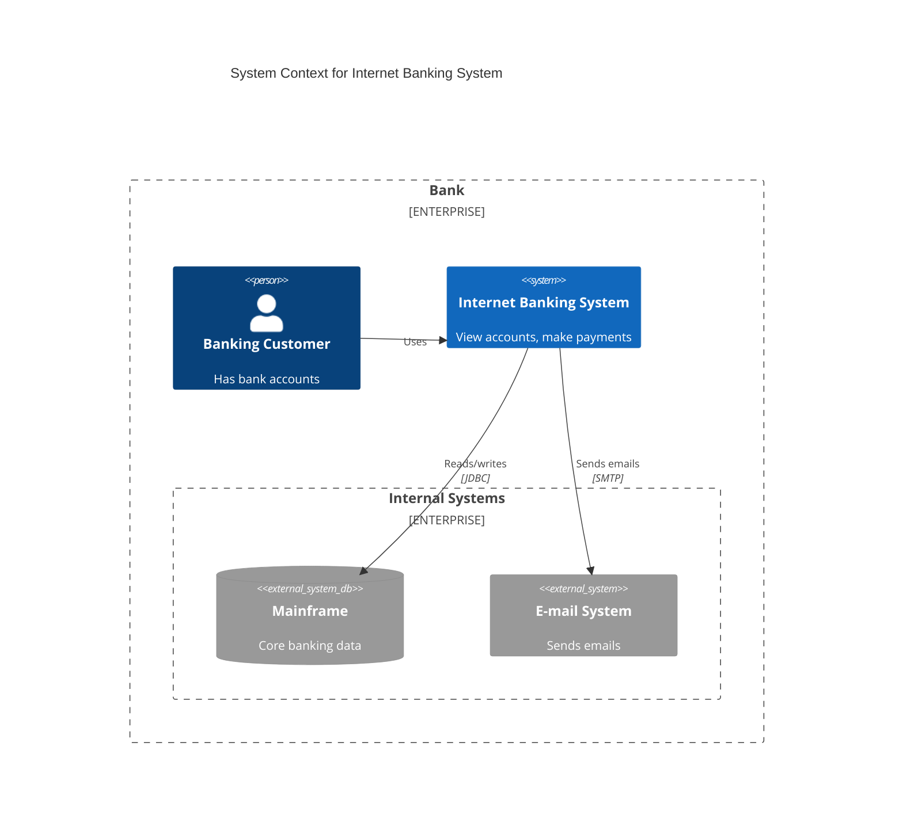
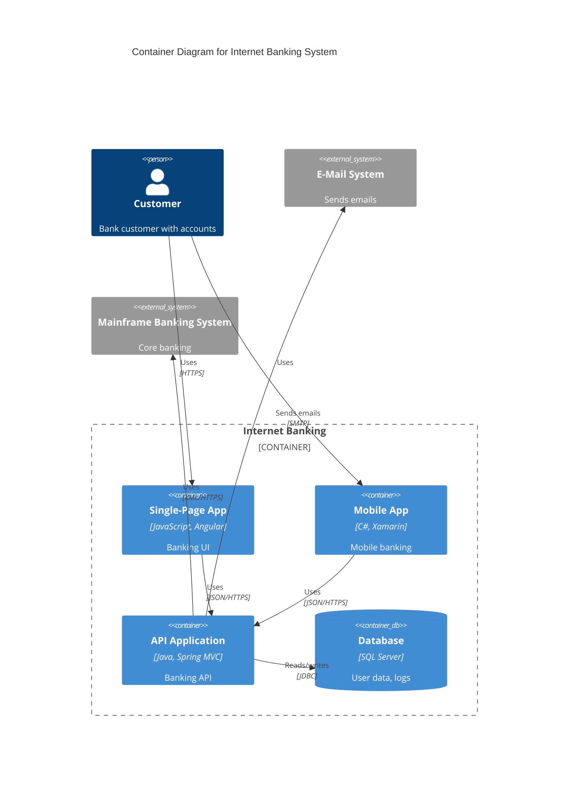
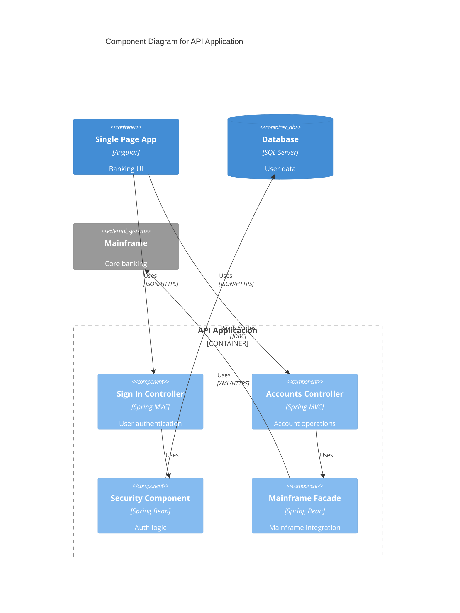
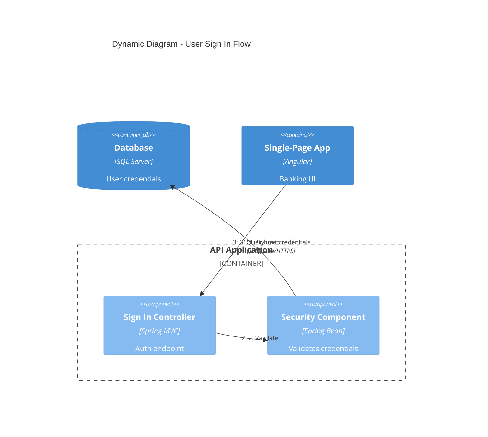
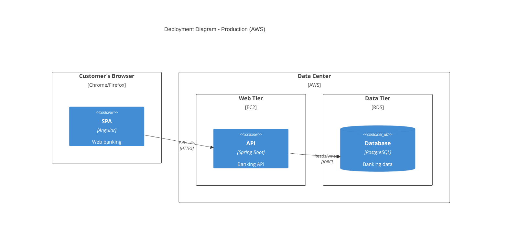

# C4 diagrams

The C4 model describes software architecture at zoom levels — Context,
Container, Component, and Code — plus Dynamic (numbered runtime flows) and
Deployment (infrastructure) views. Mermaid implements the PlantUML C4
syntax; the Code level maps onto `classDiagram`.

## Level and audience selection

| View | Declaration | Shows | Audience | When to create |
|---|---|---|---|---|
| 1 Context | `C4Context` | System + users + external systems | Everyone | Always |
| 2 Container | `C4Container` | Deployable apps, databases, services | Technical | Always |
| 3 Component | `C4Component` | Internal structure of one container | Developers | Only when it adds value |
| 4 Code | `classDiagram` | Implementation classes | Developers | Rarely; let IDEs generate |
| Dynamic | `C4Dynamic` | Numbered request flow | Technical | For complex workflows |
| Deployment | `C4Deployment` | Infrastructure nodes | DevOps | For production systems |

Recommended views per audience: executives — Context only; product
managers — Context + Container; architects — Context + Container + key
Components; developers — all levels as needed; DevOps — Container +
Deployment. Context plus Container are sufficient for most teams. Start at
Level 1 and drill down only when the audience needs the detail.

## Diagram structure

The first significant line declares the view keyword, followed by `title`
and element/relationship statements. Elements render in definition order;
reorder statements to adjust layout. Every element takes an alias, a quoted
label, then optional quoted parameters (marked `?` below).

## Element catalog

People and systems (usable in every view):

```text
Person(alias, "Label", ?"descr")
Person_Ext(alias, "Label", ?"descr")        person outside the organization
System(alias, "Label", ?"descr")
System_Ext(alias, "Label", ?"descr")        external software system
SystemDb(alias, "Label", ?"descr")          database system
SystemDb_Ext(alias, "Label", ?"descr")
SystemQueue(alias, "Label", ?"descr")       message-queue system
SystemQueue_Ext(alias, "Label", ?"descr")
```

Containers (Container view and below), signature
`(alias, "Label", ?"techn", ?"descr")`:

```text
Container(alias, "Label", ?"techn", ?"descr")
Container_Ext / ContainerDb / ContainerDb_Ext / ContainerQueue / ContainerQueue_Ext
```

Components (Component and Dynamic views), same signature as Container:

```text
Component(alias, "Label", ?"techn", ?"descr")
Component_Ext / ComponentDb / ComponentDb_Ext / ComponentQueue / ComponentQueue_Ext
```

Deployment nodes (Deployment view), signature
`(alias, "Label", ?"type", ?"descr")` with a `{ ... }` body; nodes nest:

```text
Deployment_Node(alias, "Label", ?"type", ?"descr") { ... }
Node(alias, "Label", ?"type", ?"descr") { ... }    shorthand
Node_L(alias, "Label", ?"type", ?"descr") { ... }  left-aligned label
Node_R(alias, "Label", ?"type", ?"descr") { ... }  right-aligned label
```

Boundaries group elements and take a `{ ... }` body:

```text
Enterprise_Boundary(alias, "Label") { ... }   people and systems
System_Boundary(alias, "Label") { ... }       containers
Container_Boundary(alias, "Label") { ... }    components
Boundary(alias, "Label", ?"type") { ... }     generic
```

## Relationships

```text
Rel(from, to, "Label", ?"techn", ?"descr")
BiRel(from, to, "Label", ?"techn")        bidirectional
Rel_U / Rel_Up(from, to, "Label")         upward hint
Rel_D / Rel_Down(from, to, "Label")       downward hint
Rel_L / Rel_Left(from, to, "Label")       leftward hint
Rel_R / Rel_Right(from, to, "Label")      rightward hint
Rel_Back(from, to, "Label")               reversed arrow head
RelIndex(index, from, to, "Label")        Dynamic view numbering
```

`RelIndex` numbers steps in a `C4Dynamic` view; the index value is ignored —
statement order determines the sequence. Prefer unidirectional `Rel` with
action-verb labels; `BiRel` hides the initiator (see
[c4-common-mistakes](c4-common-mistakes.md)).

## Styling and layout

```text
UpdateElementStyle(alias, ?$bgColor, ?$fontColor, ?$borderColor, ?$shadowing, ?$shape)
UpdateRelStyle(from, to, ?$textColor, ?$lineColor, ?$offsetX, ?$offsetY)
UpdateLayoutConfig($c4ShapeInRow, $c4BoundaryInRow)
```

- `UpdateElementStyle`: background/text/border color, shadow toggle, and
  shape for one element.
- `UpdateRelStyle`: label text color, line color, and pixel offsets for the
  relationship label.
- `UpdateLayoutConfig`: shapes per row (default `4`) and boundaries per row
  (default `2`) — lower the values to reduce crowding.
- `$offsetX` / `$offsetY` move a relationship label; they are the fix for
  overlapping labels.

Optional parameters may be positional (in declared order) or named with a
`$` prefix in any order:

```text
UpdateRelStyle(customer, bank, "red", "blue", "-40", "60")
UpdateRelStyle(customer, bank, $offsetX="-40", $offsetY="60", $lineColor="blue")
```



## Examples

### Context view



### Container view



### Component view



### Dynamic view



### Deployment view



Deployment nodes nest; place containers and container databases inside the
node that runs them. Name the environment in the title.

## Documented Mermaid limitations

These PlantUML C4 features are unsupported in Mermaid — they fail silently
or break rendering:

- `sprite` (custom icons), `tags`, `link` (clickable links)
- `Legend` (auto-generated legends)
- `AddElementTag` / `AddRelTag` (tag-based styling)
- `RoundedBoxShape` / `EightSidedShape` (custom shapes)
- `DashedLine` / `DottedLine` / `BoldLine` (line styles)
- Layout directives `Lay_U`, `Lay_D`, `Lay_L`, `Lay_R`

Workarounds:

- Layout control: use `UpdateLayoutConfig` instead of `Lay_*` directives.
- Overlapping labels: use `UpdateRelStyle` with `$offsetX` / `$offsetY`.
- Legends: write them as markdown next to the diagram, never inside the
  fence.
- Icons, links, tag styling, custom shapes, and line styles have no Mermaid
  equivalent; use `UpdateElementStyle` colors for emphasis. For full C4
  fidelity use Structurizr DSL, C4-PlantUML, or IcePanel instead.
- Crowding: keep diagrams under ~15 elements (20 is the hard cap) and split
  complex architectures into multiple focused diagrams.

## Best practices

- Give every element a name, type, technology (where applicable), and a
  description under ~50 characters; always include `title`.
- Name elements after the real system and keep names identical across
  levels; use `*_Ext` variants for anything outside the organization.
- Label arrows with action verbs plus the protocol or technology ("Sends
  emails using SMTP", "Reads/writes via JDBC").
- Keep one system per Context diagram and one container per Component
  diagram; group related elements with boundaries.
- Show key relationships only, and keep diagrams synchronized with the
  architecture.
