# Class diagrams

Class diagrams model object-oriented designs and domain models: entities (classes), their attributes and methods, and the relationships between them.

## Declaring classes

```mermaid
classDiagram
    ClassName
```

Declare members inside a class block:

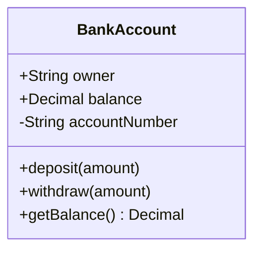

Visibility modifiers:

- `+` Public
- `-` Private
- `#` Protected
- `~` Package/Internal

Member syntax:

- `+type attribute` — attribute with a type
- `+method(params) ReturnType` — method with parameters and return type
- `method()*` — abstract method (trailing asterisk)

## Relationships

| Relationship | Syntax | Meaning |
|---|---|---|
| Association | `--` | Entities use each other but exist independently |
| Directed association | `-->` / `<--` | Association with a navigable direction |
| Composition | `*--` | Strong ownership; deleting the parent deletes the children |
| Aggregation | `o--` | Weak "has-a" ownership; children can exist independently |
| Inheritance | `<|--` | "Is-a"; the child class inherits from the parent |
| Realization | `<|..` | A class implements an interface |
| Dependency | `<..` or `..>` | One class uses another, often as a parameter or local variable |

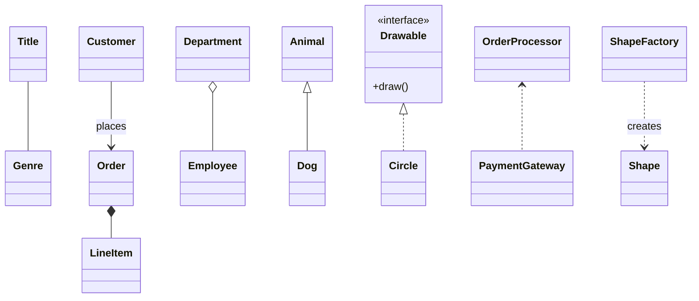

## Multiplicity and labels

Show how many instances participate in a relationship; label what the relationship means with `: label`.

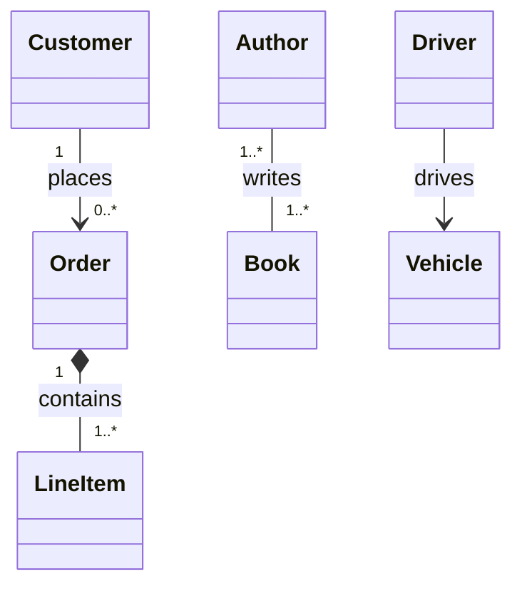

Common multiplicities:

- `1` — exactly one
- `0..1` — zero or one
- `0..*` or `*` — zero or many
- `1..*` — one or many
- `m..n` — between m and n

## Generic classes

Use `~T~` for generic type parameters; instantiate with a concrete type in the same tilde form:

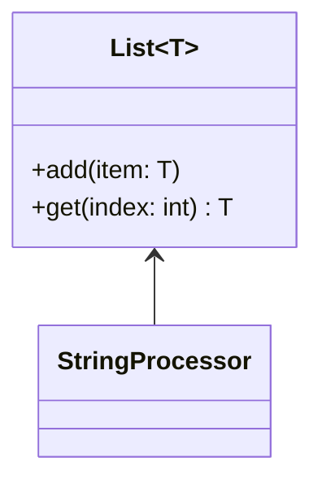

## Stereotypes and abstract classes

Mark special class types with `<<stereotype>>` inside the class block:

- `<<interface>>` — pair with `<|..` realization links
- `<<abstract>>` — abstract class; mark abstract members with a trailing `*`
- `<<service>>` — service-layer class
- `<<dataclass>>` — data-transfer or data-carrier class
- `<<enumeration>>` — enum; list the values as bare members

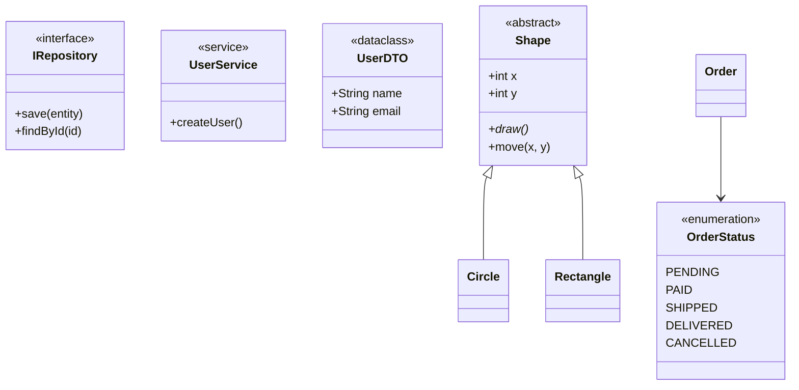

## Notes

Attach a note to one class with `note for <Class> "<text>"`:

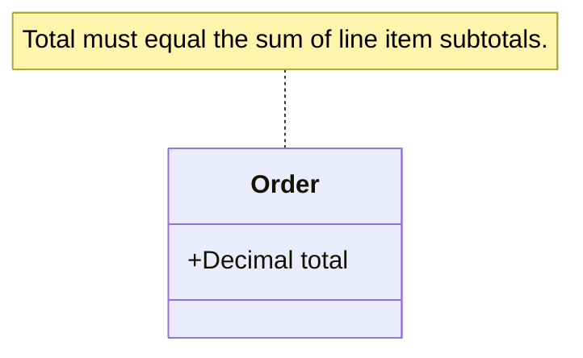

## Domain-driven design stereotypes

- `<<entity>>` — object with a stable identity
- `<<value object>>` — immutable object compared by value
- `<<aggregate root>>` — entry point of an aggregate; composition-links its members

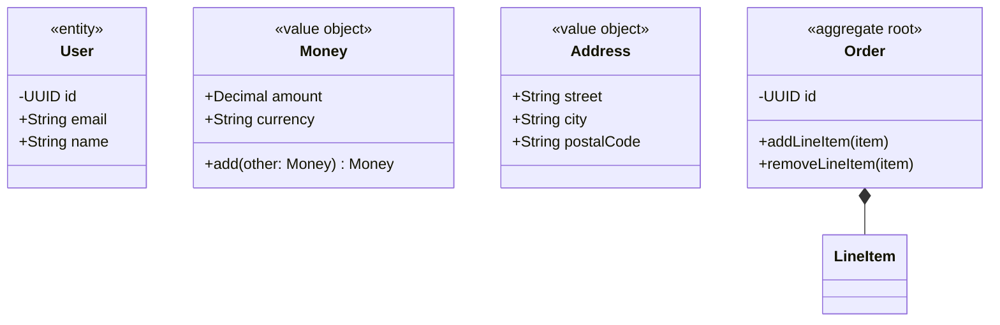

## Combined example

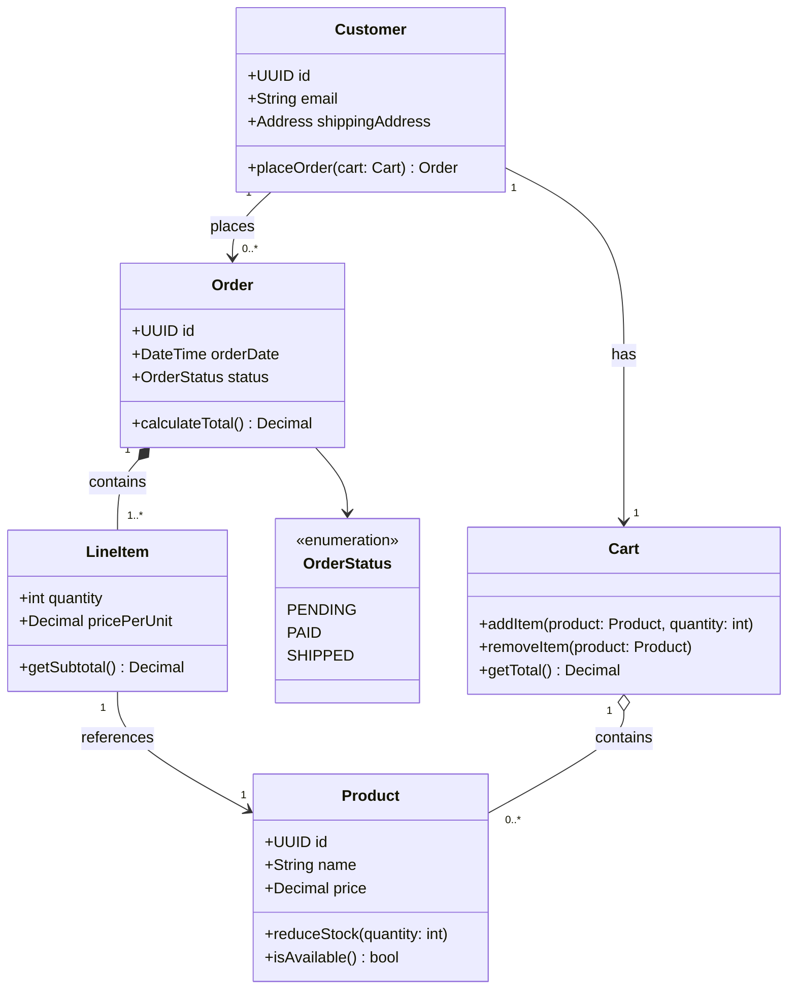

## Authoring tips

1. Start with core entities; add attributes and methods incrementally.
2. Show only relevant details; omit obvious getters and setters.
3. Choose between association, aggregation, and composition deliberately — they encode different ownership semantics.
4. Add multiplicity to clarify how many instances participate in each relationship.
5. Group related classes with notes or visual proximity.
6. Document invariants and business rules with notes.

## Common patterns

Repository:

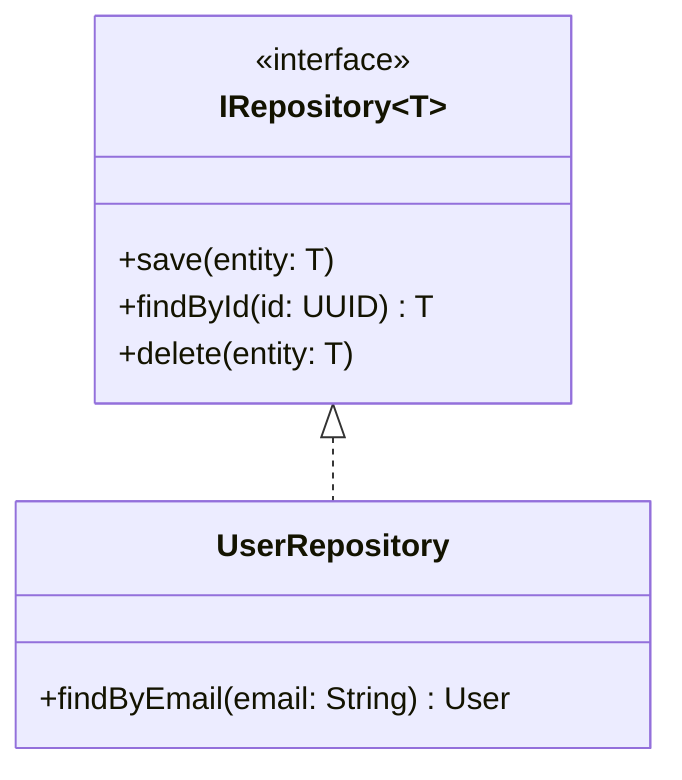

Factory:

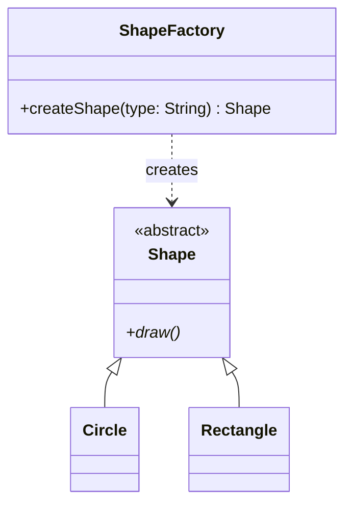

Strategy:

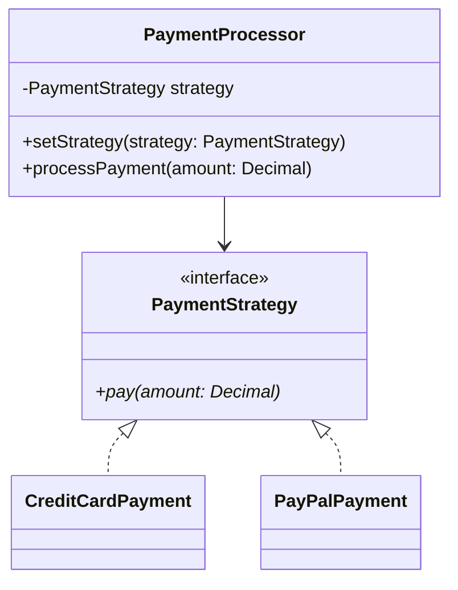
