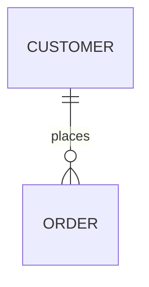
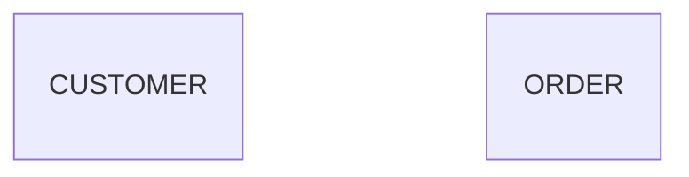
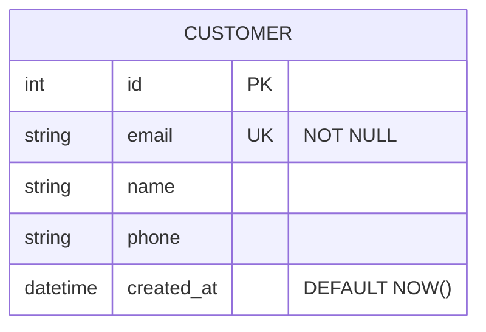
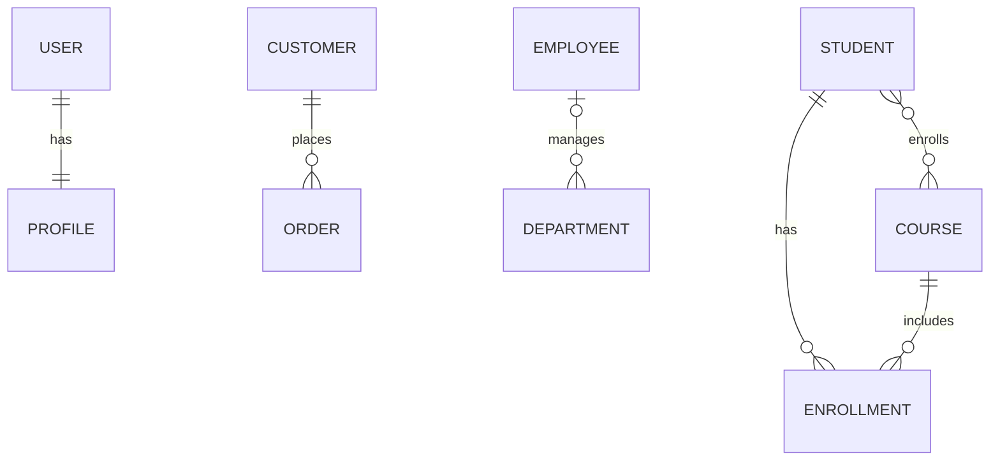
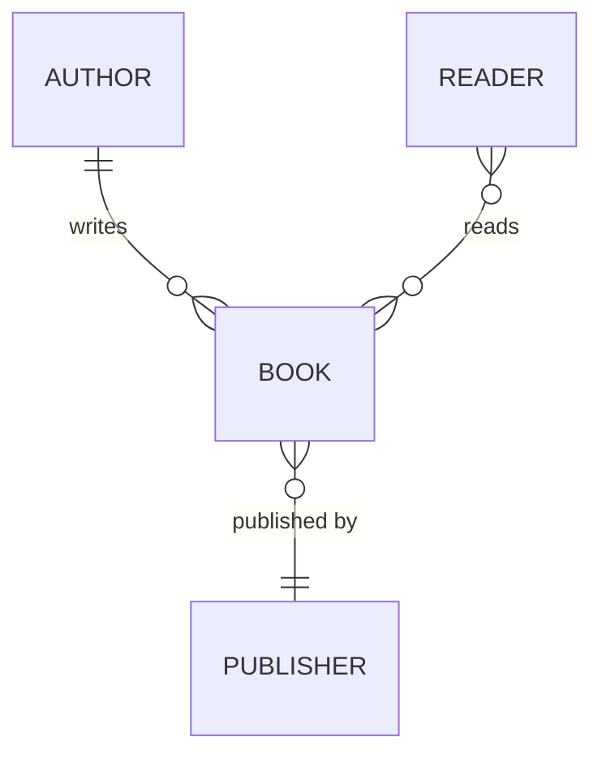
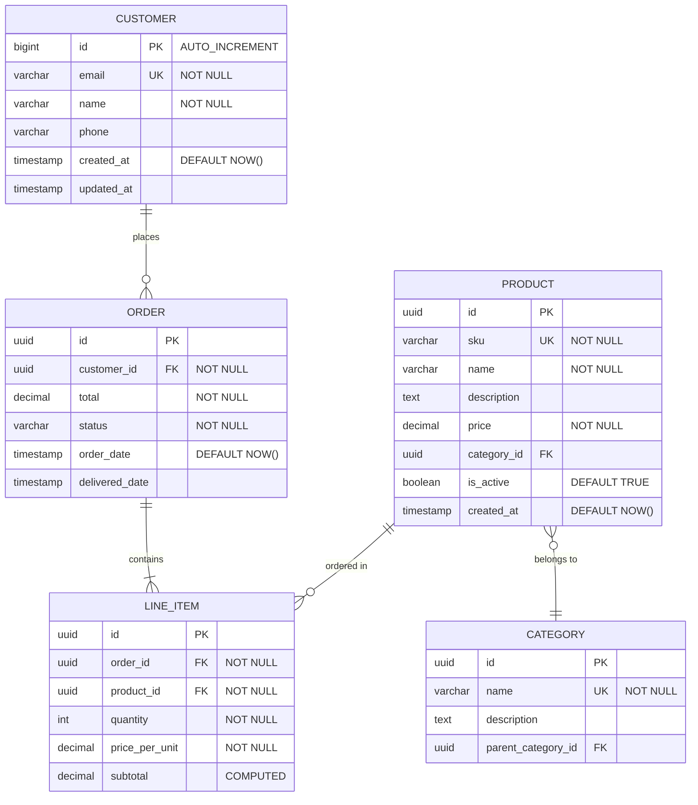
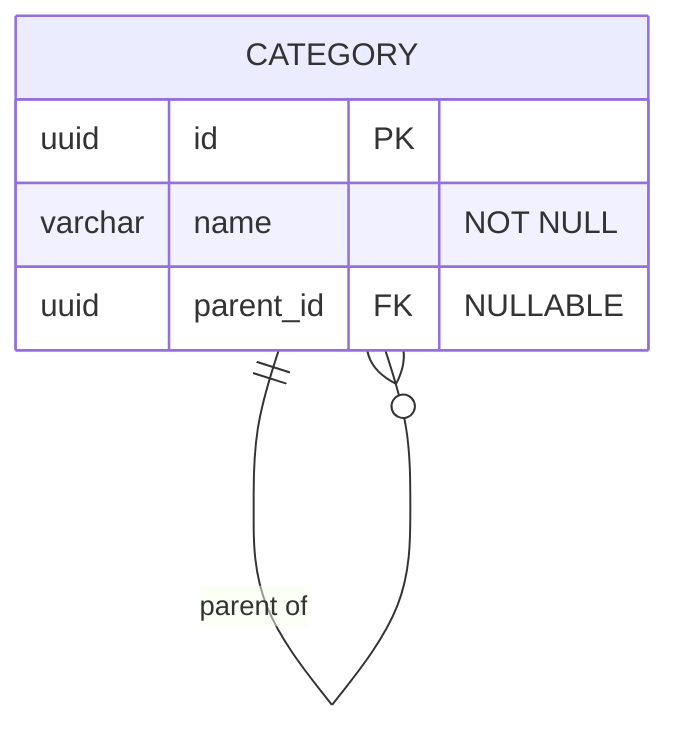
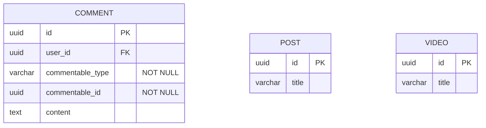
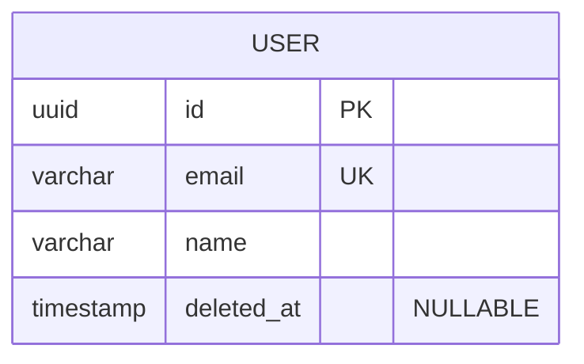
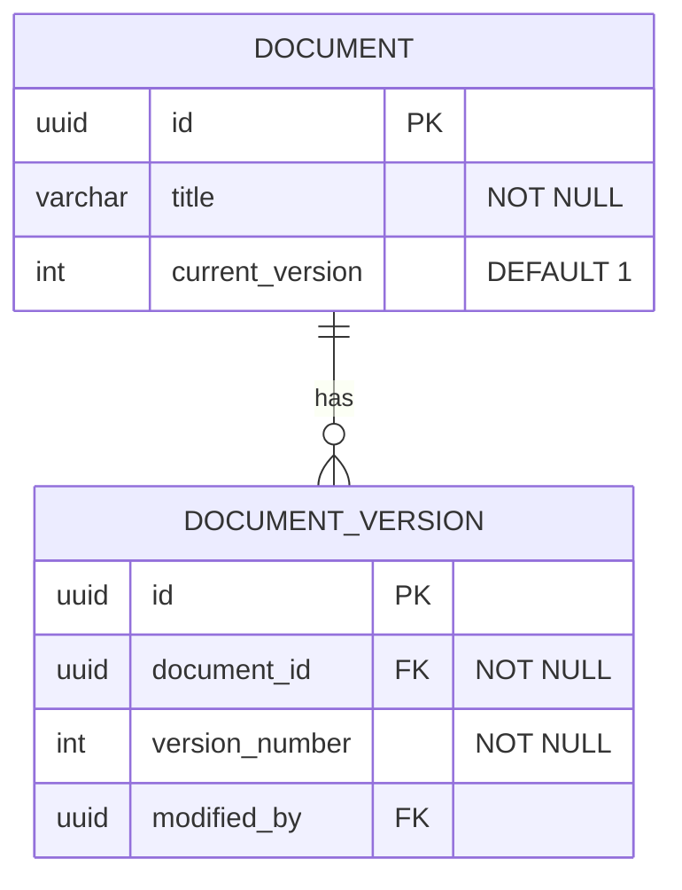

# Entity Relationship Diagrams (ERD)

ERDs model database schemas: tables as entities, columns as attributes, and
inter-table relationships, using the `erDiagram` keyword.

## Basic syntax



Declare entities with no relationship to render them standalone:



## Attributes

Attribute lines take the form `type name keys "comment"`; keys and the quoted
comment are optional. The comment is free text for constraints or defaults.



Supported key markers:

- `PK` - primary key
- `FK` - foreign key
- `UK` - unique key
- `NN` - not null (common convention, not rendered specially)

A column can carry more than one marker (composite keys in a junction table):

```mermaid
erDiagram
    ENROLLMENT {
        uuid student_id FK PK
        uuid course_id FK PK
        date enrolled_date
    }
```

Use standard database types: `int`, `bigint`, `smallint`, `varchar`, `text`,
`char`, `decimal`, `float`, `double`, `boolean`, `date`, `datetime`,
`timestamp`, `json`, `jsonb`, `uuid`, `blob`, `bytea`.

## Relationships

### Cardinality

Each side of the line takes a cardinality marker:

- `||` - exactly one
- `|o` - zero or one
- `}{` - one or many
- `}o` - zero or many

The line itself:

- `--` - non-identifying relationship
- `..` - identifying relationship (rare in practice)

### Common shapes



One entity can be the target of several relationships, and the same pair can
appear twice with different labels:



Quote multi-word relationship labels. Unquoted labels must be a single word
(`places`, `has`); `"belongs to"`, `"shipped via"` require the quotes.

## Full schema example



The comment slot documents `NOT NULL`, `DEFAULT ...`, `CHECK 1-5`-style
constraints, `COMPUTED` for derived columns, and `NULLABLE` for optional
foreign keys.

## Design patterns

### Self-referencing hierarchy

Point the FK back at the same entity; mark the parent column nullable.



### Junction table

Model many-to-many with an explicit junction entity carrying both `FK PK`
columns as its composite key.

```mermaid
erDiagram
    STUDENT }o--o{ COURSE : enrolls
    STUDENT ||--o{ ENROLLMENT : has
    COURSE ||--o{ ENROLLMENT : includes

    STUDENT {
        uuid id PK
        varchar name "NOT NULL"
    }

    ENROLLMENT {
        uuid student_id FK PK
        uuid course_id FK PK
        date enrolled_date
        varchar grade
    }

    COURSE {
        uuid id PK
        varchar title "NOT NULL"
    }
```

### Polymorphic relationship

A polymorphic target (`commentable_type` + `commentable_id`) has no real FK,
so draw no relationship lines to it; list the entities side by side.



### Soft deletes

Keep rows and mark deletion with a nullable timestamp instead of a hard
delete.



### Audit trail / versioning

Duplicate critical data into a child version table linked by FK.



## Authoring conventions

1. Name entities in UPPERCASE.
2. Use singular entity names - `USER` not `USERS`, `ORDER` not `ORDERS`.
3. Define all constraints - document `PK`, `FK`, `UK`, and `NOT NULL`.
4. Show cardinality accurately - do not blur one-to-many and many-to-many.
5. Include `created_at` / `updated_at` timestamps for auditing.
6. Mark computed or derived columns in the comment slot.
7. Quote constraint and description comments.
8. Model many-to-many relationships explicitly with junction tables.
9. Match database-specific types rather than generic ones.
10. Show unique keys (`UK`) beyond the primary key - they are the visible
    index documentation.

## Database design guidance

1. Normalize appropriately - balance normalization against query performance.
2. Use surrogate keys - UUIDs or auto-increment integers as primary keys.
3. Index foreign keys - essential for join performance.
4. Plan for soft deletes - `deleted_at` instead of hard deletes.
5. Version critical data - keep history for important entities.
6. Set appropriate defaults - timestamps, status values, boolean flags.
7. Consider denormalization - counts and cached values for performance.
8. Use enum/check constraints - enforce valid values at the database level.
