# Flowcharts

Flowcharts visualize processes, algorithms, decision trees, and user journeys. They show step-by-step progression through a system or workflow.

## Basic syntax and directions

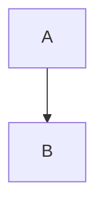

Directions: `TD`/`TB` top to bottom (default), `BT` bottom to top, `LR` left to right, `RL` right to left.

## Node shapes

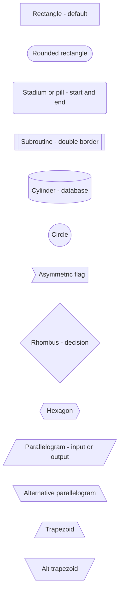

Use consistent shapes: rhombus `{...}` for decisions, stadium `(...)` for start/end nodes, cylinder `[(...)]` for data stores.

## Connections

### Edge types and labels

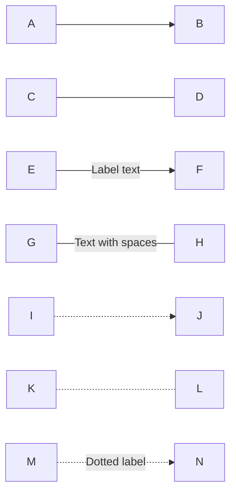

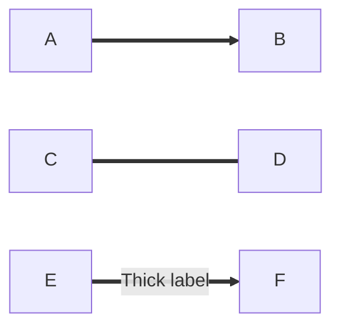

Edge catalog:

- `-->` arrow, `---` open link (no arrow)
- `-->|text|` labeled arrow; quote labels containing spaces: `-->|"Text with spaces"|`
- `-.->` dotted arrow, `-.-` dotted open link, `-.Label.->` dotted with label
- `==>` thick arrow, `===` thick open link, `==Label==>` thick with label

### Chaining and multi-directional links

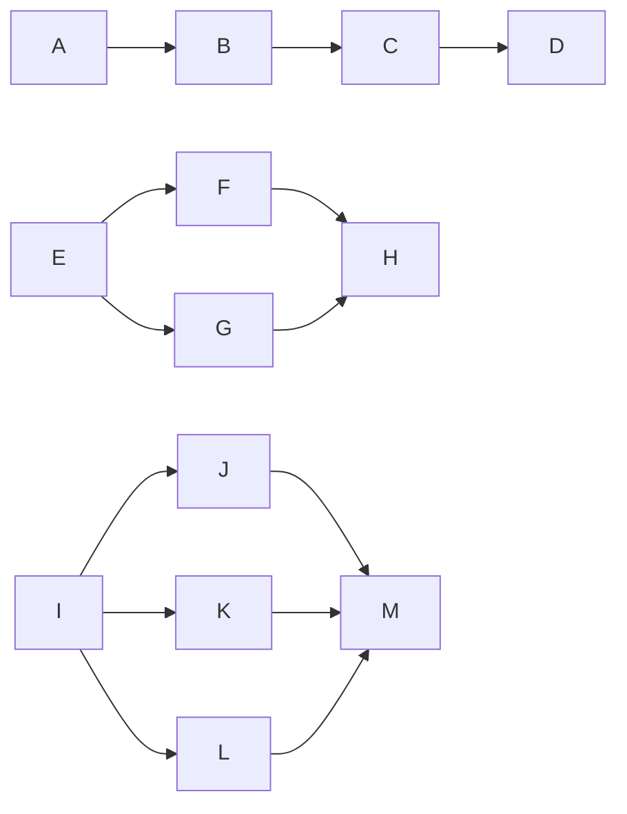

`&` fans a single edge out to or in from multiple nodes; chained edges declare a path in one line.

## Subgraphs

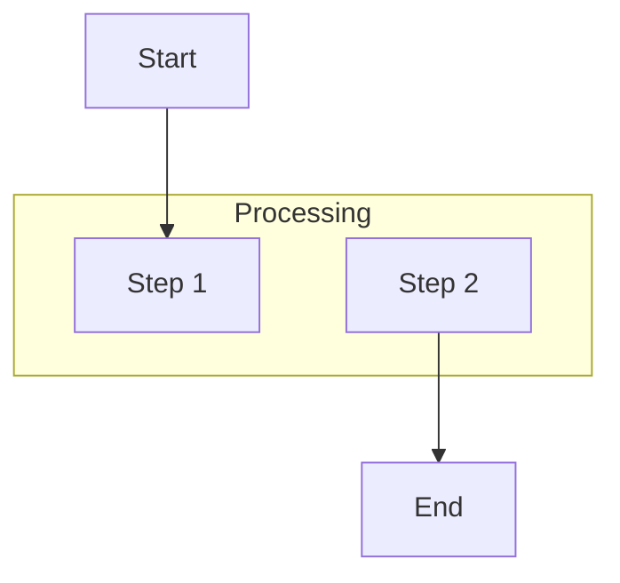

Subgraphs nest and accept their own `direction`:

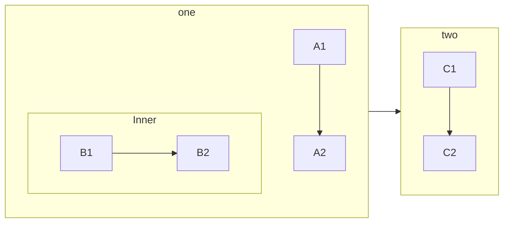

Edges may connect subgraph ids directly (`one --> two`) as well as nodes.

## Styling

### Per-node `style`

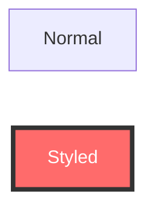

### Classes via `classDef` and `:::`

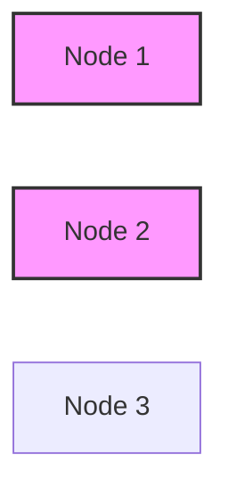

### Link styling via `linkStyle`

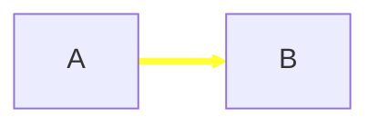

`linkStyle` takes the zero-based edge index. Use `classDef` for repeated styles instead of repeating `style` per node.

## Comprehensive example: decision flow

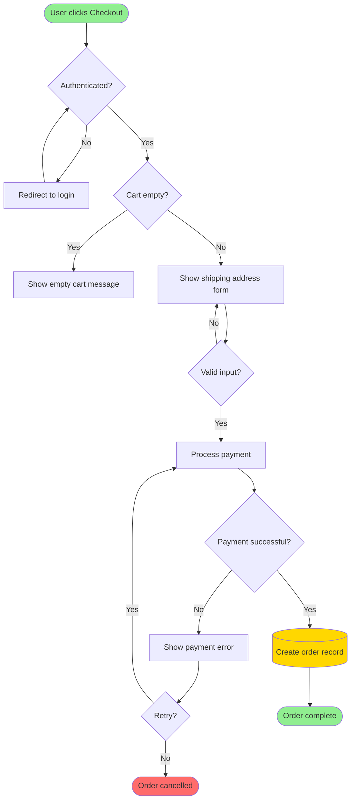

## Common patterns

### Linear flow

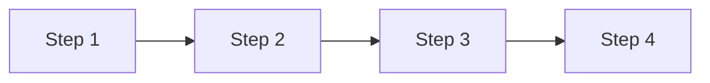

### Branching decision

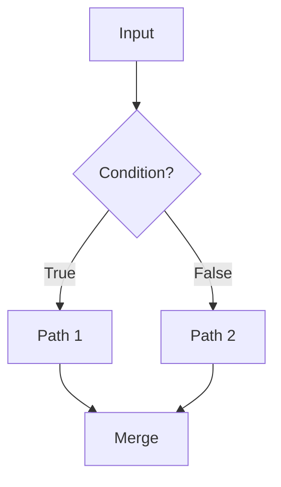

### Loop

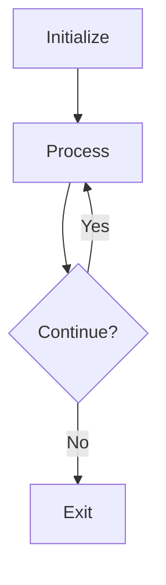

### Error handling with retry

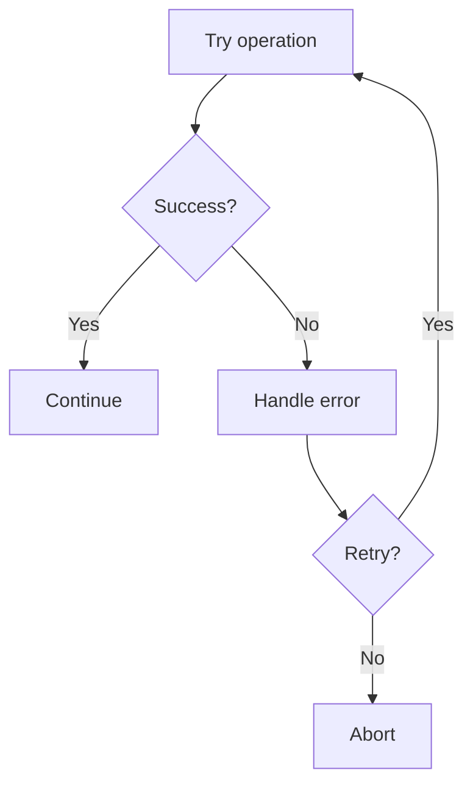

## Best practices

1. Use meaningful, action-oriented node labels.
2. Use the same shape for the same type of action across the diagram.
3. Model yes/no decisions as diamonds (`{...}`) with labeled exits.
4. Flow top-to-bottom or left-to-right; these match natural reading order.
5. Mark entry and exit points with stadium/pill nodes.
6. Group related steps into subgraphs.
7. Color-code node categories with `classDef`/`style`.
8. Minimize crossing edges by reorganizing nodes.
9. Keep one process per diagram.
