# Sequence diagrams

Sequence diagrams show interactions between participants over time. Use them for API flows, authentication sequences, and system component interactions.

## Basic syntax

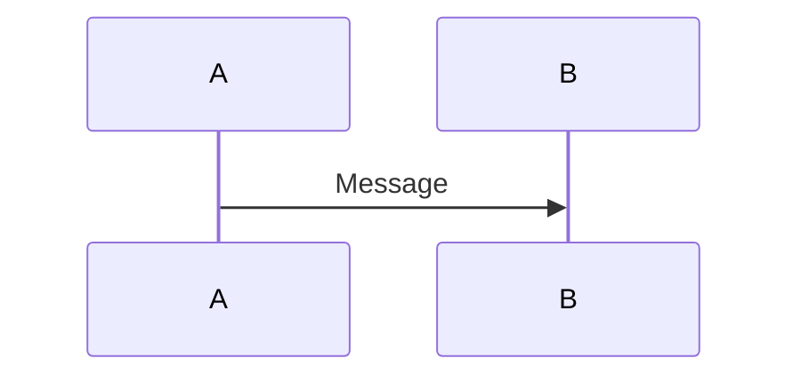

## Participants and actors

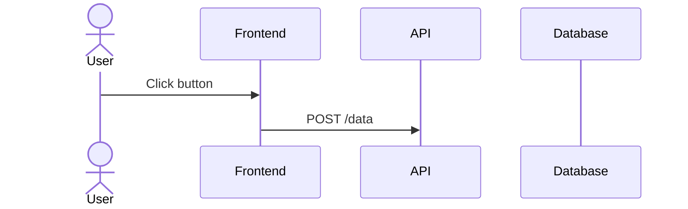

- `participant` — system components (services, classes, databases)
- `actor` — external entities (users, external systems); drawn with a stick figure

Lifelines appear in the order participants are first referenced. Declare every participant with an explicit `participant`/`actor` line before the first message to control the display order. Order them logically, typically: user, frontend, backend, database.

Give a participant a display name with `participant A as Service A`.

## Message types

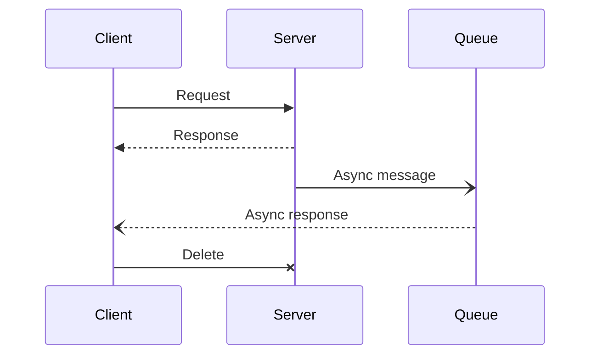

- `->>` — solid arrow (request)
- `-->>` — dotted arrow (response/return)
- `-)` — solid open arrow (asynchronous, fire-and-forget)
- `--)` — dotted open arrow (asynchronous response)
- `-x` — cross-ended arrow; the message never reaches its target (lost or delete)

A participant can message itself (`API->>API: Verify token`) to show local processing.

## Activations

Activation bars show when a participant is actively processing a request:

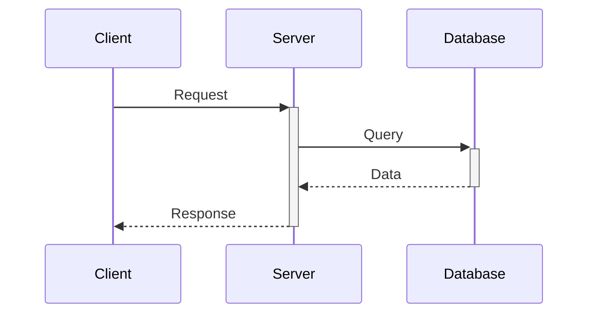

- `+` after the arrow target activates the lifeline
- `-` after the arrow target deactivates it

## Message numbering

Put `autonumber` before the first message to number messages automatically:

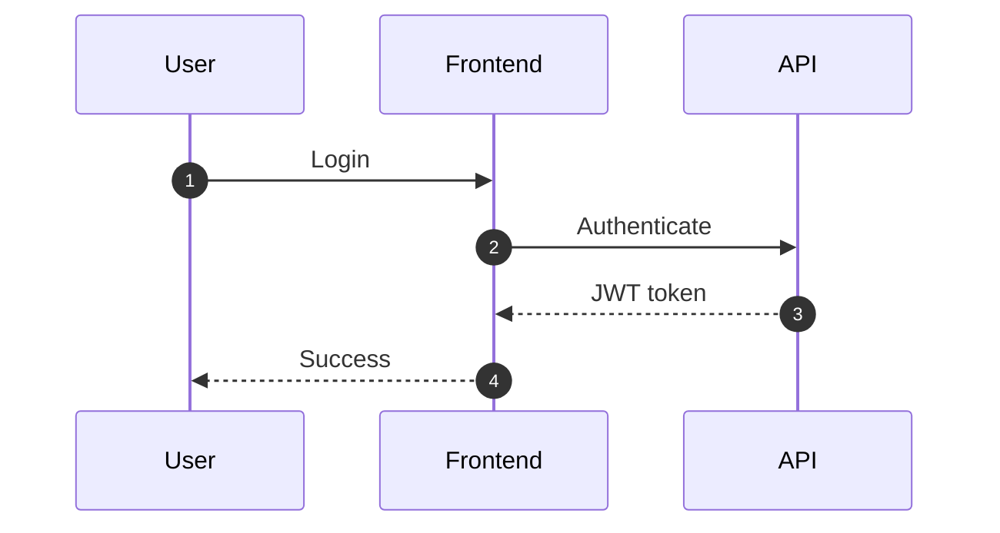

## Interaction fragments

Every fragment opens with its keyword plus a free-text condition and closes with `end`. Fragments nest.

### `alt`/`else` — conditional branches

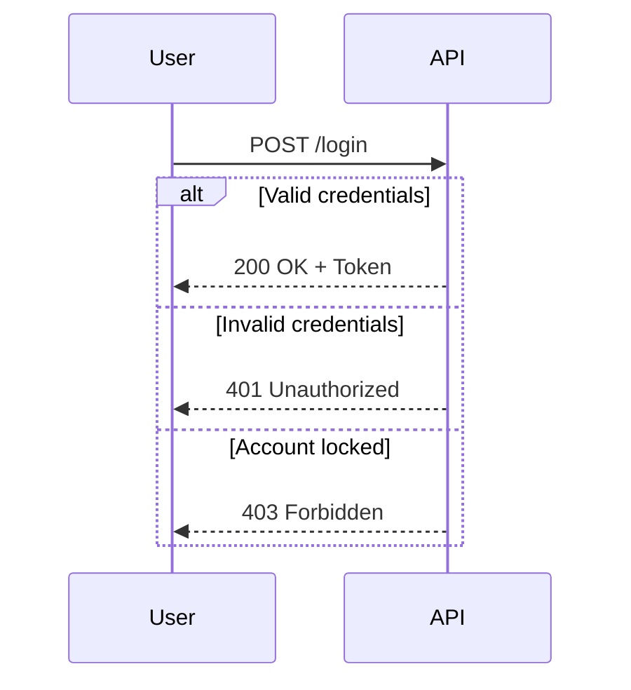

### `opt` — optional steps

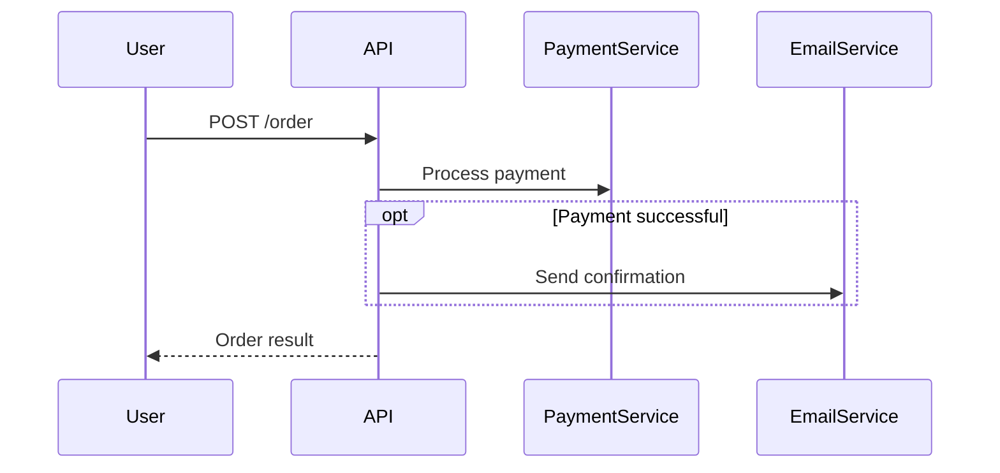

### `par`/`and` — parallel operations

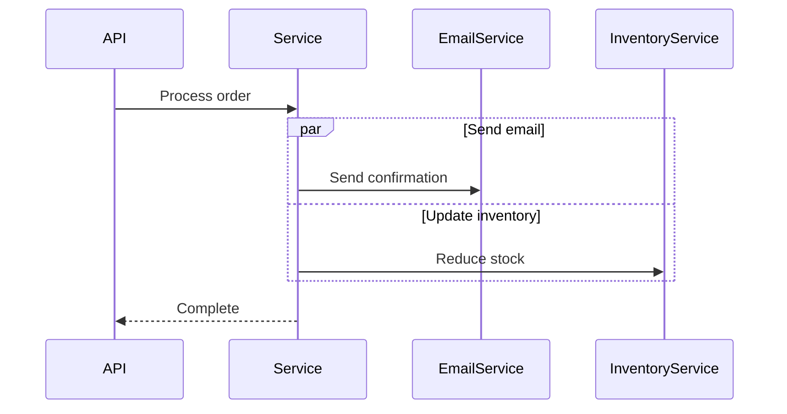

Each `and` section runs concurrently; execution continues after `end` once all sections finish.

### `loop` — repetition

The label is free text describing the condition:

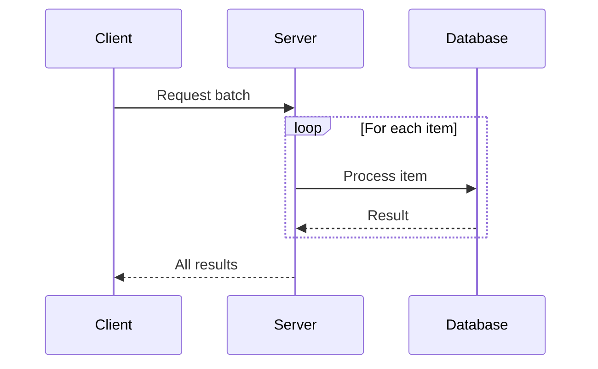

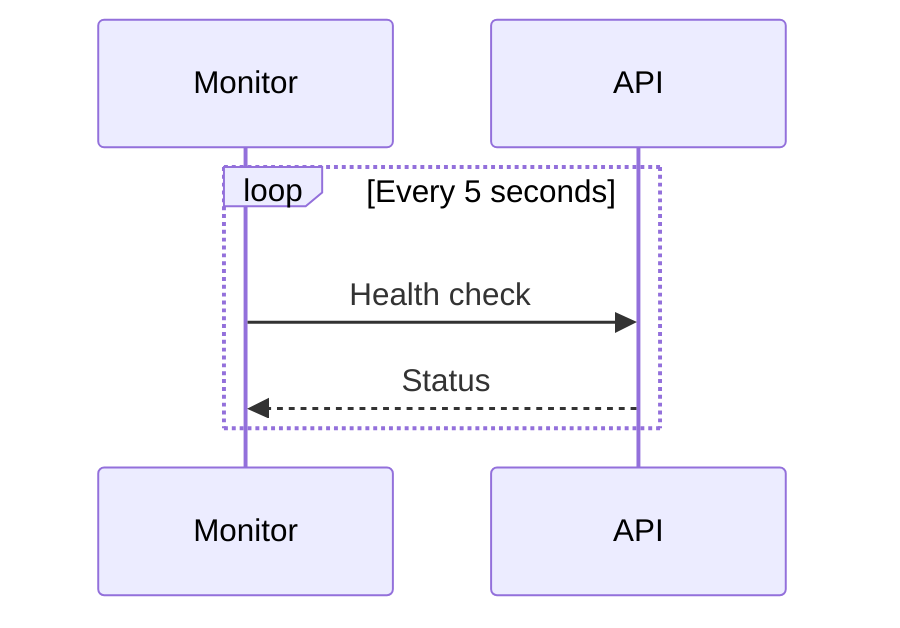

### `break` — early exit

On the condition, the flow stops and the remaining messages after the block are skipped:

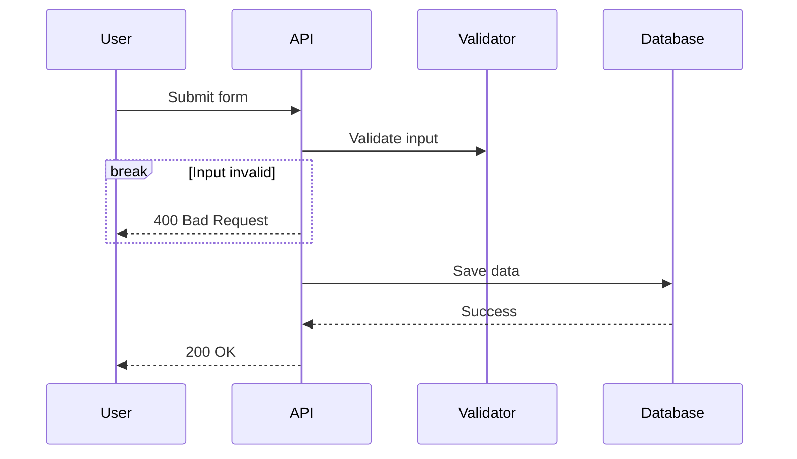

### `critical` — critical region with fallbacks

The critical section must succeed; each `option` describes a fallback for a handled failure:

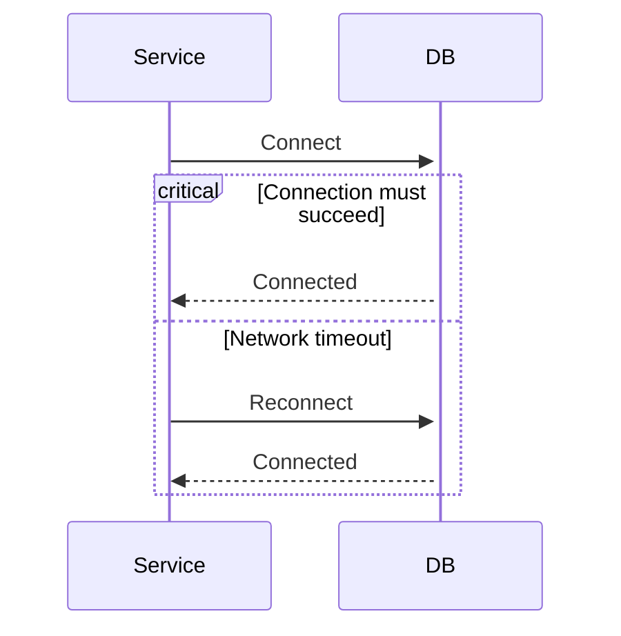

## Notes

Attach notes to lifelines with `Note over`, `Note right of`, and `Note left of`. `Note over` accepts a comma-separated span:

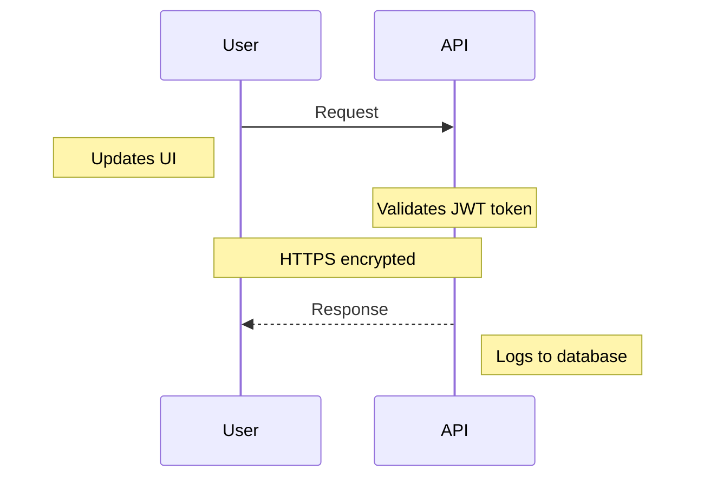

## Links

Attach clickable links to a participant with `link`; repeat for multiple links:

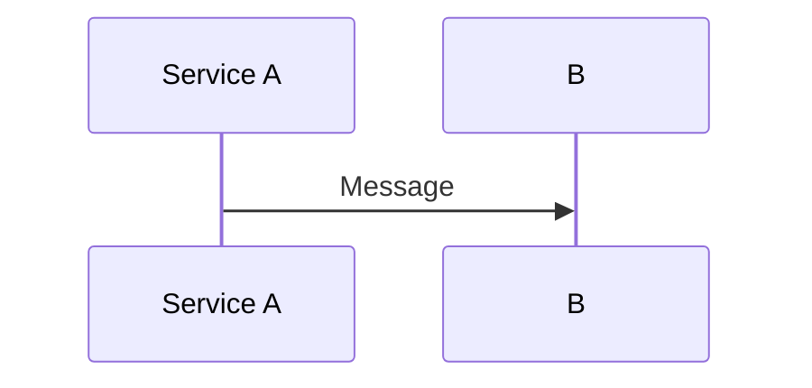

## Comprehensive example: authentication flow

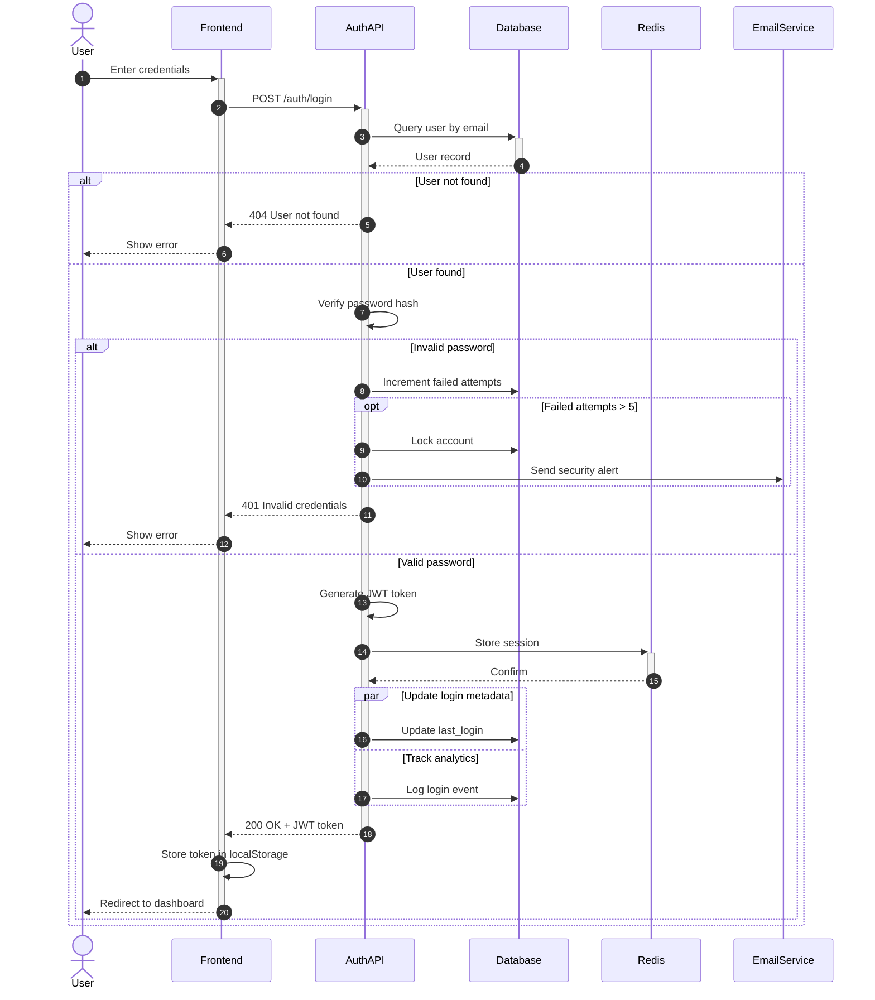

## Best practices

1. Order participants logically: user, frontend, backend, database.
2. Use activations to show when components are actively processing.
3. Group related logic with `alt`/`opt`/`par`/`loop`.
4. Add notes to explain complex logic or important details.
5. Keep one scenario per diagram.
6. Use `autonumber` for complex flows.
7. Show error paths with `alt`/`else` branches.
8. Use open arrows (`-)`, `--)`) for fire-and-forget asynchronous messages.

## Common use cases

- **Authentication** — login, OAuth/SSO, token refresh, password reset
- **API operations** — CRUD, search and filtering, batch processing, webhook handling
- **System integration** — microservice communication, third-party API calls, message queues, event-driven architecture
- **Business processes** — order fulfillment, payment processing, approval workflows, notification chains
