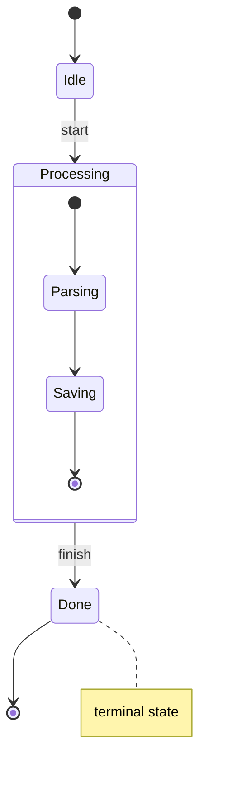
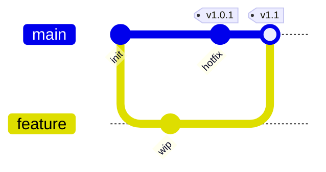
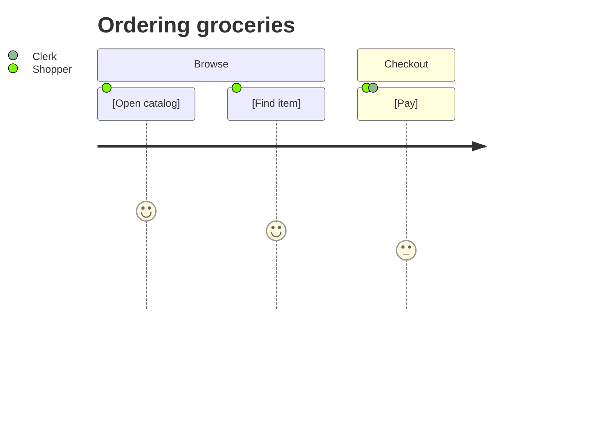
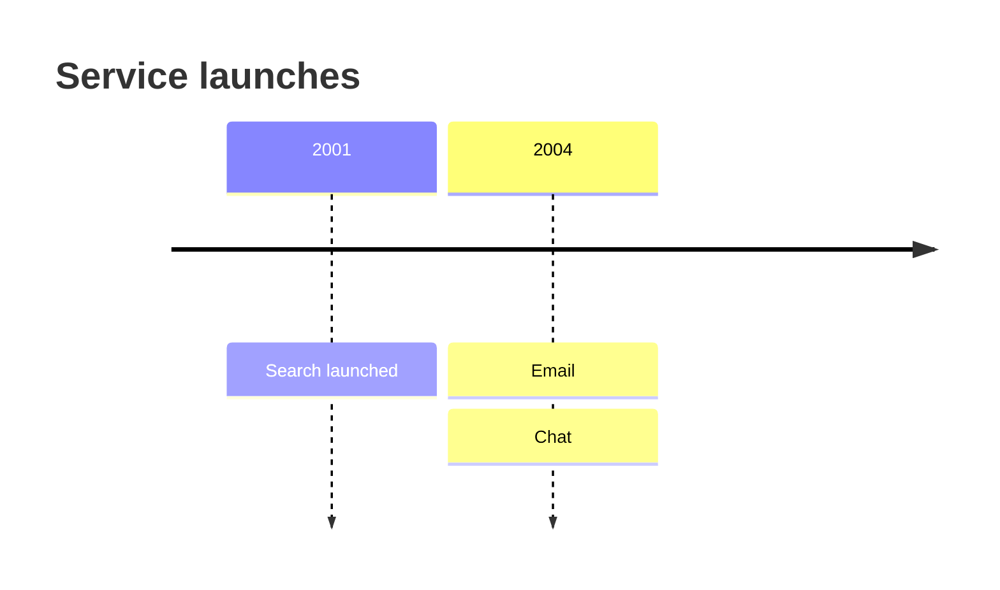
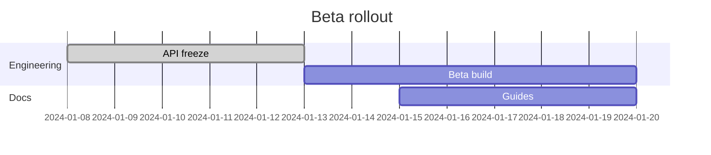
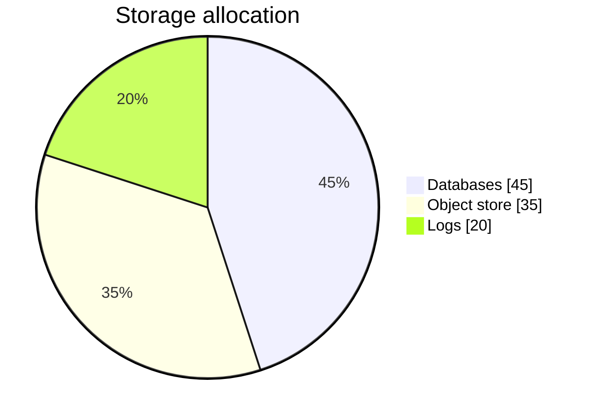
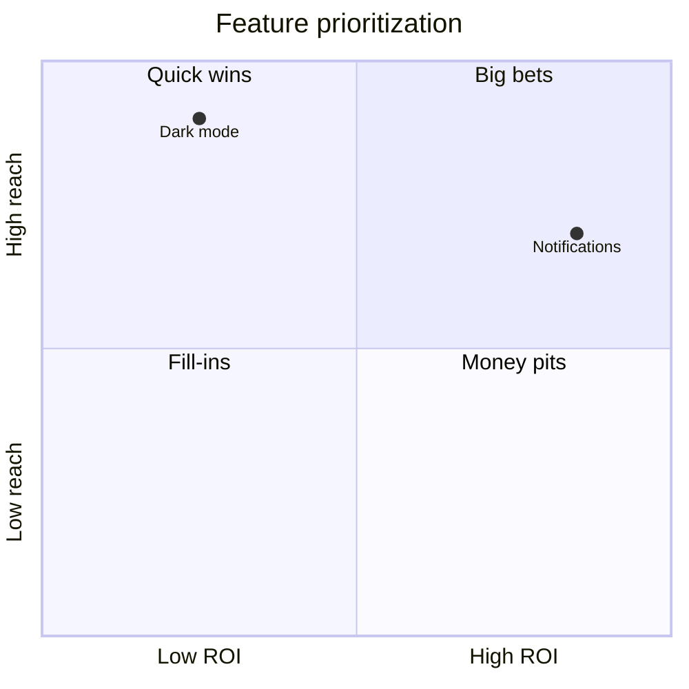
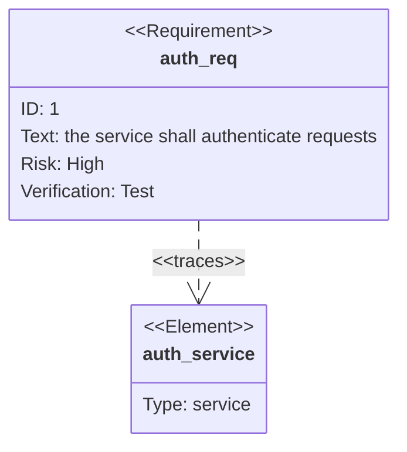

# State and behavior diagrams

Behavior diagrams: state machines, git history, user journeys, timelines, gantt schedules, pie/quadrant charts, requirements, and kanban boards. Every ```mermaid block below passes the bundled offline validator.

## stateDiagram-v2 — state machines and object lifecycles

```text
stateDiagram-v2
    direction LR
    [*] --> Initial
    State --> Other : event [guard] / action
    State --> [*]
```

- Plain states are bare words; describe with `state "Long name" as Alias` or `State : description`. Quote names containing reserved characters (`{`, `}`, `:`) in the `state "..." as` form.
- `[*]` marks the initial pseudostate (a transition target at the top) and the final pseudostate (a transition source at the bottom).
- Transition labels are `: event`, optionally `event [guard] / action` on one label. A label containing `:` twice (for example a timestamp) breaks the parser — move the extra text into a note.
- Composite state: `state Name { ... }` nests child states; transitions cross the boundary by id. Define the composite block before any transition referencing it, or the id resolves as a plain state and the nesting silently disappears.
- Choice pseudostate: `state choose <<choice>>` routes one incoming arrow to many conditionally labeled outgoing arrows.
- Fork/join: `state f <<fork>>` and `<<join>>` fan one arrow into parallel child regions and converge them back.
- Notes: `note right of Name : text` single-line, or `note left of Name` ... `end note` multi-line.
- `direction TB|BT|LR|RL` sets flow; composite states honor their own `direction`. Style states with `classDef`/`class` as in flowcharts.
- Prefer `stateDiagram-v2` over `stateDiagram` (the v1 alias still parses, but with the legacy grammar and without composite states, pseudostates, or notes). Unquoted descriptions with reserved characters fail silently — the label drops without an error.



## gitGraph — branching and merge history

```text
gitGraph
    commit id: "sha" tag: "v1.0" type: HIGHLIGHT
    branch feature
    checkout main
    merge feature tag: "release"
```

- `commit` accepts `id:`, `tag:`, and `type:` (`NORMAL`, `HIGHLIGHT`, `REVERSE`).
- `branch <name>` creates a branch off the current head; `checkout <name>` moves the head; `merge <name>` merges the named branch into the current one (optionally `tag:`). The implicit initial branch is `main`.
- Config frontmatter (see the theming reference) customizes the main branch name and commit colors — keep it outside ```mermaid fences checked by this skill's validator.
- `merge` pulls the named branch INTO the current head — the argument is the source, not the target.
- Branch names are case-sensitive; a second `branch main` duplicates the branch and renders garbage. To model a repo using `master`, set the branch name in config frontmatter — never create a second branch alongside `main`.



## journey — user experience journeys

Skeleton: `journey` / `title T` / `section S` / task lines `[Task name]: score: actor[, actor...]`.

- Scores run 1–6 (higher is better); each distinct actor gets its own lane. `title` sets the heading; `section` groups tasks.
- Square brackets are required when the task name contains spaces, colons, or commas; include them whenever in doubt — bare names with punctuation break parsing.
- Scores must be single integers 1–6; `0`, decimals, or out-of-range values fail silently and drop the task from the render. A trailing comma after the last actor adds an empty lane.



## timeline — event chronology

Skeleton: `timeline` / `title T` / optional `section S` / period lines `period : event` with further `:` segments stacking more events; `2007 ... 2010` (three dots) denotes a span instead of a point.

- Ordering is purely textual — the renderer never sorts periods; keep them chronological in the source.
- `section` groups events; each section restarts the period column set.
- Long lines cannot be wrapped; a `\n` escape inserts a line break only in some renderers — verify in the target renderer before publishing.



## gantt — project schedules

```text
gantt
    title Release plan
    dateFormat YYYY-MM-DD
    axisFormat %Y-%m
    excludes weekends
    section Phase
        Task :done, t1, 2024-01-01, 7d
        Next :after t1, 7d
```

- `dateFormat` sets BOTH the input format for task dates and the axis format; common formats are `YYYY-MM-DD`, `DD/MM/YYYY`, `HH:mm`. A missing `dateFormat` parses every date as the epoch — the format is global and never inferred per line. `axisFormat` and `tickInterval 1week` tune the axis after `dateFormat`.
- Task line: `Task :[status,][id,]start[,duration|end]`. Statuses: `done`, `active`, `crit` (combinable, for example `done, crit`). Durations accept `7d`, `2w`, `24h`; an explicit end date replaces the duration.
- Dependencies: give a task an `id`, then start a later task with `after t1` in place of (or alongside) a date. Ids are global across sections — duplicates corrupt the dependency graph silently.
- `excludes` names weekdays or dates skipped from duration counting; `includes` forces a date back in; `todayMarker off` hides the vertical today line.
- The `:` in a task line is the field separator — a task name containing a colon must be quoted (`"Fix: auth": ...`).



## pie — proportions of a whole

Skeleton: `pie [showData] [title T]` / data rows `"Key" : value`.

- Keys are quoted strings; values are numbers; percentage labels come from each value's share of the sum.
- `showData` prints the numeric value next to each slice percentage — it must sit on the same line as `pie`; on its own line it is silently ignored.
- A zero-sum dataset renders an empty ring with no error — sanity-check values before publishing.



## quadrantChart — two-axis prioritization

```text
quadrantChart
    title Priorities
    x-axis Low effort --> High effort
    y-axis Low value --> High value
    quadrant-1 Do last
    quadrant-2 Do next
    quadrant-3 Revisit
    quadrant-4 Do first
    Point A: [0.7, 0.8]
```

- Points are `Name: [x, y]` with coordinates in the range 0–1. The bracketed form is required — `Point A: 0.7, 0.8` fails silently.
- `quadrant-1` is the top-right quadrant; numbering proceeds counter-clockwise.
- Coordinates outside 0–1 clip to the chart edge without an error.
- Custom colors exist only through config frontmatter (see the theming reference) — there is no in-diagram styling syntax.



## requirementDiagram — requirements and traceability

```text
requirementDiagram
    requirement test_req {
        id: 1
        text: the app shall log in
        risk: high
        verifymethod: test
    }
    element my_sys {
        type: "service"
    }
    test_req - traces -> my_sys
```

- Requirement kinds: `requirement`, `functionalRequirement`, `performanceRequirement`, `interfaceRequirement`, `physicalRequirement`, `designConstraint`.
- Requirement fields: `id`, `text`, `risk` (`Low`/`Medium`/`High`), `verifymethod` (`Analysis`/`Inspection`/`Test`/`Demonstration`). `element` blocks take `type`, `docref`, and free-text body lines.
- Relationships (always outside the blocks): `- contains ->`, `- copies ->`, `- derives ->`, `- refines ->`, `- satisfies ->`, `- traces ->`, `- verifies ->`.
- Field names and enum values are case-sensitive in some renderers; `verifyMethod` with a capital M parses as unknown and the field drops.
- `text` values may span lines only while indented deeper than `text:` — a flush-left line closes the block.



## kanban — work items by lane

```text
kanban
    Backlog
        t1@{ priority: high }@{ assigned: Dana }: Rewrite onboarding
    In progress
        t2@{ ticket: PLAT-7 }: Fix session leak
```

- Each top-level (unindented) line names a lane; tasks are indented one level beneath it. Indentation is the entire structural grammar — there is no `section` keyword.
- A task line is `id: display text` with a board-unique id; metadata tags follow the id before the colon: `id@{ ticket: JIRA-123 }@{ assigned: alice }: text`.
- Supported tags: `done`, `priority: high|low`, `ticket`, `assigned`, and `@{ key: value }` metadata rendered as card badges.
- A missing colon after the id makes the line a nested lane, not a task; metadata keys must be wrapped in `@{ }` — the bare form `r2 priority: high:` does not parse.

```mermaid
kanban
    Backlog
        r1: Refresh docs
        r2@{ priority: high }@{ assigned: Dana }: Rewrite onboarding
    In progress
        r3@{ ticket: PLAT-7 }: Fix session leak
    Done
        r4: Migrate CI runners
```
