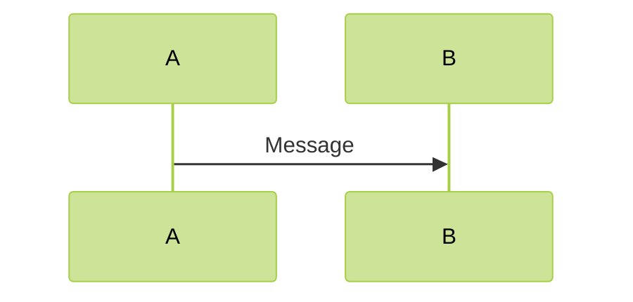
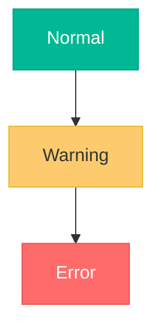
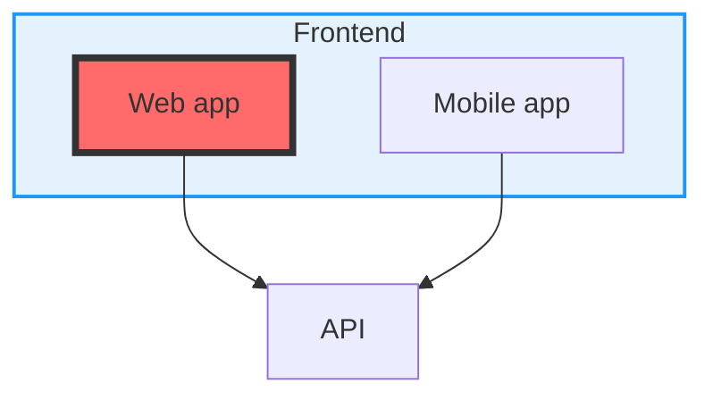
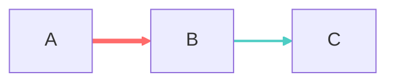
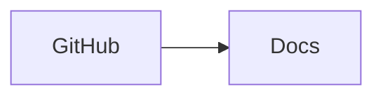

# Theming and export

Configure diagram appearance with YAML frontmatter, apply in-diagram
styling directives, and render or export diagrams from Markdown, HTML,
React, or the command line.

## Configuration frontmatter

Place a YAML block at the top of the diagram source, keyed under `config`:

```text
---
config:
  theme: base
  look: handDrawn
  layout: dagre
  themeVariables:
    primaryColor: "#ff6b6b"
    primaryTextColor: "#fff"
    primaryBorderColor: "#d63031"
    lineColor: "#74b9ff"
    secondaryColor: "#00b894"
    tertiaryColor: "#fdcb6e"
---
flowchart TD
    Start([Begin]) --> Input[Gather data]
    Input --> Process{Valid?}
    Process -->|Yes| Store[(Save to DB)]
    Process -->|No| Error[Show error]
    Store --> End([Complete])
```

**Fence gotcha:** the bundled validator rejects any ```mermaid block whose
first significant line is `---` (the frontmatter opener). Show frontmatter
examples in plain ```text fences, and never submit a frontmatter-topped
diagram to validation inside a ```mermaid fence.

Alternatively, pass configuration as an inline directive. The directive is
a `%%` comment, so the block validates with the keyword line in any
position relative to it:



## Built-in themes

| Theme | Character |
|---|---|
| `default` | Standard blue theme |
| `forest` | Green earth tones |
| `dark` | Dark-mode friendly |
| `neutral` | Grayscale professional |
| `base` | Minimal theme, the starting point for customization |

Set with `theme: <name>` in frontmatter, or `{'theme':'<name>'}` inside an
init directive.

## Theme variables

Override individual colors with `themeVariables` under `config`; use the
`base` theme for full control. Common variables:

```text
themeVariables:
  primaryColor: "#ff6b6b"     # node fill
  primaryTextColor: "#fff"    # node label text
  primaryBorderColor: "#d63031"
  lineColor: "#74b9ff"       # edges
  secondaryColor: "#00b894"
  tertiaryColor: "#fdcb6e"
  background: "#f0f0f0"      # canvas
  mainBkg: "#ffffff"         # flowchart node background
  textColor: "#333333"       # general text
  nodeBorder: "#333333"
  clusterBkg: "#f9f9f9"      # subgraph fill
  clusterBorder: "#666666"   # subgraph outline
```

Unknown variable names fail silently — no error, no effect.

## Layout engines

- `layout: dagre` — the default; classic balanced layout.
- `layout: elk` — advanced automatic layout for complex diagrams; prefer it
  when dagre produces crossed lines. Some renderers require a separate ELK
  integration package. Configure under an `elk` key:

```text
config:
  layout: elk
  elk:
    mergeEdges: true
    nodePlacementStrategy: BRANDES_KOEPF
```

ELK node placement strategies:

- `SIMPLE` — basic placement
- `NETWORK_SIMPLEX` — network optimization
- `LINEAR_SEGMENTS` — linear arrangement
- `BRANDES_KOEPF` — balanced placement (default)

Use ELK for diagrams with more than 20 nodes, and enable `mergeEdges` to
collapse parallel edges and reduce visual clutter.

## Look

- `look: classic` — traditional Mermaid rendering.
- `look: handDrawn` — sketch-like, informal strokes.

Test both: some diagrams read better with the classic look. When embedding,
set the look through `mermaid.initialize({ look: 'handDrawn' })`.

## In-diagram styling

**Class-based styling** — define with `classDef`; attach with `:::name` on
a node or `class n1,n2 name` for a list:



**Node and subgraph styling** — `style <id>` applies to nodes and subgraphs;
a subgraph accepts `direction <TB|BT|LR|RL>` to control its internal flow:



**Link styling** — `linkStyle <index>` targets edges by 0-based order of
appearance; comma-separate multiple indices:



**Links and click events** — bind navigation with `click`, optionally with
hover tooltip text:



**Tooltips** — attach hover text with the `link` directive:

```mermaid
flowchart LR
    A[Service A] -.->|REST API| B[Service B]
    link A: API documentation @ https://api.example.com
    link B: Service dashboard @ https://dashboard.example.com
```

**Comments** — `%%` starts a comment line; use comments to explain
non-obvious styling choices and organize complex sources. Avoid `{}`
inside comment text — braces render as an error.

## Rendering support

Mermaid fences render natively in:

- GitHub and GitLab — automatic rendering in Markdown.
- VS Code — with a Markdown Mermaid extension.
- Notion, Obsidian, Confluence — built-in support.

The [Mermaid Live Editor](https://mermaid.live) renders pasted source and
exports PNG/SVG; use it to check syntax and as the fallback validator when
Bun is unavailable.

## Export with mermaid-cli

Install the CLI, then convert `.mmd` sources:

```sh
npm install -g @mermaid-js/mermaid-cli
mmdc -i input.mmd -o output.png
```

SVG export options — custom dimensions, background color, transparent
background:

```sh
mmdc -i diagram.mmd -o output.svg -w 1920 -H 1080
mmdc -i diagram.mmd -o output.svg -b "#ffffff"
mmdc -i diagram.mmd -o output.svg -b "transparent"
```

Docker, without a local Node install:

```sh
docker run --rm -v "$(pwd):/data" minlag/mermaid-cli -i /data/input.mmd -o /data/output.png
```

Test exports — verify the diagram renders correctly in the target format
before publishing.

## Embedding

HTML page via CDN, with global config in `mermaid.initialize`:

```html
<script type="module">
  import mermaid from 'https://cdn.jsdelivr.net/npm/mermaid@10/dist/mermaid.esm.min.mjs';
  mermaid.initialize({
    startOnLoad: true,
    theme: 'dark',
    look: 'handDrawn'
  });
</script>
<pre class="mermaid">
  flowchart LR
      A --> B
</pre>
```

React — initialize once, then call `contentLoaded()` after mount:

```jsx
import React from 'react';
import mermaid from 'mermaid';

mermaid.initialize({ startOnLoad: true, theme: 'forest' });

function DiagramComponent() {
  React.useEffect(() => { mermaid.contentLoaded(); }, []);
  return <div className="mermaid">flowchart LR A --> B</div>;
}
```

Make embedded diagrams responsive by wrapping the rendered container with
`max-width: 100%; overflow: auto;` CSS.

## Accessibility and performance

- Use high-contrast color combinations (for example `primaryColor: "#0066cc"`
  with `primaryTextColor: "#ffffff"`, and `lineColor: "#333333"` on a light
  `background`).
- Never rely on color alone to convey meaning; include descriptive text
  labels.
- Test with color-blindness simulators; consider dark-mode alternatives.
- Split very large diagrams into multiple focused views; organize the rest
  with subgraphs.
- Limit styling to essential elements — too many colors reduce clarity.

## Best practices

- Pick one theme for related diagrams and keep it consistent.
- Version-control diagram configs alongside the diagrams.
- Don't over-style; clarity beats decoration.
