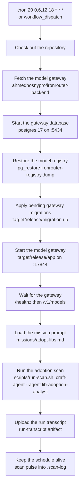
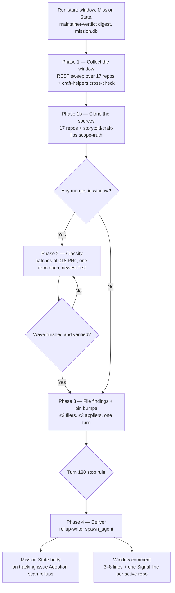
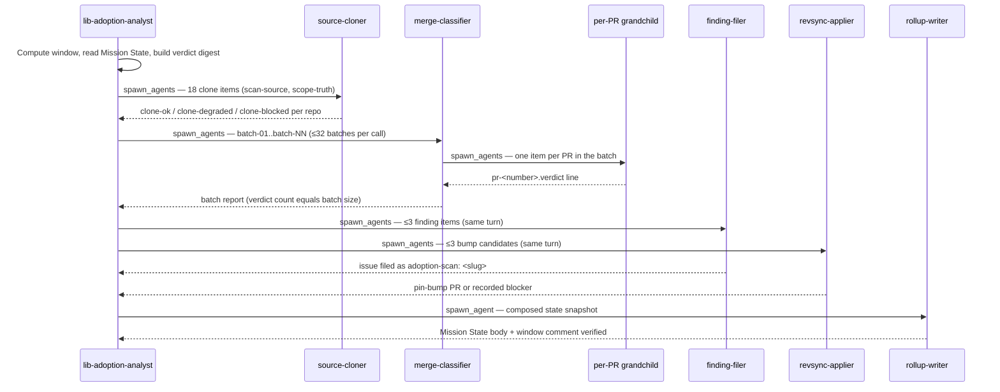
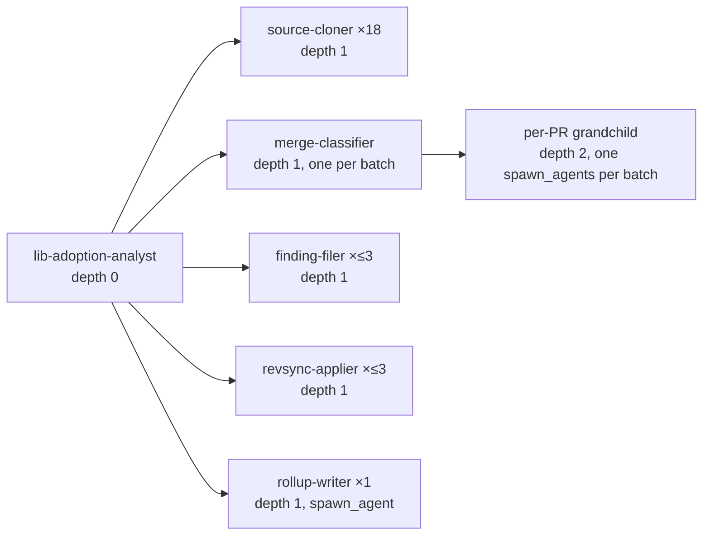
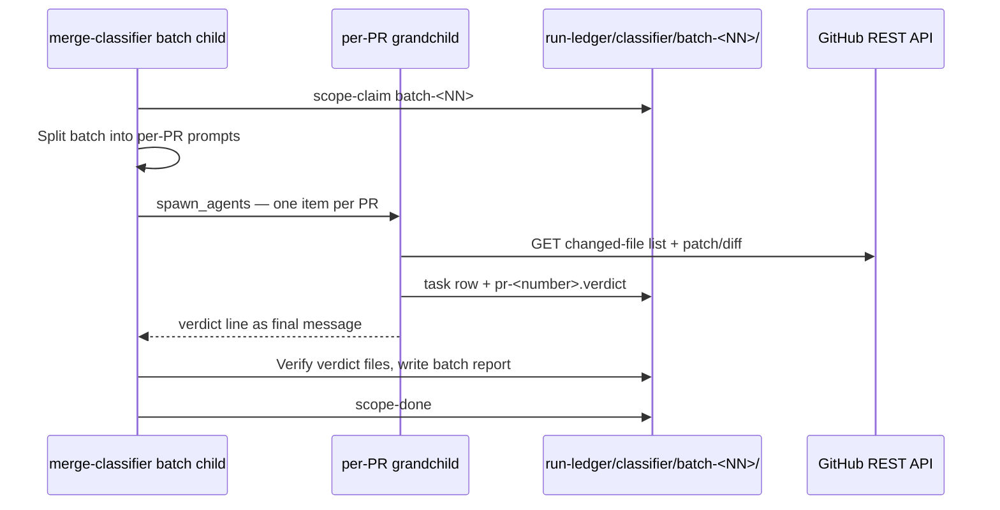
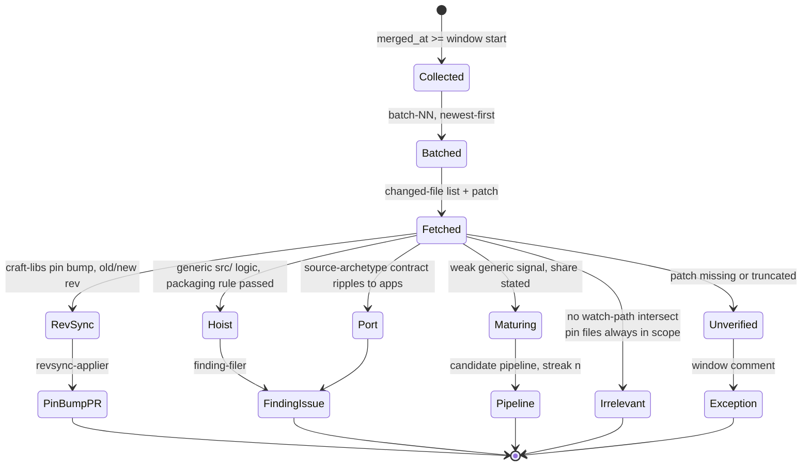
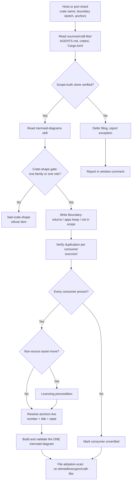
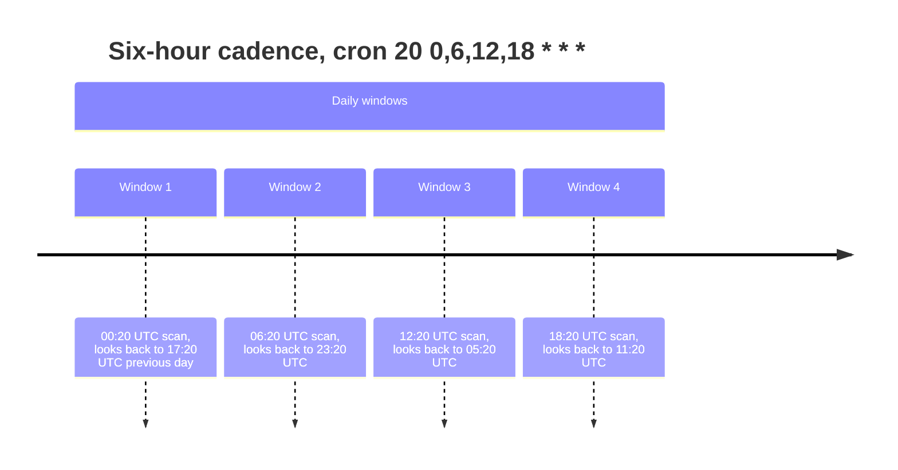
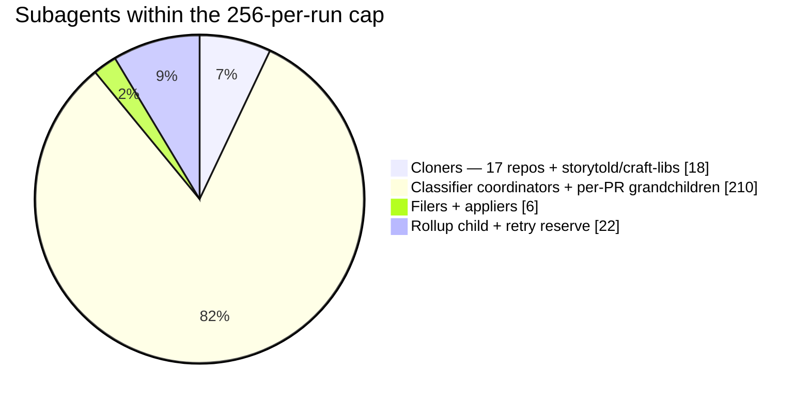

# The adoption scan, visualized

How the six-hour craft-libs adoption scan actually runs: the GitHub Actions job in
`.github/workflows/adopt-libs.yml`, the mission phases from `missions/adopt-libs.md`, and the
subagent pool of `.craft-agent/agents/`. Every name below is a real file, step, phase, agent, or
artifact. One diagram per concept; nothing here invents entities.

## 1. The CI job — boot the gateway, run the scan

The job `scan` on `ubuntu-latest` (timeout 360 min). The private model gateway
(`ahmedhosnypro/ironrouter-backend`) is cloned, its Postgres registry restored on :5434, and the
binary serves on :17844 before `scripts/run-scan.sh` starts the agent. The pulse step is
best-effort: it never turns a green scan red.

## 2. The mission phases

The orchestrator `lib-adoption-analyst` computes the window itself (`date -u -d '7 hours ago'` —
a 7-hour look-back on the 6-hour cadence), reads the tracking issue's Mission State body and the
maintainer-verdict digest, then drives the five phases. Zero merges skips classification; the
clones still run because duplication is proven across the suite, not across the window.

## 3. The run as a sequence

The orchestrator never classifies, files, or delivers itself; each phase is a wave of specialist
children, and every child deliverable is verified against `gh api` before the next wave starts.

## 4. The subagent tree

Depth 3 by design and never deeper: coordinators may spawn grandchildren, grandchildren never
spawn. Every spawn carries `maxTurns: 10000`, `timeoutSecs: 0`, `maxTokens: 75000000` — omitting
`maxTokens` starves later waves of the run's 5,000,000,000-token budget.

## 5. Inside one classification wave

A batch child never loops over its PRs. Its four moves — claim, spawn, verify and report, close —
and the grandchildren's three describe the fastest honest path; turn counts are guidance, not caps.

## 6. A PR's verdict lifecycle

Verdict classes come from `missions/adopt-libs.md`: `rev-sync`, `hoist`, `port`, `irrelevant`,
`unverified`, or `maturing:<slug>`. A maturing candidate reaches filing only after corroboration in
two consecutive windows, and only when the maintainer-verdict digest's revival conditions allow it.

## 7. The filer's gate chain

A finding only reaches GitHub after the scope-truth clone is read, the crate shape passes, and
duplication is proven per consumer. A hoist carries exactly one validated mermaid diagram or it
does not file at all.

## 8. The cadence and the look-back

Four windows a day. The 7-hour look-back overlaps the 6-hour cadence by an hour — idempotent,
because merges are keyed by `owner/repo#number` — and it heals a missed slot.

## 9. The subagent budget

At most 256 subagents per run, at most 64 concurrent tree-wide. The reserve covers the 18 cloners,
up to 6 filers/appliers, the rollup child, and retries; the rest is classifier coordinators and
per-PR grandchildren. Beyond the cap the run classifies newest-first and reports the unclassified
count as an exception.

