# The adoption scan, visualized

How the six-hour craft-libs adoption scan actually runs: the GitHub Actions job in
`.github/workflows/adopt-libs.yml`, the mission phases from `missions/adopt-libs.md`, and the
subagent pool of `.craft-agent/agents/`. Every name below is a real file, step, phase, agent, or
artifact. One diagram per concept; nothing here invents entities.

Two modes are drawn here. **Mission mode** (sections 1–9) is today's CI default and the rollback
path: `lib-adoption-analyst` drives the phases itself and the specialists write to GitHub directly.
**Workflow mode** (sections 10–12) is the judged DAG in `.craft-agent/workflows/adopt-libs.md` —
10 steps gating every GitHub write behind a panel and an appellate verdict, and running one pipeline
per PR. Mission mode is the
current reality; workflow mode is what the same run becomes, so where the two conflict the
mission-mode sections describe the rollback path, not the destination.

## 1. The CI job — boot the gateway, run the scan

The job `scan` on `ubuntu-latest` (timeout 360 min). The private model gateway comes from the
published IronRouter release (`ahmedhosnypro/IronRouter`): the latest release (or a dispatch-pinned
`gateway-tag`) is downloaded and checksum-verified, the registry dump is fetched from the backend
source repo (`ahmedhosnypro/ironrouter-backend`) by itself, restored into Postgres on :5434, and
the gateway binary serves on :17844 before `scripts/run-scan.sh` starts the agent. The pulse step is
best-effort: it never turns a green scan red.

Mission mode (the current default and the rollback path): the `Load the mission prompt` step reads
`missions/adopt-libs.md`, and `scripts/run-scan.sh` runs `craft-agent run --agent
lib-adoption-analyst --prompt <mission file>`. Workflow mode swaps that for `craft-agent workflow
--workflow adopt-libs` (no `--max-tokens` — it is a per-step cap), with the renderer following the
run's journal (step events) and the per-step session transcripts (prompts, tool calls, tool results)
under `.craft-agent/workflows/<run_id>/` for mid-step liveness; `run-scan.sh` selects it from
`CRAFT_AGENT_WORKFLOW`, which the `workflow` dispatch dropdown sets (`mission` or `adopt-libs`);
scheduled runs always take the mission — see section 10. Concurrency is event-scoped:
scheduled runs serialize on one group (`adopt-libs-scheduled`), and every manual dispatch joins its own
group (`adopt-libs-${{ github.run_id }}`), so a mission scan and a workflow rehearsal can run at the
same time — the tracking-issue state update and the `already-filed`/`already-open` checks are the
racy surfaces those parallel runs share.

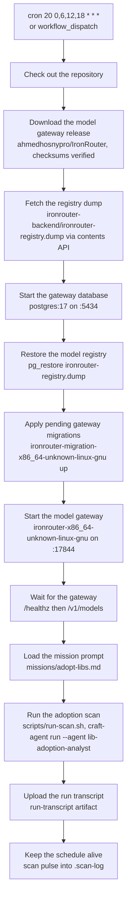

## 2. The mission phases

**Mission mode — the rollback path.** The orchestrator `lib-adoption-analyst` computes the window
itself (`date -u -d '7 hours ago'` — a 7-hour look-back on the 6-hour cadence), reads the tracking
issue's Mission State body and the maintainer-verdict digest, then drives the phases. Zero
merges skips classification; the clones still run because duplication is proven across the suite,
not across the window. Phase 1, Phase 1b, and the digest read are scripts started by
`scripts/launch-sweeps.sh` in one call, running concurrently — the AI never collects or clones.

Under the judged workflow (section 10) the same phases become steps: `prepare` launches and verifies
the sweeps, `pr-pipeline` runs Phase 2 as one pipeline per PR, and the specialists no longer write to
GitHub at all.

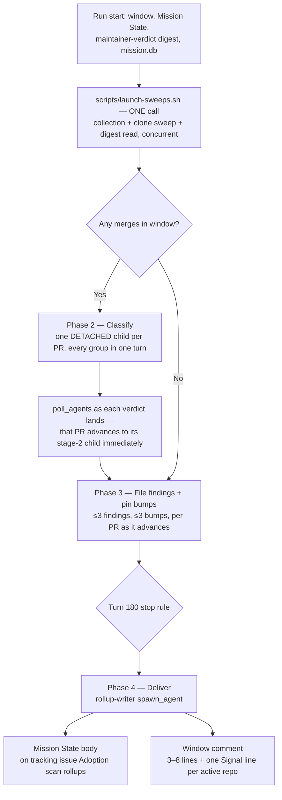

## 3. The run as a sequence

The orchestrator never classifies, files, or delivers itself; the sweep is a script, every PR is its
own detached child, and each PR advances to its stage-2 child the moment its verdict is verified —
no wave barrier between PRs, and no PR waiting on another.

**Rollback-path note:** the arrows below are mission mode. Under the judged workflow the filer,
applier, and rollup children only produce drafts in `run-ledger/`; the writes shown here move to
the committers behind the gates of section 11.

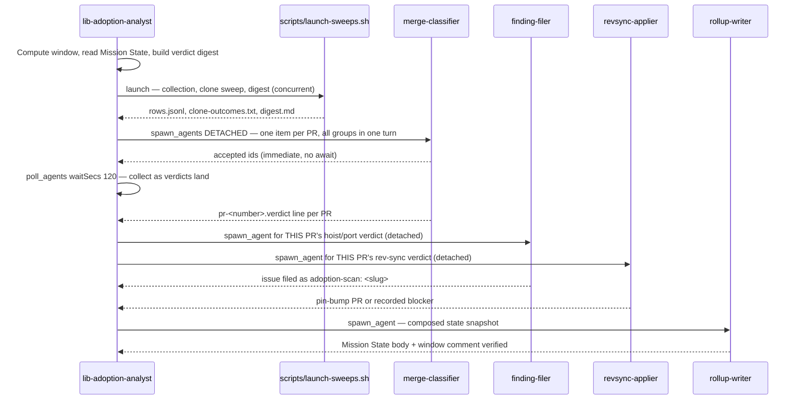

## 4. The subagent tree

Depth 2 by design and never deeper: the orchestrator spawns children, and a per-PR child never
spawns — the coordinator layer is gone. Every spawn carries `maxTurns: 10000` and a finite
`timeoutSecs` (1800, or 3600 for a classifier child) and omits `maxTokens`: subagent token budgets
are unlimited and reserve nothing, so a group's admission never depends on a slice-times-count
reservation.

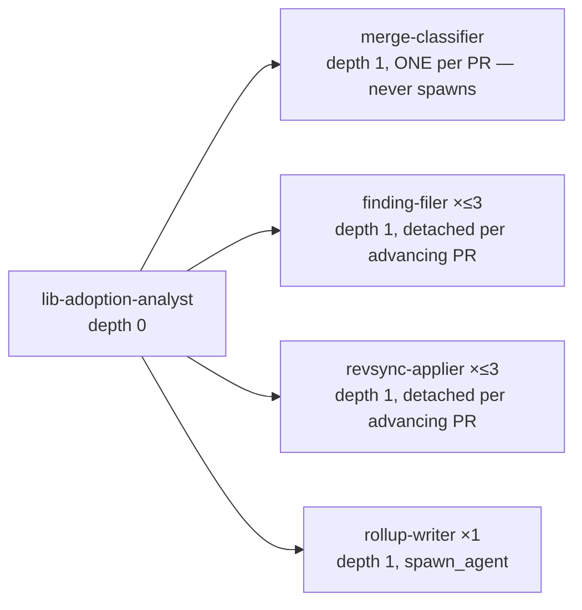

## 5. Inside one classification pipeline

A classifier child owns exactly ONE PR — no coordinator, no grandchild, because a coordinator is a
barrier its members wait on and a grandchild adds a level the per-PR shape does not need. Its moves
— claim, fetch, classify, verify — describe the fastest honest path; turn counts are guidance, not
caps. Every child in the wave is independent: it shares nothing with any other child and waits on
none.

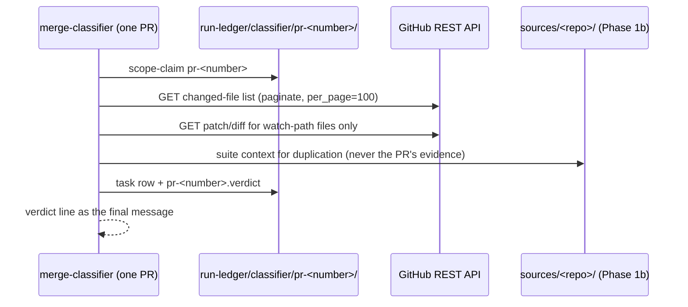

## 6. A PR's verdict lifecycle

Verdict classes come from `missions/adopt-libs.md`: `rev-sync`, `hoist`, `port`, `irrelevant`,
`unverified`, or `maturing:<slug>`. A maturing candidate reaches filing only after corroboration in
two consecutive windows, and only when the maintainer-verdict digest's revival conditions allow it.

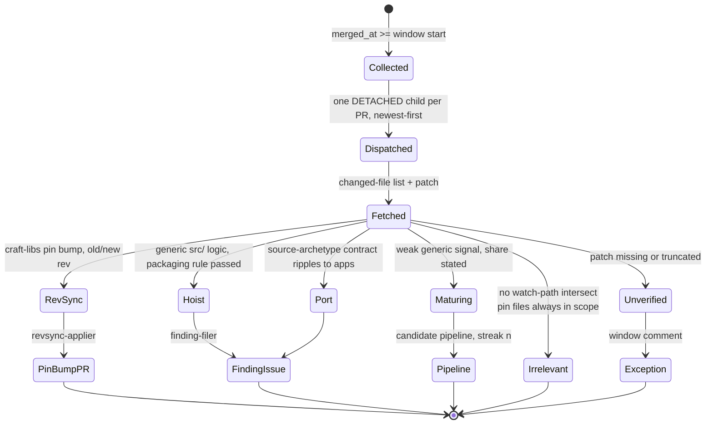

## 7. The filer's gate chain

**Rollback-path note:** this chain ends with `File adoption-scan: <slug>` because in mission mode
the filer writes to GitHub itself. Under the judged workflow the chain stops at the draft in
`run-ledger/filer/<slug>/` and `file-commit` (`finding-committer`) performs the only write — see
section 12.

A finding only reaches GitHub after the scope-truth clone is read, the crate shape passes, and
duplication is proven per consumer. A hoist carries exactly one validated mermaid diagram or it
does not file at all.

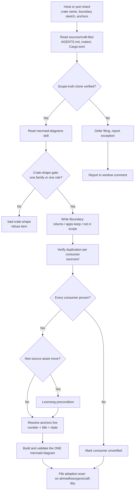

## 8. The cadence and the look-back

Four windows a day. The 7-hour look-back overlaps the 6-hour cadence by an hour — idempotent,
because merges are keyed by `owner/repo#number` — and it heals a missed slot.

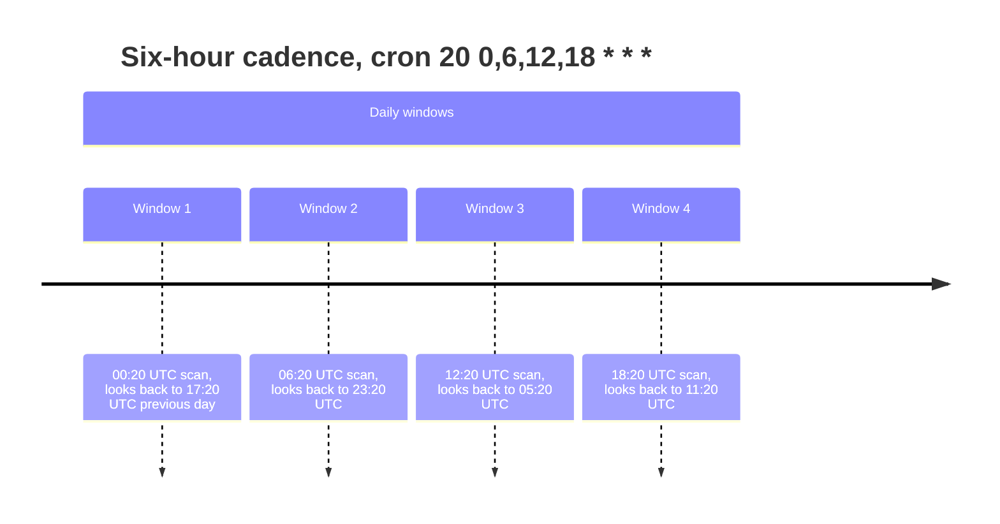

## 9. The subagent budget

At most 1024 subagents per run, and at most 48 concurrent tree-wide (the scan's knob is a
deliberate bound, not a ceiling: each child is a full runner with its own context and provider
stream, and the job's runner has 7 GB — the hub queues the rest FIFO, so the window's per-PR
pipelines still all progress, just 48 at a time). The reserve covers the stage-2 filers and
appliers, the rollup child, and retries; the rest is per-PR classifier children, and their token
budgets are unlimited (only the run's own budget guards). Beyond the cap the run classifies
newest-first and reports the unclassified count as an exception.

**Rollback-path note:** this pie is mission mode's pool. Under the judged workflow the engine
sequences the 10 steps itself (`max-concurrent-steps: "4"`) and `pr-pipeline` dispatches its
detached per-PR pool, bounded instead by the run's `max-total-turns: "10000"` and
`max-total-tokens: "100000000"` pool.

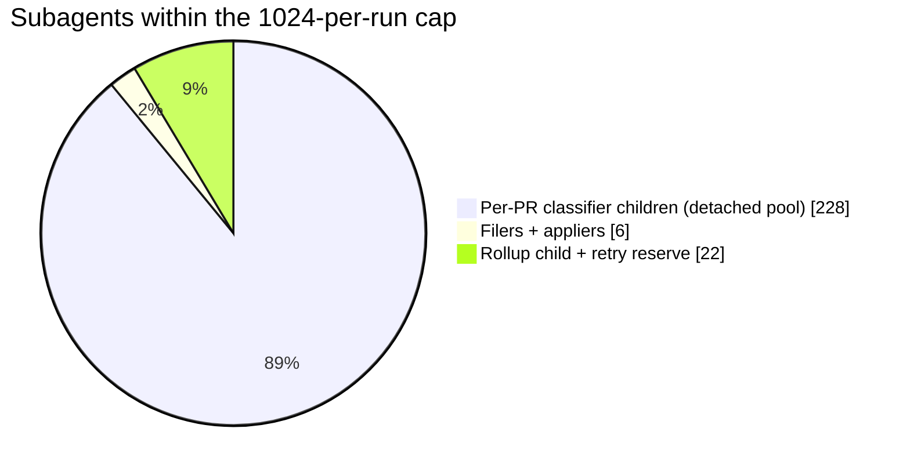

---

## 10. The judged workflow — the 10-step DAG, one pipeline per PR

Workflow mode lives in `.craft-agent/workflows/adopt-libs.md` (frontmatter `name: adopt-libs`, arg
`window` default `7h`) — the same scan, but the engine sequences the steps instead of the
orchestrator, and every GitHub write sits behind a verdict. Limits: `max-steps: "12"`,
`max-concurrent-steps: "4"`, `max-total-turns: "10000"`, `max-total-tokens: "100000000"`,
`max-retries-per-step: "2"`. Every step states `max-turns`, `retry`, and `on-failure` explicitly —
never relying on the 25/0/stop defaults.

The shape: a scripted parallel sweep (`prepare`), one per-PR pipeline step (`pr-pipeline`), one
merged judge family (`pipeline-gate`, `pipeline-appeal`), two committers that need only the appeal
(`file-commit`, `bump-commit`), and the rollup island (`rollup-draft`, `rollup-gate`,
`rollup-appeal`, `rollup-commit`) that starts the moment `prepare` settles. Only success releases
dependants, so what happens after a failure depends on that step's `on-failure`.

What changed from the 16-step shape and why: `classify`, `file-draft`, and `bump-draft` collapsed
into `pr-pipeline` because a per-PR pipeline is not a phase — every PR's journey is its own, and a
PR may finish while another is only in its first stage. The gates merged for the same reason: one
judge family verifies the whole per-PR output, exhaustive only on the ≤3 findings and ≤3 bumps that
can actually be filed, sampled elsewhere.

**Failure policy — schema-enforced, not a preference.** A step the run survives a failure of
(`skip` or `warn`) must be a leaf: the workflow schema forbids `skip`/`warn` on a step that has
dependants, or the pipeline stalls. So every step anything depends on is `stop`, and only the three
leaf committers — nothing needs them — are `skip`. A gate that settles failed therefore halts
admissions: the run ends `Failed` (exit 1 on a step error, 2 on max-turns, 3 on budget), its
committers settle as skipped with a named `DependencyFailed` reason (journaled, never silent), and
the next run heals from the prior state body. A skipped *committer* still records the failure (the
run is `Failed`), but in-flight sibling branches keep running, so their terminal rows reach the
rollup's exception list — that is the audit trail for a failed lane.

`rollup-draft` composes the snapshot from the terminal `run-ledger/outcomes/*.md` rows and the
journal — skipped steps become named exceptions, never silence — with a bounded wait (≤45 min) for
the file and bump lanes, and never claims an artifact it cannot verify. `pr-pipeline` carries the
heaviest budget (1200 turns): one detached child per PR, then polls as each verdict lands and
advances that PR immediately, so a `rev-sync` PR gets its applier while a `hoist` PR three hundred
rows down is still fetching files.

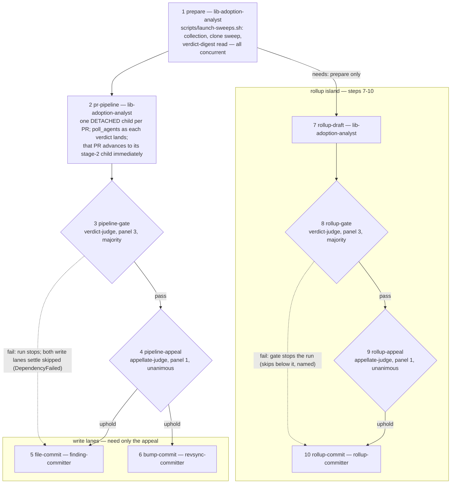

The dotted edge shows what a failed gate does: admissions halt, and everything below it settles as
skipped with a named `DependencyFailed` reason — the committers never run, the rollup island
finishes if already in flight, and the run's conclusion is `Failed` with the journal carrying every
reason.

## 11. One pipeline — per PR, detached, never blocked by a wave

`pr-pipeline` is the step the per-PR architecture lives in. It shards `rows.jsonl` into ONE item per
PR and dispatches the whole window as detached children: every group's `spawn_agents` call carries
`"detached": true`, so it returns at admission and the pool runs the members under the concurrency
knob while the orchestrator does other work. No call awaits a wave, so no PR waits for another.

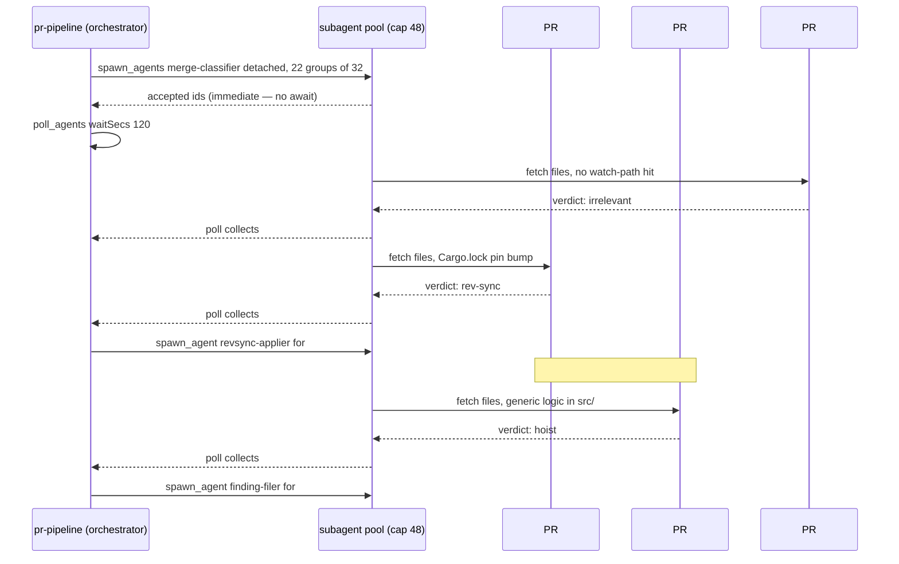

What the shape buys, and what it costs. Bought: a PR's journey never waits on a sibling, the
wall-clock reclaims one child without stalling 47 others, and each child's context holds one PR's
evidence instead of a batch of six. Cost: the orchestrator tracks ~N PRs, which is why per-PR state
lives in `run-ledger/` and its context holds the chart — it verifies a verdict by reading the
child's FILE, never by re-reading the envelope into its own context.

## 12. The draft/commit split

The stage-2 drafters and the committers are different agents. The drafters keep the judgment and
lose the write: `finding-filer` writes `run-ledger/filer/<slug>/draft.md` plus its evidence bundle
and returns `ready <slug>` / `already-filed` / `already-tracked` / `refused` / `blocked`;
`revsync-applier` clones, branches, and commits pin lines locally — never pushes — writing
`run-ledger/revsync/<slug>/branch.md` and the PR body and returning `ready` / `already-open #N` /
`blocker`; `rollup-writer` composes `run-ledger/rollup/target.md`, `state-body.md`, and
`comment.md` and writes nothing to GitHub. The judges re-verify those drafts live. Only then do the
committers — deliberately mechanical, because the intelligence is gated upstream — perform the
run's only GitHub writes, each idempotently so a retry can never duplicate an issue.

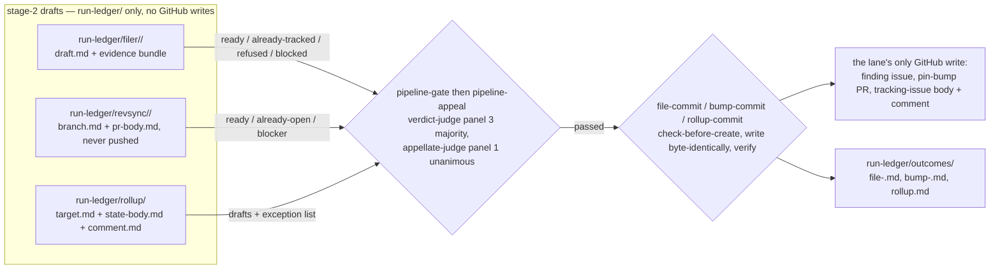
