# The adoption scan, visualized

How the six-hour craft-libs adoption scan actually runs: the GitHub Actions job in
`.github/workflows/adopt-libs.yml`, the mission phases from `missions/adopt-libs.md`, and the
subagent pool of `.craft-agent/agents/`. Every name below is a real file, step, phase, agent, or
artifact. One diagram per concept; nothing here invents entities.

Two modes are drawn here. **Mission mode** (sections 1–9) is today's CI default and the rollback
path: `lib-adoption-analyst` drives the phases itself and the specialists write to GitHub directly.
**Workflow mode** (sections 10–12) is the judged DAG in `.craft-agent/workflows/adopt-libs.md` —
6 steps where each PR's whole life, including its own gate and appeal, runs on its own detached
pipeline, and only the seal's write gathers the run again. Mission mode is the
current reality; workflow mode is what the same run becomes, so where the two conflict the
mission-mode sections describe the rollback path, not the destination.

## 1. The CI job — boot the gateway, run the scan

The job `scan` on `ubuntu-latest` (timeout 360 min). The private model gateway comes from the
published IronRouter release (`ahmedhosnypro/IronRouter`): the latest release (or a dispatch-pinned
`gateway-tag`) is downloaded and checksum-verified, the registry dump is fetched from the backend
source repo (`ahmedhosnypro/ironrouter-backend`) by itself, restored into Postgres on :5434, and
the gateway binary serves on :17844 before `scripts/run-scan.sh` starts the agent. The pulse step is
best-effort: it never turns a green scan red.

Mission mode (the rollback path): the `Load the mission prompt` step reads
`missions/adopt-libs.md`, and `scripts/run-scan.sh` runs `craft-agent run --agent
lib-adoption-analyst --prompt <mission file>`. Workflow mode swaps that for `craft-agent workflow
--workflow adopt-libs` (no `--max-tokens` — it is a per-step cap), with the renderer following the
run's journal (step events) and the per-step session transcripts (prompts, tool calls, tool results)
under `.craft-agent/workflows/<run_id>/` for mid-step liveness; `run-scan.sh` selects it from
`CRAFT_AGENT_WORKFLOW`, which the `workflow` dispatch dropdown sets (`mission` or `adopt-libs`);
scheduled cron runs always take the workflow, a dispatch with the input left at `mission` keeps the
mission — see section 10. Concurrency is event-scoped:
scheduled runs serialize on one group (`adopt-libs-scheduled`), and every manual dispatch joins its own
group (`adopt-libs-${{ github.run_id }}`), so a mission scan and a workflow rehearsal can run at the
same time — the tracking-issue state update and the `already-filed`/`already-open` checks are the
racy surfaces those parallel runs share.

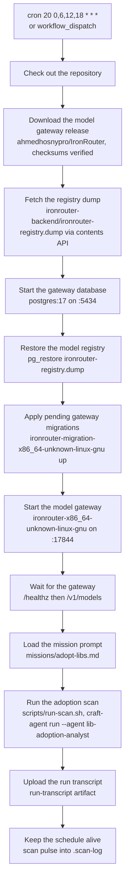

## 2. The mission phases

**Mission mode — the rollback path.** The orchestrator `lib-adoption-analyst` computes the window
itself (`date -u -d '7 hours ago'` — a 7-hour look-back on the 6-hour cadence), reads the tracking
issue's Mission State body and the maintainer-verdict digest, then drives the phases. Zero
merges skips classification; the clones still run because duplication is proven across the suite,
not across the window. Phase 1, Phase 1b, and the digest read are scripts started by
`scripts/launch-sweeps.sh` in one call, running concurrently — the AI never collects or clones.

Under the judged workflow (section 10) the same phases become steps: `prepare` launches and verifies
the sweeps, `pr-pipeline` dispatches one pipeline per PR that runs Phases 2–4 inside itself, and
the specialists' writes sit behind the pipeline's lease and the gates.

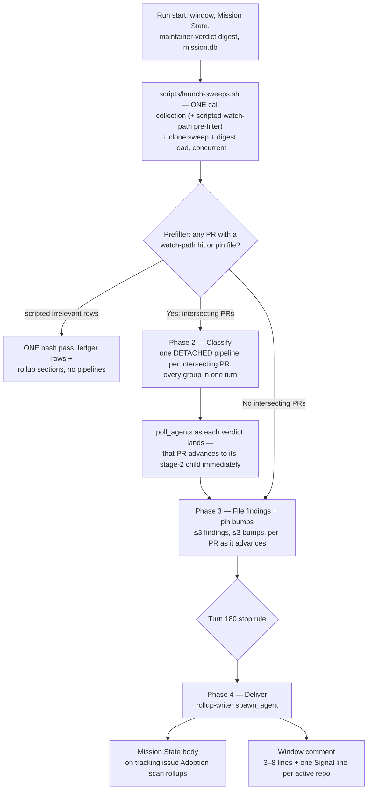

## 3. The run as a sequence

The orchestrator never classifies, files, or delivers itself; the sweep is a script, every PR is its
own detached child, and each PR advances to its stage-2 child the moment its verdict is verified —
no wave barrier between PRs, and no PR waiting on another.

**Rollback-path note:** the arrows below are mission mode. Under the judged workflow the same
children are stage children of the PR's own pipeline, each write gated by a filing lease and then
by that pipeline's own single-PR gate; see section 12.

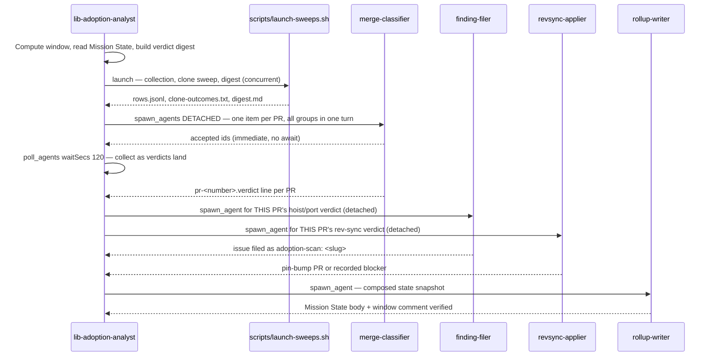

## 4. The subagent tree

Depth 3, and the third level spawns nothing: the orchestrator spawns per-PR pipeline children, each
pipeline spawns its own stage children, and the one stage that fans out further is the filer — it
spawns one `dup-verifier` child per claimed consumer in a single detached batch, proving every
app's duplication in parallel while it works the scope read and the licensing gate itself.
`dup-verifier` spawns nothing. Every spawn carries `maxTurns: 10000`
and a finite `timeoutSecs` (1800 for a stage child, 3600 for a classifier child, 7200 for the
pipeline child itself) and omits `maxTokens`: subagent
token budgets are unlimited and reserve nothing, so a group's admission never depends on a
slice-times-count reservation.

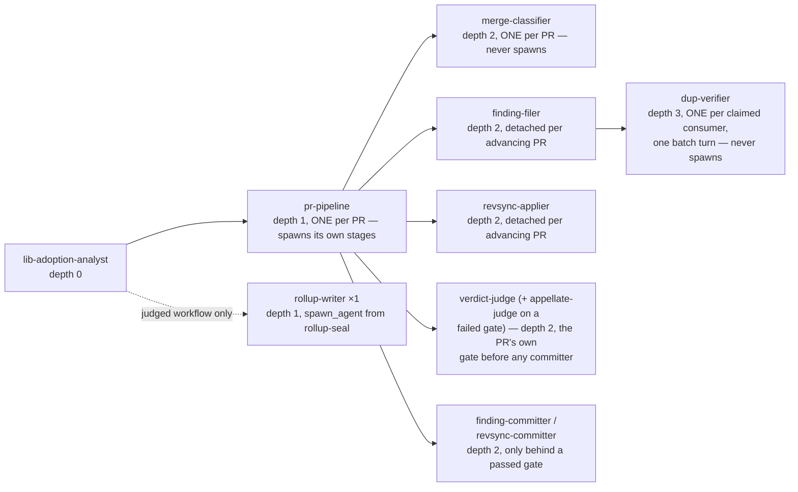

## 5. Inside one classification pipeline

A classifier child owns exactly ONE PR — no coordinator, no grandchild, because a coordinator is a
barrier its members wait on and a grandchild adds a level the per-PR shape does not need. Its moves
— claim, fetch, classify, verify — describe the fastest honest path; turn counts are guidance, not
caps. Every child in the wave is independent: it shares nothing with any other child and waits on
none.

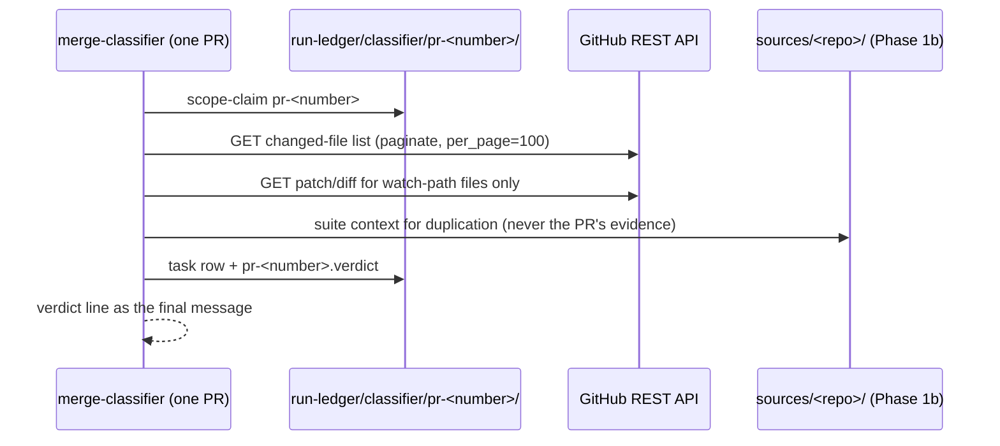

## 6. A PR's verdict lifecycle

Verdict classes come from `missions/adopt-libs.md`: `rev-sync`, `hoist`, `port`, `irrelevant`,
`unverified`, or `maturing:<slug>`. A maturing candidate reaches filing only after corroboration in
two consecutive windows, and only when the maintainer-verdict digest's revival conditions allow it.

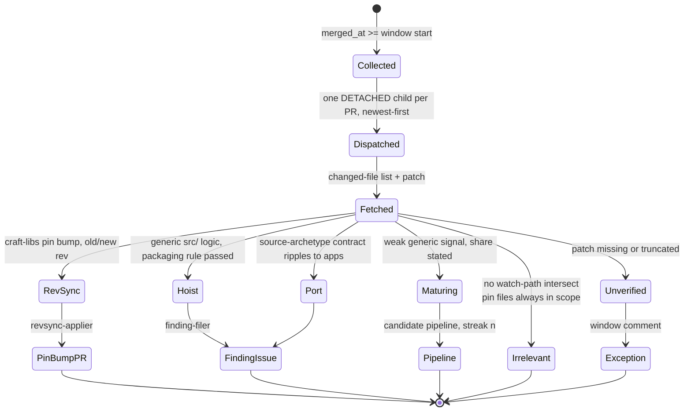

## 7. The filer's gate chain

**Rollback-path note:** this chain ends with `File adoption-scan: <slug>` because in mission mode
the filer writes to GitHub itself. Under the judged workflow the chain stops at the draft in
`run-ledger/filer/<slug>/` and `file-commit` (`finding-committer`) performs the only write — see
section 12.

A finding only reaches GitHub after the scope-truth clone is read, the crate shape passes, and
duplication is proven per consumer. A hoist carries exactly one validated mermaid diagram or it
does not file at all.

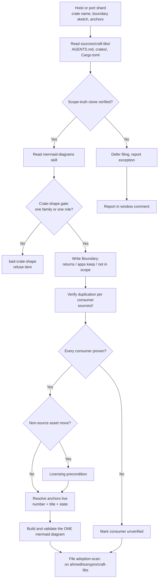

## 8. The cadence and the look-back

Four windows a day. The 7-hour look-back overlaps the 6-hour cadence by an hour — idempotent,
because merges are keyed by `owner/repo#number` — and it heals a missed slot.

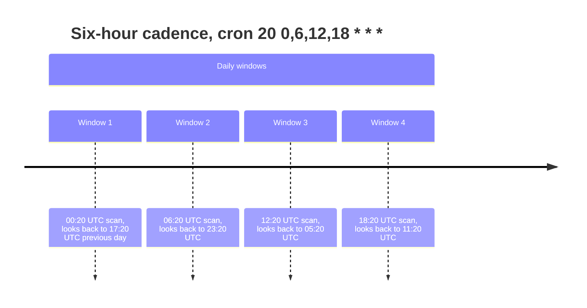

## 9. The subagent budget

At most 4096 subagents per run, and at most 48 concurrent tree-wide (the scan's knob is a
deliberate bound, not a ceiling: each child is a full runner with its own context and provider
stream, and the job's runner has 7 GB). A saturated pool queues detached spawns rather than
refusing them, and a dispatch from a running pipeline launches ahead of fresh dispatches, so every
PR's next stage runs the moment a slot frees. Token budgets stay unlimited (only the run's own
budget guards); every spawn carries a finite wall clock.

**Rollback-path note:** this pie is mission mode's pool. Under the judged workflow the engine
sequences the 8 steps itself (`max-concurrent-steps: "4"`) and `pr-pipeline` dispatches its detached
per-PR pool, bounded by the same 4096-per-run cap and the run's `max-total-turns: "10000"`.

---

## 10. The judged workflow — the 6-step DAG, gates live inside each pipeline

Workflow mode lives in `.craft-agent/workflows/adopt-libs.md` (frontmatter `name: adopt-libs`, arg
`window` default `7h`) — the same scan, but the engine sequences the steps instead of the
orchestrator, and every GitHub write sits behind a verdict. Limits: `max-steps: "8"` (headroom over
the 6 steps), `max-concurrent-steps: "4"`, `max-total-turns: "10000"`, `max-total-tokens: "1000000000"`,
`max-retries-per-step: "2"`. Every step states `max-turns`, `retry`, and `on-failure` explicitly —
never relying on the 25/0/stop defaults. The judge seats are budget-bound, not advised: the gate
bodies write a call plan (call 1 one composed bash pass, 2-4 the live reads) and the step caps bind
it — `max-turns: "90"` on the panel gates, `"60"` on the appeals — so a seat that walks the ledger
file-by-file fails instead of spending the window.

The shape: a scripted parallel sweep (`prepare`), one per-PR dispatch step (`pr-pipeline`) whose
children each run that PR's ENTIRE life — classification, its draft, its OWN gate and appeal, its
own commit, its rollup section — and the seal island (`rollup-seal`, `rollup-gate`,
`rollup-appeal`, `rollup-commit`) that composes what settled and makes the run's one tracking-issue
write. The PRs never meet again after the dispatch: there is no post-pipeline gate step, because
the gate a PR's write sits behind is a stage inside the PR's own pipeline, so a write is audited
by the same pipeline seconds after its package is verified, not by a global seat hours later.

What changed from the earlier 8-step shape and why: the global `pipeline-gate`/`pipeline-appeal`
steps are gone — they audited every PR's output in one merged seat after the whole pipeline step
settled, which re-gathered the PRs the architecture had just separated and serialized the window's
most expensive work. Their per-PR checks moved into stage 4 of each pipeline (one `verdict-judge`
child per PR, one repair, one `appellate-judge` appeal — no GitHub write is ever made behind a
failed gate), and their cross-PR arithmetic (every PR has a gated row, counts and leases, clone
and write laws) moved into the `rollup-gate` rubric, where the seal already reads every pipeline's
ledger row. The step's job shrank to dispatching the window's pipelines, polling only its own ids,
verifying each pipeline's ledger row records its gate verdict before its committer, and naming
exceptions.

**Failure policy — schema-enforced, not a preference.** A step the run survives a failure of
(`skip` or `warn`) must be a leaf: the workflow schema forbids `skip`/`warn` on a step that has
dependants, or the pipeline stalls. So every step anything depends on is `stop`, and only
`rollup-commit` — nothing needs it — is `skip`. A gate that settles failed therefore halts
admissions: the run ends `Failed` (exit 1 on a step error, 2 on max-turns, 3 on budget), its
dependants settle as skipped with a named `DependencyFailed` reason (journaled, never silent), and
the next run heals from the prior state body. Inside a pipeline the same rule holds per PR: a
failed gate defers that PR with its issues named — it never silently loses the PR.

`rollup-seal` composes the state snapshot from the pipelines' per-PR sections under
`run-ledger/rollup/<slug>.md`, the outcome rows, and the journal — a missing section is a named
exception, never a guess — with a bounded wait (≤45 min) for the file and bump lanes. `pr-pipeline`
carries the heaviest budget (1200 turns): one detached child per PR, then polls as each pipeline's
envelope lands and verifies its ledger, gate record, verdict file, packages, and outcome rows.

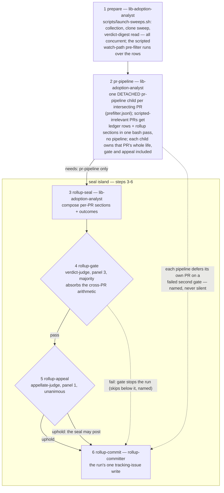

The dotted edges show what a failed gate does: a per-PR gate failure defers only that PR (its
pipeline names it and moves on); a failed `rollup-gate` halts admissions, everything below it
settles as skipped with a named `DependencyFailed` reason — the seal never posts, and the run's
conclusion is `Failed` with the journal carrying every reason.

## 11. One pipeline — per PR, a whole life, never blocked by a sibling

`pr-pipeline` is the step the per-PR architecture lives in. It shards by the scripted pre-filter —
`prefilter.jsonl` carries one row per PR, and only rows with a watch-path hit, a pin file, a
file-list error, or a page cap become ONE pipeline item each; rows with no intersection and no pin
are scripted `irrelevant`, recorded as ledger rows and rollup sections in one bash pass with no
children. It dispatches the intersecting PRs as detached `pr-pipeline` children: every group's
`spawn_agents` call carries `"detached": true`, so it returns at admission and the pool runs the
members under the concurrency knob. Each child then runs its PR's ENTIRE life inside itself,
spawning its own stage children detached and polling only its own ids. A PR may finish its whole
life — classification, filed issue, rollup section — while another PR is still in its first stage.

The pool makes that true at window scale. A saturated pool QUEUES a detached spawn instead of
refusing it (the caller already returned at admission), and a dispatch from a running child — a
continuation — launches ahead of fresh dispatches the root parent has not started, so a PR's next
stage never waits behind pipelines that have not begun. Every parent polls ONLY the ids its own
spawn calls named: the hub is shared, and a bulk drain would steal a sibling's envelope.

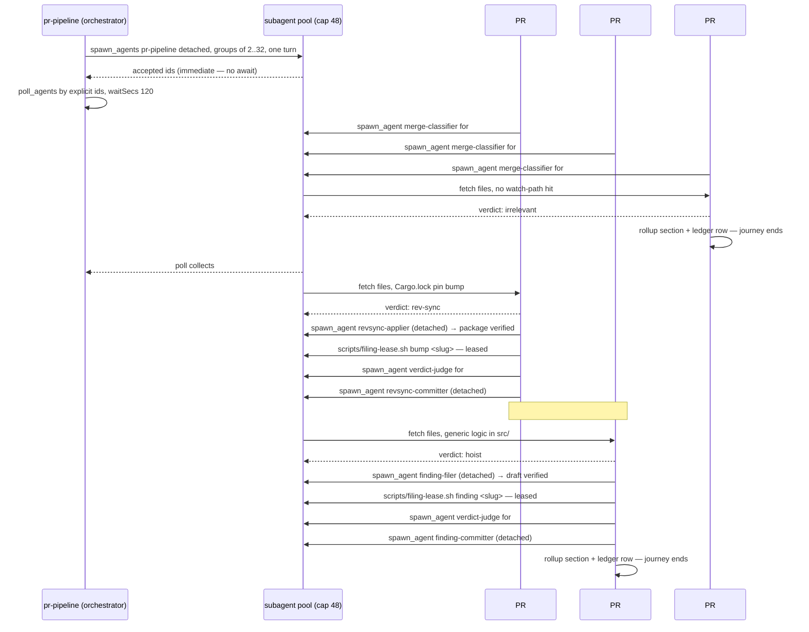

What the shape buys, and what it costs. Bought: a PR's whole life never waits on a sibling; the
wall-clock reclaims one child without stalling 47 others; each pipeline's context holds one PR's
journey instead of a window's; the filing lease keeps the ≤3/≤3 caps honest without a ranking
barrier. Cost: each pipeline tracks its own stage children, which is why per-PR state lives in
`run-ledger/pipeline/` and a pipeline's context holds only its own chart — it verifies a stage
child by reading its FILE, never by re-reading the envelope into its own context.

## 12. The pipeline's own writes — leased, then committed

The stage-2 drafters, the gate, and the committers are different agents, and they are all stage
children of the pipeline that owns the PR. `finding-filer` writes `run-ledger/filer/<slug>/draft.md` plus its
evidence bundle and returns `ready <slug>` / `already-filed` / `already-tracked` / `refused` /
`blocked`; its own per-consumer duplication proof is parallel — it spawns one `dup-verifier`
child per claimed consumer in one batch turn (depth 3) and works the scope read and the licensing
gate while they run, then verifies each evidence file and composes the section from what stands.
`revsync-applier` clones, branches, and commits pin lines locally — never pushes —
writing `run-ledger/revsync/<slug>/branch.md` and the PR body and returning `ready` /
`already-open #N` / `blocker`. BEFORE any committer runs, the pipeline takes its lease from
`scripts/filing-lease.sh` — `flock`-guarded, at most 3 findings and 3 bumps per window — and an
over-cap PR defers with its reason recorded. With the lease held, the pipeline's OWN gate runs: one
`verdict-judge` child audits this PR's package against the single-PR rubric (evidence resolves,
verdict matches package, scope holds, lease honored, package writable-as-is); a failed gate is
repaired once and re-judged, and a second failure goes to one `appellate-judge` child whose verdict
binds — overturn commits, uphold defers the PR with its issues named. Only a passed gate releases
the committers, each idempotently so a retry can never duplicate an issue; the gate verdict (and
the appeal's, if one ran) is recorded on the pipeline's ledger row before the committer stage.

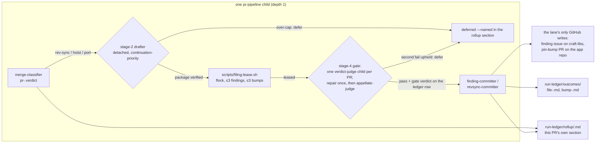
