# The adoption scan, visualized

How the six-hour craft-libs adoption scan actually runs: the GitHub Actions job in
`.github/workflows/adopt-libs.yml`, the mission phases from `missions/adopt-libs.md`, and the
subagent pool of `.craft-agent/agents/`. Every name below is a real file, step, phase, agent, or
artifact. One diagram per concept; nothing here invents entities.

Two modes are drawn here. **Mission mode** (sections 1–9) is today's CI default and the rollback
path: `lib-adoption-analyst` drives the phases itself and the specialists write to GitHub directly.
**Workflow mode** (sections 10–12) is the judged DAG in `.craft-agent/workflows/adopt-libs.md` —
16 steps gating every GitHub write behind a panel and an appellate verdict. Mission mode is the
current reality; workflow mode is what the same run becomes, so where the two conflict the
mission-mode sections describe the rollback path, not the destination.

## 1. The CI job — boot the gateway, run the scan

The job `scan` on `ubuntu-latest` (timeout 360 min). The private model gateway
(`ahmedhosnypro/ironrouter-backend`) is cloned, its Postgres registry restored on :5434, and the
binary serves on :17844 before `scripts/run-scan.sh` starts the agent. The pulse step is
best-effort: it never turns a green scan red.

Mission mode (the current default and the rollback path): the `Load the mission prompt` step reads
`missions/adopt-libs.md`, and `scripts/run-scan.sh` runs `craft-agent run --agent
lib-adoption-analyst --prompt <mission file>`. Workflow mode swaps that for `craft-agent workflow
--workflow adopt-libs` (no `--max-tokens` — it is a per-step cap), with the renderer following the
run's journal (step events) and the per-step session transcripts (prompts, tool calls, tool results)
under `.craft-agent/workflows/<run_id>/` for mid-step liveness; `run-scan.sh` selects it from
`CRAFT_AGENT_WORKFLOW`, which the `workflow` dispatch input sets; scheduled runs and an empty input
keep mission mode until the first live rehearsal — see section 10. Concurrency is event-scoped:
scheduled runs serialize on one group (`adopt-libs-scheduled`), and every manual dispatch joins its own
group (`adopt-libs-${{ github.run_id }}`), so a mission scan and a workflow rehearsal can run at the
same time — the tracking-issue state update and the `already-filed`/`already-open` checks are the
racy surfaces those parallel runs share.

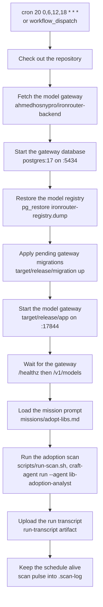

## 2. The mission phases

**Mission mode — the rollback path.** The orchestrator `lib-adoption-analyst` computes the window
itself (`date -u -d '7 hours ago'` — a 7-hour look-back on the 6-hour cadence), reads the tracking
issue's Mission State body and the maintainer-verdict digest, then drives the five phases. Zero
merges skips classification; the clones still run because duplication is proven across the suite,
not across the window.

Under the judged workflow (section 10) the same phases become steps: `prepare` runs Phase 1 + Phase
1b plus verification, `classify` runs Phase 2, and the specialists no longer write to GitHub at all.

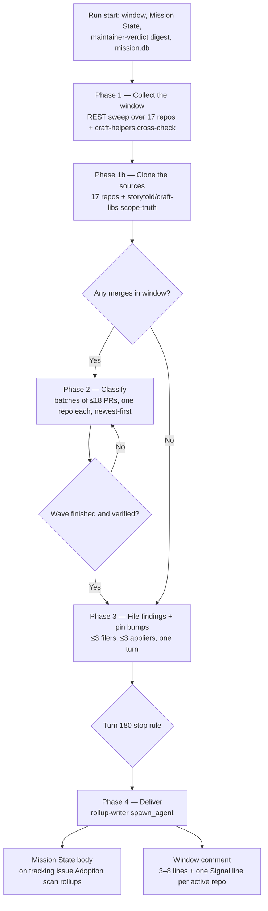

## 3. The run as a sequence

The orchestrator never classifies, files, or delivers itself; each phase is a wave of specialist
children, and every child deliverable is verified against `gh api` before the next wave starts.

**Rollback-path note:** the arrows below are mission mode. Under the judged workflow the filer,
applier, and rollup children only produce drafts in `run-ledger/`; the writes shown here move to
the committers behind the gates of section 11.

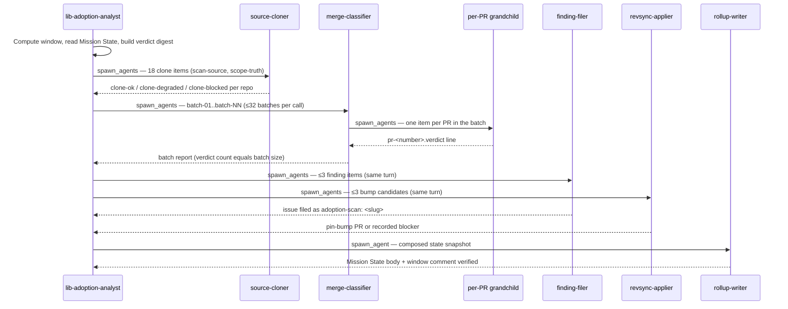

## 4. The subagent tree

Depth 3 by design and never deeper: coordinators may spawn grandchildren, grandchildren never
spawn. Every spawn carries `maxTurns: 10000`, `timeoutSecs: 0`, `maxTokens: 75000000` — omitting
`maxTokens` starves later waves of the run's 5,000,000,000-token budget.

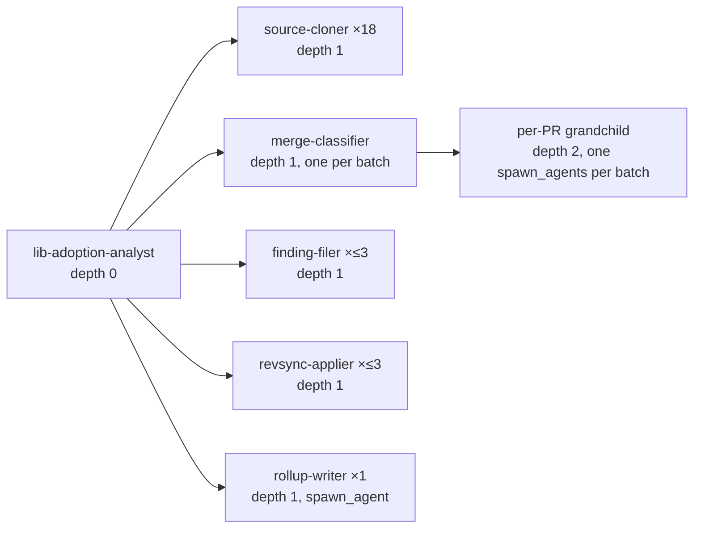

## 5. Inside one classification wave

A batch child never loops over its PRs. Its four moves — claim, spawn, verify and report, close —
and the grandchildren's three describe the fastest honest path; turn counts are guidance, not caps.

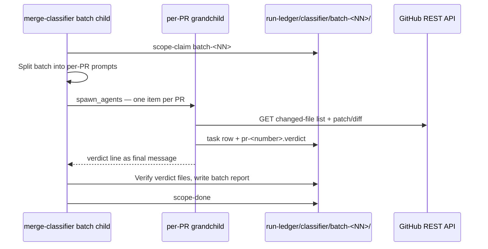

## 6. A PR's verdict lifecycle

Verdict classes come from `missions/adopt-libs.md`: `rev-sync`, `hoist`, `port`, `irrelevant`,
`unverified`, or `maturing:<slug>`. A maturing candidate reaches filing only after corroboration in
two consecutive windows, and only when the maintainer-verdict digest's revival conditions allow it.

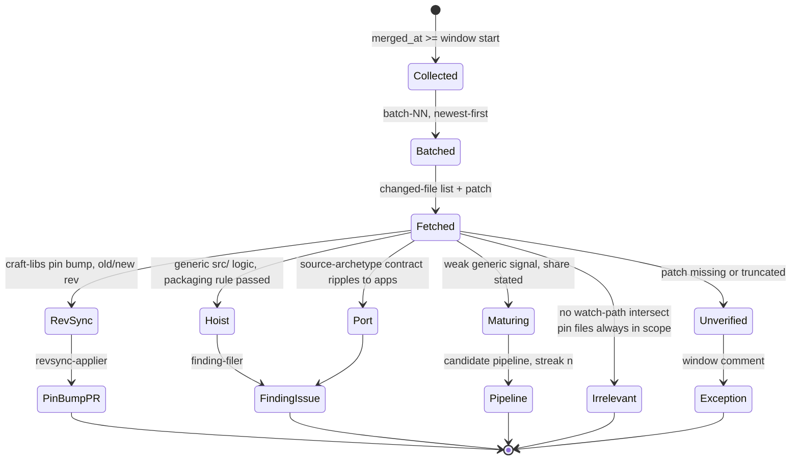

## 7. The filer's gate chain

**Rollback-path note:** this chain ends with `File adoption-scan: <slug>` because in mission mode
the filer writes to GitHub itself. Under the judged workflow the chain stops at the draft in
`run-ledger/filer/<slug>/` and `file-commit` (`finding-committer`) performs the only write — see
section 12.

A finding only reaches GitHub after the scope-truth clone is read, the crate shape passes, and
duplication is proven per consumer. A hoist carries exactly one validated mermaid diagram or it
does not file at all.

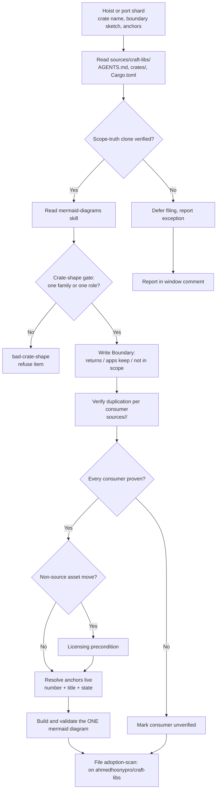

## 8. The cadence and the look-back

Four windows a day. The 7-hour look-back overlaps the 6-hour cadence by an hour — idempotent,
because merges are keyed by `owner/repo#number` — and it heals a missed slot.

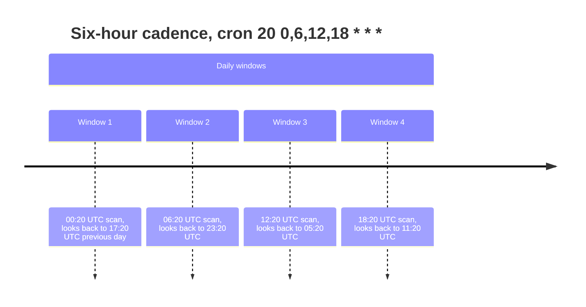

## 9. The subagent budget

At most 256 subagents per run, at most 64 concurrent tree-wide. The reserve covers the 18 cloners,
up to 6 filers/appliers, the rollup child, and retries; the rest is classifier coordinators and
per-PR grandchildren. Beyond the cap the run classifies newest-first and reports the unclassified
count as an exception.

**Rollback-path note:** this pie is mission mode's pool. Under the judged workflow the engine
sequences the 16 steps itself (`max-concurrent-steps: "4"`) and each dispatcher step still spawns
its own specialist waves, bounded instead by the run's `max-total-turns: "10000"` and
`max-total-tokens: "100000000"` pool.

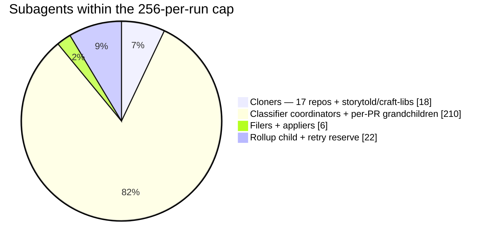

---

## 10. The judged workflow — the 16-step DAG

Workflow mode lives in `.craft-agent/workflows/adopt-libs.md` (frontmatter `name: adopt-libs`, arg
`window` default `7h`) — the same scan, but the engine sequences the steps instead of the
orchestrator, and every GitHub write sits behind a verdict. Limits: `max-steps: "16"` (the hard cap,
so the DAG is exactly full — a new phase means a consolidation, not a 17th step),
`max-concurrent-steps: "4"`, `max-total-turns: "10000"`, `max-total-tokens: "100000000"`,
`max-retries-per-step: "2"`. Every step states `max-turns`, `retry`, and `on-failure` explicitly —
never relying on the 25/0/stop defaults.

The shape: one shared spine (`prepare`, `classify`, `classify-gate`, `classify-appeal`) then three
parallel islands that never touch each other — file (5–8), bump (9–12), rollup (13–16). Only
success releases dependants, so what happens after a failure depends on that step's `on-failure`.

**Failure policy — schema-enforced, not a preference.** A step the run survives a failure of
(`skip` or `warn`) must be a leaf: the workflow schema forbids `skip`/`warn` on a step that has
dependants, or the pipeline stalls. So all 13 steps anything depends on are `stop`, and only the
three leaf committers — nothing needs them — are `skip`. A gate that settles failed therefore halts
admissions: the run ends `Failed` (exit 1 on a step error, 2 on max-turns, 3 on budget), its appeal
and commit settle as skipped with a named `DependencyFailed` reason (journaled, never silent), and
the next run heals from the prior state body. A skipped *committer* still records the failure (the
run is `Failed`), but in-flight sibling branches keep running, so their terminal rows reach the
rollup's exception list — that is the audit trail for a failed lane.

`rollup-draft` composes the snapshot from the terminal `run-ledger/outcomes/*.md` rows and the
journal — skipped steps become named exceptions, never silence — with a bounded wait (≤45 min) for
the file and bump lanes, and never claims an artifact it cannot verify. Worst case is ≈5 000 turns
against the 10 000 pool (dispatchers ~2 900; four gates × 3 seats × up to 3 verdict rounds ~1 100;
committers ~480). `max-feedback: "0"` on the appellate seats is what makes their `needs:
[<judge>]` legal — feedback may never target another judge.

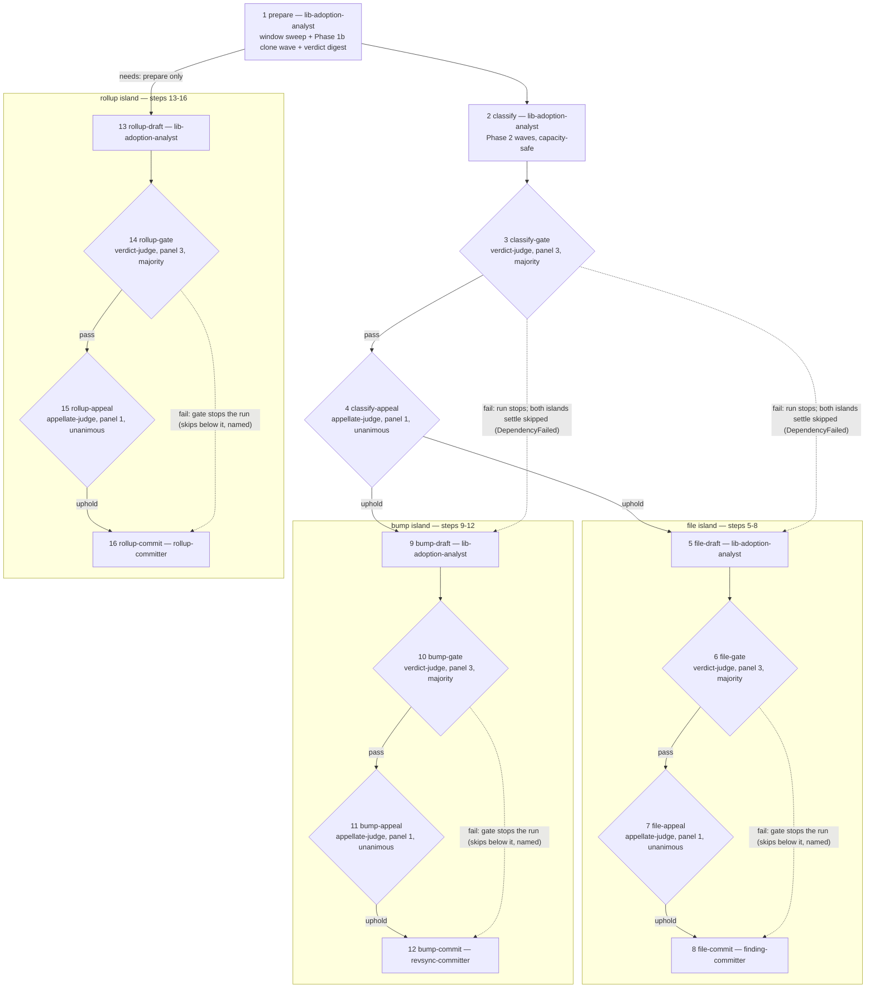

The dotted edges show what a failed gate does: admissions halt, and everything below the gate
settles as skipped with a named `DependencyFailed` reason — the failed lane's appeal and commit never
run, the other islands finish if already in flight, and the run's conclusion is `Failed` (exit 1 on a
step error, 2 on max-turns, 3 on budget) with the journal carrying every reason.

## 11. One gate — producer, panel, appellate, commit

Every lane is the same four-step shape. Behind each `*-draft` sits a panel of three
`verdict-judge` seats (`panel: "3"`, `merge: majority`, `max-feedback: "2"`, `deny-write` every
path), then a one-seat `appellate-judge` (`panel: "1"`, `merge: unanimous`, `max-feedback: "0"`),
then the mechanical committer. Seats run concurrently inside one step — one engine concurrency
slot — and each seat's final message is exactly `{"verdict":"pass"|"fail","issues":[...]}`; the
merged verdict is the step's settled final message. A majority needs strictly more pass votes, so a
tie fails; unanimous needs every seat. The producer's claims are not evidence: a seat re-reads the
artifacts and re-verifies live with read-only `gh` (`gh api`, `gh issue/pr view` — never a write).

A fail issue names what the rubric requires, what the work shows, and where the proof lives; a
failed verdict then requeues the producer with a `## Judge feedback` section (journaled as
`FeedbackRetried`) and the panel re-runs, bounded per producer by `max-feedback 2`. Still failing
after that budget, the gate settles failed and its `on-failure` decides the rest. The appellate seat
is the check on the panel: it re-derives the verdict from the cited evidence rather than counting
votes, overturns one it cannot reproduce, and treats rubric-out-of-scope requests as no grounds for
failure. Because a seat that errors fails the whole judge step as an error rather than a verdict,
judge steps carry generous `max-turns` (45–60) and `retry: 1`.

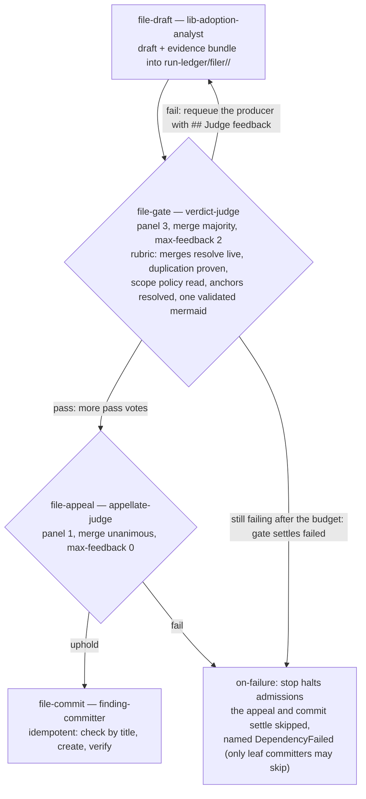

## 12. The draft/commit split

The drafters and the committers are different agents. The drafters keep the judgment and lose the
write: `finding-filer` writes `run-ledger/filer/<slug>/draft.md` plus its evidence bundle and
returns `ready <slug>` / `already-filed` / `already-tracked` / `refused` / `blocked`;
`revsync-applier` clones, branches, and commits pin lines locally — never pushes — writing
`run-ledger/revsync/<slug>/branch.md` and `pr-body.md` and returning `ready` / `already-open #N` /
`blocked`; `rollup-writer` composes `run-ledger/rollup/target.md`, `state-body.md`, and
`comment.md` and writes nothing to GitHub. The judges re-verify those drafts live. Only then do the
committers — deliberately mechanical, because the intelligence is gated upstream — perform the
run's only GitHub writes, each idempotently so a retry can never duplicate an issue.

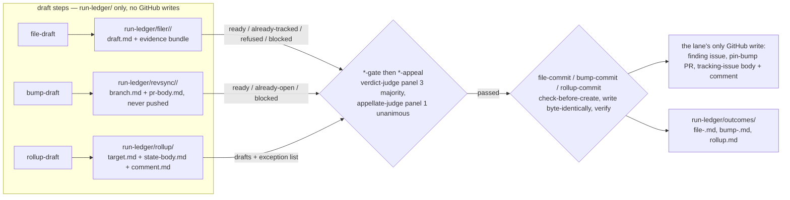

